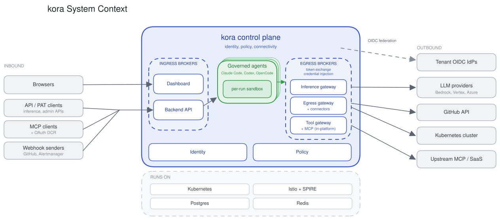

# kora Architecture

kora is the control plane for AI agents. It gives every agent a verifiable
identity, checks every action against policy before it runs, and brokers every
credential so agents never hold secrets.

The architecture is organised around three questions:

- **Who is this agent?** Identity, shared by humans and agents.
- **What can it access?** Policy, evaluated before an action executes.
- **How does it connect?** Connectivity, brokered so credentials are injected
  just in time.

## System context

Two ingress gateways sit at the edge: the Backend API fronts every backend
service behind edge policy, and the Dashboard serves the frontend and its BFF.
Governed agents run inside the control-plane, each run given its own sandbox.
Inbound work reaches an agent through the Backend API, and its outbound calls are
captured by in-platform egress brokers that perform token exchange and credential
injection. Identity and Policy govern both humans and agents.

## Deep dives

- [Runtime topology](docs/architecture/runtime-topology.md): control plane, data plane, egress brokers, and the shared substrate.
- [Identity](docs/architecture/identity.md): workload attestation, token exchange, delegation.
- [Policy](docs/architecture/policy.md): edge and in-service enforcement, before the action.
- [Connectivity](docs/architecture/connectivity.md): brokered egress and just-in-time credentials.
- [Inference gateway](docs/architecture/inference-gateway.md): model brokering, routing, budgets, and usage.
- [Agent execution](docs/architecture/agent-execution.md): pod topology, per-run sandboxing, identity, and egress.

Diagrams are Excalidraw sources under [`docs/diagrams/`](docs/diagrams). See
[`tools/diagrams/README.md`](tools/diagrams/README.md) for how they render.
