# kora Architecture: Diagrams and Flows

This document contains comprehensive Mermaid diagrams showing how kora's components interact.

---

## 1. System Architecture Overview

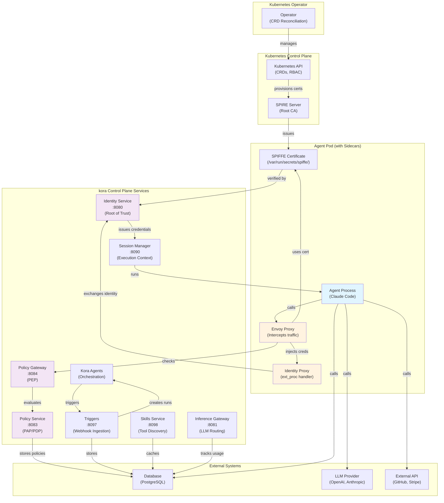

---

## 2. Agent Authentication & SPIFFE Identity Flow

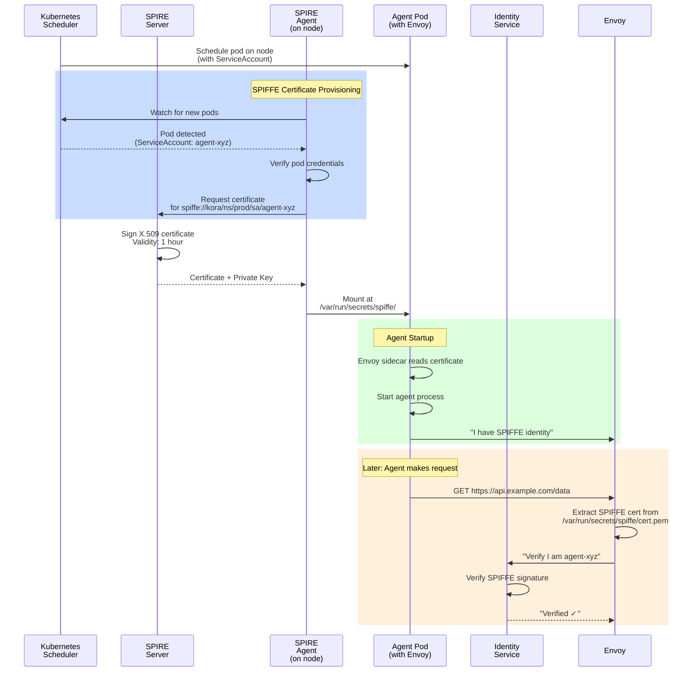

---

## 3. API Call with Policy Check & Credential Injection

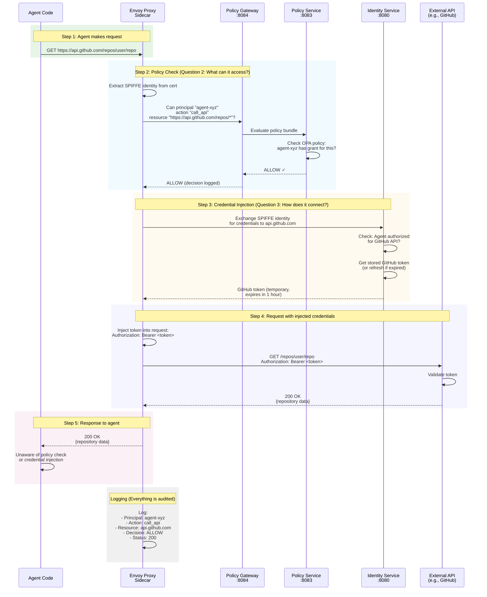

---

## 4. Complete Message Sequence: Webhook Trigger → Agent Execution

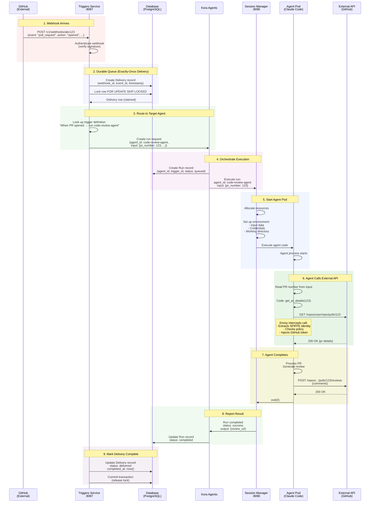

---

## 5. Policy Evaluation Flow

```mermaid
graph LR
    subgraph "Request Arrives"
        A["Envoy receives<br/>outbound request"]
    end
    
    subgraph "Identity Extraction"
        B["Read SPIFFE certificate<br/>from /var/run/secrets/spiffe/"]
        C["Extract principal:<br/>agent-xyz"]
    end
    
    subgraph "Policy Evaluation"
        D{["Is policy<br/>embedded in<br/>Envoy?"]}
        E["Evaluate policy<br/>locally in Envoy<br/>(fast)"]
        F["Call Policy Gateway<br/>:8084<br/>(slower)"]
    end
    
    subgraph "OPA Policy Engine"
        G["Load OPA bundle<br/>from Policy Service"]
        H["Check grants:<br/>Does agent-xyz<br/>have permission X?"]
        I["Check roles:<br/>Does agent-xyz's role<br/>include permission X?"]
        J["Check scopes:<br/>Is permission<br/>still valid?"]
    end
    
    subgraph "Decision"
        K{["Allow or<br/>Deny?"]}
        L["ALLOW:<br/>Proceed to<br/>credential injection"]
        M["DENY:<br/>Return error<br/>to agent"]
    end
    
    subgraph "Logging"
        N["Log decision:<br/>- Principal<br/>- Action<br/>- Resource<br/>- Decision<br/>- Timestamp"]
    end
    
    A --> B --> C --> D
    D -->|Yes| E
    D -->|No| F
    E --> H
    F --> G --> H
    H --> I --> J --> K
    K -->|Allow| L
    K -->|Deny| M
    L --> N
    M --> N
    
    style A fill:#e3f2fd
    style E fill:#fff9c4
    style F fill:#fff9c4
    style H fill:#f3e5f5
    style I fill:#f3e5f5
    style J fill:#f3e5f5
    style L fill:#c8e6c9
    style M fill:#ffcdd2
    style N fill:#eeeeee
```

---

## 6. Credential Brokering & Exchange Flow

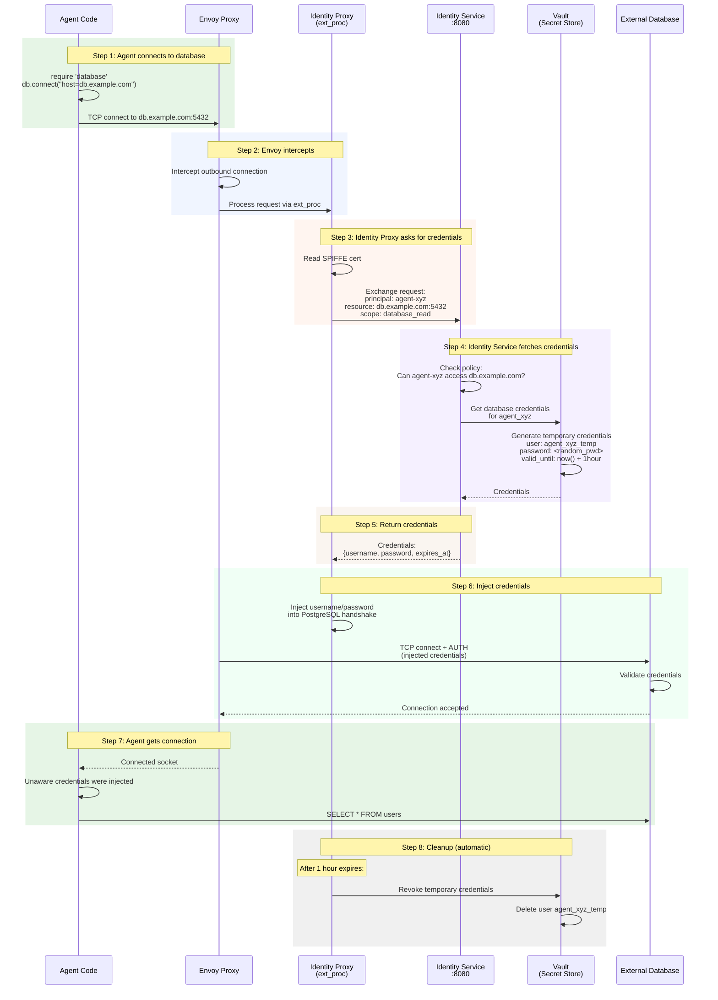

---

## 7. Multi-Tenant Isolation

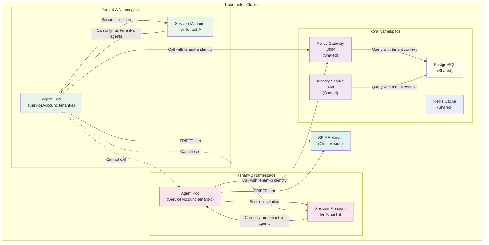

---

## 8. Operator: CRD to Pod Provisioning Flow

```mermaid
graph LR
    subgraph "Git/Config"
        A["Agent CRD<br/>manifests.yaml"]
    end
    
    subgraph "Kubernetes API"
        B["Agent CRD<br/>created"]
        C["Operator watches<br/>Agent CRD"]
    end
    
    subgraph "Operator Logic"
        D["Parse Agent spec:<br/>- Image<br/>- Config<br/>- Triggers<br/>- Secrets"]
        E["Generate Pod spec:<br/>- ServiceAccount<br/>- Sidecars<br/>- Resource limits"]
        F["Create Pod<br/>via K8s API"]
    end
    
    subgraph "Pod Lifecycle"
        G["Pod scheduled<br/>on node"]
        H["SPIRE Agent detects pod<br/>Issues SPIFFE cert"]
        I["Envoy sidecar starts<br/>loads policies"]
        J["Agent process starts<br/>Ready to execute"]
    end
    
    subgraph "Runtime"
        K["Agent receives<br/>webhook events"]
        L["Kora Agents<br/>creates run"]
        M["Session Manager<br/>executes agent"]
        N["Agent completes<br/>Result stored"]
    end
    
    A --> B --> C --> D --> E --> F --> G --> H --> I --> J --> K --> L --> M --> N
```

---

## 9. Policy Decision: Allow vs Deny

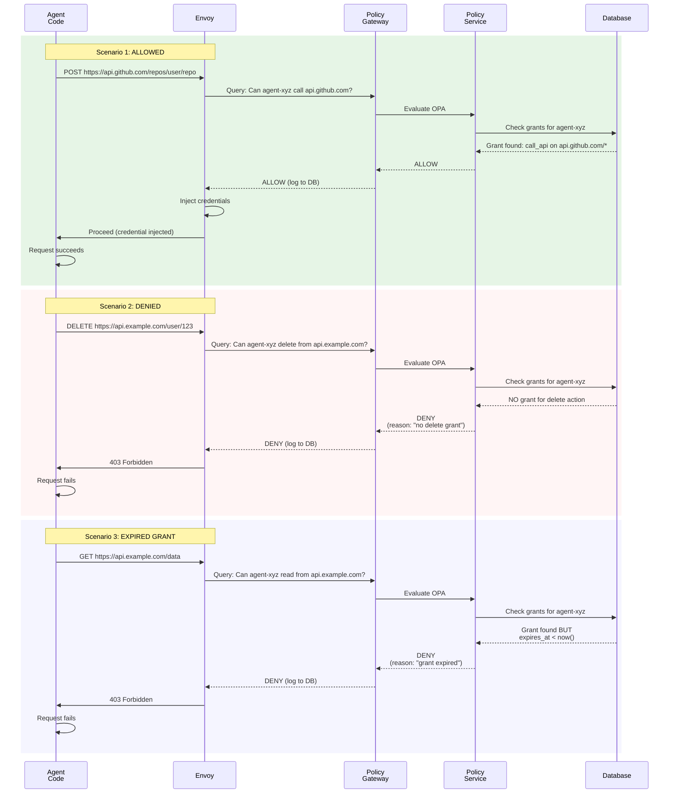

---

## 10. Error Handling & Denied Request Flow

```mermaid
graph TD
    A["Request arrives<br/>at Envoy"]
    
    B{["Policy check?"]}
    C["Call Policy Gateway"]
    D{["Decision?"]}
    E["ALLOW: Continue"]
    F["DENY: Block request"]
    
    G["Generate error response"]
    H["Log denial:<br/>- Principal<br/>- Action<br/>- Resource<br/>- Reason<br/>- Timestamp"]
    
    I["Send to Observability<br/>System<br/>(Prometheus, Jaeger)"]
    J["Alert if pattern detected<br/>(brute-force, etc.)"]
    
    K["Return error to agent:<br/>403 Forbidden<br/>or<br/>Network timeout"]
    
    L["Agent handles error:<br/>- Retry?<br/>- Fail gracefully?<br/>- Log?"]
    
    A --> B
    B -->|Check| C
    C --> D
    D -->|Allow| E
    D -->|Deny| F
    E -->|OK| K
    F --> G --> H --> I --> J --> K --> L
    
    style A fill:#e3f2fd
    style E fill:#c8e6c9
    style F fill:#ffcdd2
    style G fill:#ffcdd2
    style H fill:#fffde7
    style I fill:#f3e5f5
    style K fill:#e0e0e0
    style L fill:#f5f5f5
```

---

## 11. Trigger Delivery State Machine

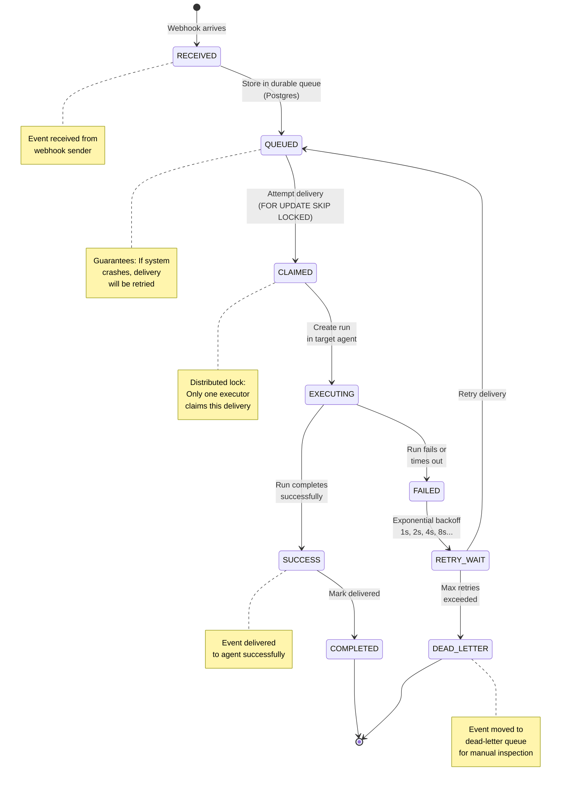

---

## 12. Complete Request Lifecycle with All Checks

```mermaid
graph TD
    Start["Agent code:<br/>api.call()"]
    
    S1["Envoy intercepts<br/>outbound request"]
    
    S2["Extract SPIFFE<br/>identity from cert"]
    
    S3["Policy Gateway<br/>evaluate policy"]
    
    S3_Result{["Policy<br/>Decision?"]}
    S3_Allow["ALLOW"]
    S3_Deny["DENY"]
    
    S4["Identity Proxy<br/>exchange credentials"]
    
    S4_Result{["Credentials<br/>available?"]}
    S4_Yes["Credentials found"]
    S4_No["No credentials"]
    
    S5["Inject credentials<br/>into request"]
    
    S6["Send to<br/>external system"]
    
    S7{["External<br/>response?"]}
    S7_OK["200 OK"]
    S7_Error["4xx/5xx Error"]
    
    S8["Return response<br/>to agent code"]
    
    DenyError["Return 403<br/>to agent"]
    
    CredError["Return 401<br/>to agent"]
    
    LogAll["Log:<br/>- Principal<br/>- Action<br/>- Resource<br/>- Decision<br/>- Status"]
    
    Start --> S1 --> S2 --> S3 --> S3_Result
    
    S3_Result -->|ALLOW| S3_Allow --> S4
    S3_Result -->|DENY| S3_Deny --> DenyError
    
    S4 --> S4_Result
    S4_Result -->|Yes| S4_Yes --> S5
    S4_Result -->|No| S4_No --> CredError
    
    S5 --> S6 --> S7
    S7 -->|Success| S7_OK --> S8
    S7 -->|Error| S7_Error --> S8
    
    DenyError --> LogAll
    CredError --> LogAll
    S8 --> LogAll
    
    LogAll --> End["Complete<br/>(audit trail created)"]
    
    style Start fill:#e3f2fd
    style S3_Allow fill:#c8e6c9
    style S3_Deny fill:#ffcdd2
    style S7_OK fill:#c8e6c9
    style S7_Error fill:#ffcdd2
    style DenyError fill:#ffcdd2
    style CredError fill:#ffcdd2
    style End fill:#e0e0e0
    style LogAll fill:#fffde7
```

---

## 13. Service-to-Service Communication Flow

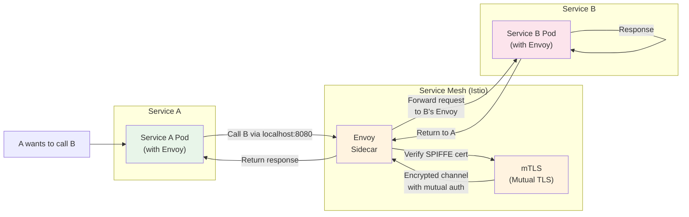

---

## 14. Grant vs Role vs Policy Hierarchy

```mermaid
graph TB
    Policy["OPA Policy<br/>(Rego code)<br/>Answers: Allow or Deny?"]
    
    Role["Role<br/>Named permission<br/>collection<br/>e.g., data-analyst"]
    
    Grant["Grant<br/>Principal → Permission<br/>binding<br/>e.g., agent-xyz can call API"]
    
    Principal["Principal<br/>- Agent<br/>- User<br/>- Service"]
    
    Principal --> Grant
    Grant --> Role
    Role --> Grant
    
    Role --> Policy
    Grant --> Policy
    
    Policy --> Decision["Policy Decision<br/>ALLOW / DENY"]
    
    note right of Grant
        Direct assignment of
        permission to principal
        e.g., "agent-xyz
        can read_file /workspace/*"
    end note
    
    note right of Role
        Reusable collection
        of grants
        e.g., "data-analyst role
        includes: call_api,
        read_file"
    end note
    
    note right of Policy
        Logic that evaluates
        grants and roles
        in context
        Time-based, quota-based, etc.
    end note
    
    style Policy fill:#f3e5f5
    style Role fill:#e1f5fe
    style Grant fill:#fff9c4
    style Principal fill:#f0f4c3
    style Decision fill:#c8e6c9
```

---

## 15. Agent Pod Sidecar Architecture

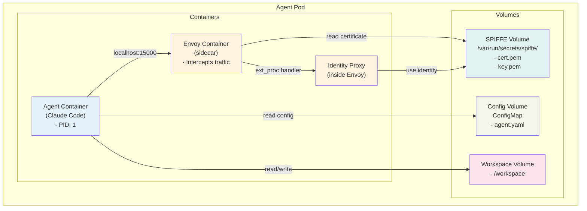

---

## Summary: The Three Questions in Diagram Form

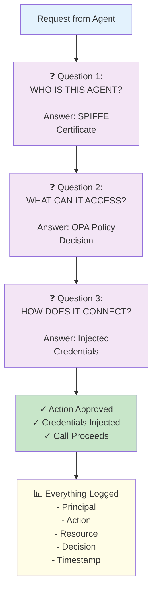

---

## Legend

- **Orange boxes** = Network/Transport layer (Envoy, proxies)
- **Purple boxes** = Policy/Security layer (Identity, Policy)
- **Blue boxes** = Data/Storage layer (Database, Redis)
- **Green boxes** = Success/Allow paths
- **Red boxes** = Failure/Deny paths
- **Yellow boxes** = Logging/Observability

