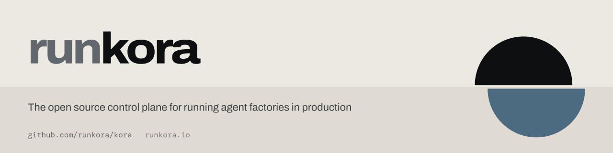

<picture>
  <source media="(prefers-color-scheme: dark)" srcset=".github/assets/banner-dark.svg">
  
</picture>

   

kora is an open source control plane for running agent factories in production. An agent on a laptop runs with its developer's credentials and leaves no audit trail of what it did. kora makes those agents safe to run at scale.

kora is not an agent framework, a model router, or an LLM wrapper. It runs the agent harnesses you already use, such as Claude Code, Codex and OpenCode, on Kubernetes, and governs everything they do.

- **Agent execution.** Every agent works in a durable run inside its own sandbox, started by a webhook, queue, schedule, the API or a person.
- **Identity.** Every agent has its own identity. Autonomous agents act with their own access, and delegated agents act for the person who started the run and can never do more than that person can.
- **Policy.** Every action by a person or an agent is evaluated against policy before it runs.
- **Connectivity.** Agents never handle credentials. kora intercepts outbound calls and injects a scoped, just-in-time credential.

## Getting started

- **Run kora in a Kubernetes cluster:** Install it with the [deployment guide](docs/guides/deployment.md).
- **Work on kora:** Get it running locally with the [local development guide](docs/contributing/local-development.md).

## Documentation

- [Concepts](docs/concepts/runs-and-sessions.md): Runs, sandboxes, identity and connectivity.
- [Architecture](ARCHITECTURE.md): How kora works.
- [Docs](https://runkora.dev): Comprehensive platform documentation.
- [Contributing](CONTRIBUTING.md): Start here if you want to contribute.

## Security

Report vulnerabilities by following the [security policy](SECURITY.md). Do not open a public issue for a suspected vulnerability.

## License

Licensed under the Apache License, Version 2.0. See [LICENSE](LICENSE).
