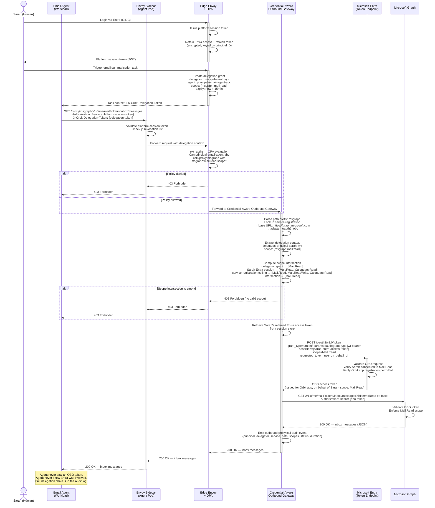

# 0012. Credential-Aware Outbound Gateway

**Status:** Accepted
**Date:** 2026-03-03
**Deciders:** Engineering Team
**Technical Story:** Defining how Orbit agents make governed, audited calls to external services (MSGraph, Salesforce, cloud provider APIs, and arbitrary SaaS) without credentials ever existing inside the agent process.

---

## Context

Orbit agents frequently need to interact with external services — Microsoft Graph, Salesforce, AWS APIs, third-party SaaS, and any other HTTP service that exists outside the Orbit platform boundary. These external services have their own identity models: OAuth2 bearer tokens, API keys, AWS SigV4 signatures, GCP service account tokens. None of them understand Orbit's principal model, SPIFFE SVIDs, or platform session tokens.

At the same time, Orbit's security model requires that:

- Credentials must never exist inside agent processes — a compromised agent workload must not be able to exfiltrate live external credentials
- Every external call an agent makes must be auditable at the request level, not just at the "credential was issued" level
- Delegated authority must be enforced at the credential boundary — if a human delegated `msgraph:mail:read` to an agent, the credential the agent uses must only carry `Mail.Read`, even if the human's own Entra session carries broader permissions
- The platform must remain the governed exit point for all agent-to-external-service communication

### Background

ADR-0008 established the unified identity model and platform session token. ADR-0009 established delegation flow patterns using RFC 8693, including the `X-Orbit-Delegation-Token` header for carrying delegation context. ADR-0011 established Envoy as the universal policy enforcement data plane.

These ADRs collectively define how identity and policy work inside the platform. What they do not address is how agents reach services outside the platform. This is the outbound leg of the platform — there is no existing component that owns the external call path.

The platform already governs the inbound leg (Edge Envoy handling north-south ingress) and the east-west leg (Envoy sidecars handling internal service-to-service traffic). The outbound leg — agent to external service — requires a dedicated component that understands both Orbit's internal identity model and the credential models of external services.

### Problem Statement

We need to define:

1. How agents address and invoke external services through the platform
2. Which platform component constructs, holds, and injects external credentials
3. How delegated human credentials (e.g. Entra OAuth tokens) are used to derive narrowly-scoped external tokens for agents acting on a human's behalf
4. How external service registrations are configured and what they contain
5. Where policy enforcement occurs for outbound calls — which component decides whether an agent is permitted to call a given external service
6. How the escape hatch for credential issuance (for cases where proxying is impractical) is controlled

### Goals

- **Credential isolation**: Raw external credentials must never exist inside agent processes
- **Request-level auditability**: Every external API call an agent makes must be recorded, not just credential issuance events
- **Delegated credential derivation**: When an agent acts on behalf of a human, the credential used must be derived from the human's delegated authority via OAuth2 OBO, scoped to the intersection of delegation grant and human consent
- **Adapter extensibility**: The gateway must support multiple external credential models (OAuth2 OBO, client credentials, API keys, cloud provider tokens) without requiring a new gateway deployment per credential type
- **Multi-tenant isolation**: External service registrations and credentials are tenant-scoped — different tenants using the same Orbit instance have completely isolated credential stores
- **Consistency with platform architecture**: The outbound path must integrate cleanly with the existing Envoy-based policy enforcement model established in ADR-0011

### Non-Goals

- Implementing a full API management layer (rate limiting, response transformation, schema validation — out of scope for initial implementation)
- Supporting non-HTTP protocols in the primary proxy model (gRPC, WebSocket — addressed as an escape hatch exception only)
- Building a credential store — Orbit relies on an external secret manager (Vault or equivalent) for credential storage; the gateway is a consumer of stored credentials, not a vault itself
- Per-endpoint policy rules as the default model — path-based OPA rules are available but not the primary enforcement mechanism

---

## Decision Drivers

* **Security isolation**: Credentials must not be extractable from agent processes — proxy model enforces this structurally, not by convention
* **Auditability**: Orbit must be able to answer "what did this agent call on MSGraph at 14:32?" not just "was a credential issued to this agent?"
* **Delegated authority correctness**: OBO token scopes must be the strict intersection of delegation grant, human Entra session scopes, and service registration limits — no ambient authority
* **Consistency with sidecar model**: Agents are plain HTTP clients; infrastructure handles credentials. This extends naturally to outbound calls.
* **Multi-tenant correctness**: Tenants share an Orbit instance but must have fully isolated credential configurations — per-tenant registration is mandatory
* **Operational simplicity**: Adding a new external service should require registering one service entry, not configuring per-endpoint rules

---

## Considered Options

### Option 1: Credential Issuance (Agent Holds Credential Directly)

**Description:** The agent requests a short-lived, scoped credential from Orbit before calling an external service. Orbit issues the token (an OBO token, API key, etc.). The agent holds it in memory and makes the external call directly, not through Orbit.

**Pros:**
- No proxy latency — agent calls the external service directly
- Simpler infrastructure — no outbound proxy service required
- Works natively with streaming responses, binary content, WebSocket connections
- Familiar model for developers

**Cons:**
- Raw credentials exist inside the agent process — compromised agent process can exfiltrate them
- Orbit loses request-level visibility — only "credential was issued" is auditable, not what the agent called with it
- Policy can only be applied at issuance time, not at call time — agent could call any path on the external service with an issued token
- Delegation grant scope enforcement relies entirely on correct token scoping at issuance — no secondary enforcement point

### Option 2: Credential-Aware Outbound Proxy (Primary)

**Description:** The agent calls Orbit's outbound gateway at `/proxy/{service-name}/{**path}`. The gateway resolves the target service, selects the appropriate credential adapter, constructs a correctly scoped external credential, injects it on the outbound leg, makes the real HTTP call to the external service, and streams the response back. The agent never holds or sees the external credential.

**Pros:**
- Credentials never exist in the agent process — structural isolation, not convention
- Full request-level audit trail — Orbit sees every external API call including method, path, and response status
- Policy enforcement at call time via Envoy (can this agent call this service?) and credential-level (OBO token carries only permitted scopes)
- Consistent with the platform's sidecar philosophy — agent is a plain HTTP client, infrastructure handles credentials
- One service registration covers all endpoints on that service — operational overhead is per-service, not per-endpoint

**Cons:**
- Orbit becomes a dependency in the outbound call path — gateway availability affects agent ability to call external services
- Adds latency (one additional network hop through the gateway)
- Streaming, binary, and WebSocket responses are harder to proxy faithfully

### Option 3: Transparent HTTP CONNECT Proxy

**Description:** The agent pod is configured with `HTTP_PROXY=https://orbit-gateway`. All outbound HTTP calls transparently route through the credential gateway via the standard HTTP CONNECT tunnelling protocol. The agent calls `https://graph.microsoft.com` directly; the proxy intercepts and injects credentials.

**Pros:**
- Completely transparent to the agent — no Orbit-specific URLs required
- Every HTTP client in every language respects `HTTP_PROXY` automatically
- No SDK dependency

**Cons:**
- HTTPS CONNECT creates an opaque tunnel — the gateway sees only the destination hostname, not the request body or headers, unless TLS is terminated
- TLS interception requires the agent to trust Orbit's CA for all intercepted destinations — adds certificate trust complexity to every agent pod
- Harder to enforce per-call policy without full TLS visibility

### Option 4: DNS Aliasing

**Description:** Orbit overrides DNS for registered external services inside the pod (via CoreDNS or `/etc/hosts` injection). `graph.microsoft.com` resolves to the Orbit gateway's cluster IP. The agent calls the real URL; DNS silently redirects it.

**Pros:**
- Agent calls the real URL with no awareness of redirection
- No `HTTP_PROXY` configuration required

**Cons:**
- Requires a DNS entry per registered external service — operational overhead scales linearly with registrations
- Certificate handling is complex — the gateway must present a certificate the agent trusts for `graph.microsoft.com`
- DNS-level interception is fragile — agents that bypass system DNS (e.g. by using hardcoded IPs) escape the control boundary

### Option 5: SDK / Client Library Wrapper

**Description:** Orbit provides a thin language-specific client library (`orbit-go`, `orbit-py`). The agent calls `orbit.MSGraph().Get("/v1.0/me/messages")`. The library routes through the explicit proxy URL internally.

**Pros:**
- Best developer experience — feels like calling the service natively
- Orbit controls routing and can evolve it without agent code changes

**Cons:**
- Every supported language requires a maintained SDK
- Agents running third-party tooling (off-the-shelf MCP servers, open-source tools) cannot use the SDK and gain no benefit
- Ties agent code to Orbit's library versioning

---

## Decision

**Chosen Option:** Option 2 (Credential-Aware Outbound Proxy) as the primary model, with Option 1 (Credential Issuance) as an explicitly controlled escape hatch.

### Rationale

Option 2 is the only model that satisfies all of the core security and auditability requirements simultaneously. Credentials never enter the agent process — this is a structural guarantee, not a developer discipline requirement. Every external call is auditable at the request level. Policy is enforced at two points: Envoy policy enforcement before the gateway is reached, and credential scope intersection at credential construction time.

This is also the natural extension of the platform's existing sidecar philosophy. Agents are already pure HTTP clients whose identity infrastructure is managed transparently by Envoy and SPIRE. Extending this to outbound calls — where external credentials are also managed transparently by the gateway — is architecturally consistent.

The escape hatch for credential issuance is retained for cases where proxying is genuinely impractical: streaming responses, large binary file downloads, WebSocket connections. However, credential issuance requires explicit per-service, per-scope allowlisting and is an audited exception, not a general fallback.

Options 3, 4, and 5 were rejected because they either introduce fragile TLS interception complexity (3, 4) or require language-specific SDK maintenance without solving the third-party tooling problem (5).

### Component Architecture

The Credential-Aware Outbound Gateway is a dedicated platform service. It is not Envoy — Envoy's role ends at policy enforcement (is this agent permitted to call this service?). The gateway is the termination point for proxied requests and the sole component in the platform that holds, constructs, and injects external credentials.

**Request flow:**

```
Agent (plain HTTP call)
  → Envoy sidecar
      validates platform session token
      attaches delegation context from X-Orbit-Delegation-Token
  → Edge Envoy Gateway
      OPA policy evaluation: is this agent's principal permitted to call /proxy/{service-name}?
      403 Forbidden if policy denies — gateway is never reached
  → Credential-Aware Outbound Gateway
      resolves target service from path prefix (msgraph → https://graph.microsoft.com)
      selects credential adapter for the service registration
      constructs scoped external credential (OBO token, API key, SigV4 signature, etc.)
      injects credential on outbound leg
      makes real HTTP call to the external service
      streams response back to the agent
```

Envoy never sees or handles external credentials. The gateway is the only component with access to the credential store for external services.

### Agent Addressing

Agents address external services via an explicit proxy URL:

```
{METHOD} /proxy/{service-name}/{**path}
```

Examples:
```
GET  /proxy/msgraph/v1.0/me/messages
POST /proxy/msgraph/v1.0/me/sendMail
GET  /proxy/salesforce/services/data/v57.0/sobjects/Account
GET  /proxy/s3/my-bucket/path/to/object
```

Orbit registers services, not individual endpoints. Registering `msgraph` maps the prefix `/proxy/msgraph/` to `https://graph.microsoft.com`. All paths under that prefix are forwarded verbatim. Adding new MSGraph endpoints requires no changes to Orbit — the agent simply uses them via the existing prefix.

### External Service Registration

Service registrations are **per-tenant**. Tenants in a multi-tenant Orbit instance have different Entra tenants, different OAuth app registrations, and different credential configurations. Sharing registrations across tenants would violate tenant isolation.

Each service registration contains:

```
service_name:     msgraph                           # agent-facing prefix
base_url:         https://graph.microsoft.com       # real outbound destination
adapter_type:     oauth2_obo                        # which credential adapter to use
adapter_config:                                     # adapter-specific config
  tenant_id:      {entra-tenant-id}
  client_id:      {orbit-app-client-id}
  client_secret:  {secret-reference}                # reference to secret manager, not raw value
allowed_scopes:   [Mail.Read, Mail.ReadWrite, Calendars.Read, ...]  # max scopes Orbit may request
scope_mapping:                                      # Orbit internal → external scope
  msgraph:mail:read:     Mail.Read
  msgraph:mail:write:    Mail.ReadWrite
  msgraph:calendar:read: Calendars.Read
```

### Credential Adapter Types

The gateway implements one adapter per credential mechanism. Service registrations declare which adapter they use. Adding a new service does not require a new adapter unless it uses a genuinely new credential mechanism.

**Adapter 1 — OAuth2 OBO / Token Exchange (Entra)**

For Entra-backed services (MSGraph, SharePoint, Teams, any Azure service). Used when the agent is acting on behalf of a delegating human.

The adapter:
1. Retrieves the human delegator's retained Entra access token from the session store (using the delegator principal ID from `X-Orbit-Delegation-Token`)
2. Computes the scope intersection: `min(delegation grant scopes, human Entra session scopes, service registration allowed scopes)`
3. Performs the OBO exchange against Entra's token endpoint:
   ```
   POST https://login.microsoftonline.com/{tenant}/oauth2/v2.0/token
   grant_type=urn:ietf:params:oauth:grant-type:jwt-bearer
   &client_id={orbit-app-client-id}
   &client_secret={orbit-app-client-secret}
   &assertion={human-entra-access-token}
   &scope={computed-intersection-scopes}
   &requested_token_use=on_behalf_of
   ```
4. Returns the resulting OBO access token for injection

**Adapter 2 — OAuth2 Client Credentials**

For services where the agent acts as itself (not on behalf of a human). Orbit holds a client ID and secret, requests a token directly using the client credentials grant.

**Adapter 3 — API Key Injection**

For SaaS services using static API keys (Salesforce, Stripe, SendGrid, etc.). The adapter retrieves the API key from the secret manager and injects it as a header or query parameter per the service registration's configuration.

**Adapter 4 — Cloud Provider Signatures (AWS SigV4 / GCP SA)**

For AWS and GCP API calls. The adapter holds a service account credential and constructs the appropriate request signature. Supports short-lived token derivation from long-lived service account credentials.

### Scope Intersection Enforcement

For delegated calls using the OBO adapter, the external credential scope is always the **strict intersection** of three constraints:

```
OBO token scopes = min(
  delegation grant permitted scopes,     // from X-Orbit-Delegation-Token
  human Entra session scopes,            // from the retained Entra access token
  service registration allowed scopes    // configured ceiling for this service
)
```

This ensures that:
- An agent cannot receive broader authority than the human explicitly delegated
- An agent cannot receive authority the human does not themselves hold in their Entra session
- A service registration cannot be used to request scopes beyond what was configured by the tenant administrator

If the computed intersection is empty (e.g. the human's Entra session does not have consent for the requested scope), the gateway returns 403 Forbidden before making any call to Entra.

### Human Entra Token Retention

For OBO flows to work, Orbit must retain the human's upstream Entra access token at login time. ADR-0008's session model is extended: when a human authenticates via Entra, Orbit retains the Entra access token and refresh token in the session store alongside the platform session token. These are stored encrypted, referenced by principal ID, and are never returned in API responses — they are used exclusively by the credential gateway's OBO adapter.

Entra access tokens are short-lived. The gateway uses the retained refresh token to obtain a fresh Entra access token before performing the OBO exchange if the stored access token has expired.

### Credential Issuance Escape Hatch

For cases where proxying is impractical — streaming responses (large file downloads), binary content, WebSocket connections — the gateway supports credential issuance as an explicit escape hatch.

The escape hatch:
- Must be explicitly enabled per service registration (`allow_direct_issuance: true`)
- Must specify which scopes are issuable (`issuable_scopes: [Files.Read]`)
- Requires the agent to make an explicit credential request (`POST /proxy/{service-name}/_credentials`)
- Returns a short-lived, scoped credential the agent holds in memory for the duration of the operation
- Emits an audit event at issuance time and is subject to the same scope intersection enforcement

Credential issuance is an audited exception. It is not available unless explicitly configured for a specific service registration.

### Per-Call Policy Enforcement

Policy enforcement for outbound calls operates at two levels:

**Level 1 — Gateway access (Envoy / OPA)**: Can this agent's principal call this registered external service at all? This is evaluated by OPA at the Edge Envoy layer before the request reaches the gateway. A 403 here prevents any credential construction.

**Level 2 — Credential scope (default)**: The OBO token or client credential carries only the permitted scopes. The external service itself enforces path-level permissions using its own authorisation model. This is the default and preferred enforcement model — Orbit delegates path-level decisions to the external service's native authorisation.

**Level 3 — Path-based OPA rules (exception)**: If a tenant requires Orbit to enforce specific path restrictions (e.g. allow `GET /proxy/msgraph/v1.0/me/messages` but deny `DELETE /proxy/msgraph/v1.0/me/messages/{id}`), this can be expressed as OPA policy rules evaluated at the Edge Envoy layer. This is an operational exception requiring explicit policy authoring and should not be the default approach.

---

## Consequences

### Positive

- **Structural credential isolation**: Agent processes never hold live external credentials. Compromise of an agent workload cannot yield extractable external service tokens.
- **Request-level auditability**: Orbit has complete visibility into every external API call — method, service, path, response status, principal, and delegation chain — not just credential issuance events.
- **Delegated authority correctness**: The scope intersection enforcement at the OBO adapter layer means delegated authority is mathematically bounded. Over-privilege at the external service level is structurally prevented.
- **Agent simplicity**: Agents remain plain HTTP clients. No credential management, no token refresh logic, no adapter-specific SDK required for governed external calls.
- **Adapter reuse**: One OBO adapter implementation covers all Entra-backed services. Adding MSGraph, SharePoint, and Teams requires three service registrations, not three adapter implementations.
- **Consistent enforcement model**: Outbound calls pass through the same Envoy-based policy enforcement layer as all other platform traffic. There is one enforcement topology, not separate models for internal and external calls.

### Negative

- **Gateway availability dependency**: The credential-aware outbound gateway is in the critical path for all agent-to-external-service calls. Gateway downtime or degradation directly impacts agent capability.
- **Additional network hop**: Proxying through the gateway adds latency compared to direct external calls. The magnitude depends on gateway proximity and connection reuse.
- **Streaming and binary complexity**: Proxying streaming responses faithfully requires the gateway to avoid buffering large payloads — this requires careful implementation and is the primary driver for the credential issuance escape hatch.
- **Entra token custody**: Orbit now holds live external Entra access and refresh tokens on behalf of human users. This increases the value of the session store as a target and requires careful encryption and access controls.

### Neutral

- **Agents are aware they call through Orbit**: With explicit proxy URLs, agents know they are making governed calls through the platform. This is architecturally honest — the agent is making a governed, audited external call — but it is a different mental model from calling external services directly.
- **Service registration is per-tenant operational overhead**: Each tenant must register the external services their agents use. This is intentional for tenant isolation but requires an operator workflow for service registration management.
- **Path-based policy is available but not encouraged**: The OPA layer can enforce path-level restrictions on external calls, but credential-level enforcement is the preferred and default model. Teams that need path-level rules must author and maintain OPA policies explicitly.

---

## Implementation

### Gateway Service

The Credential-Aware Outbound Gateway is a standalone platform service deployed in the Orbit control plane. It is not a sidecar — it runs as a dedicated service that the Edge Envoy forwards to for routes matching `/proxy/{service-name}/`.

The gateway exposes:
- `{METHOD} /proxy/{service-name}/{**path}` — primary proxy endpoint (all HTTP methods)
- `POST /proxy/{service-name}/_credentials` — credential issuance escape hatch (requires explicit service registration flag)

### Adapter Interface

Adapters implement a common interface:

```go
type CredentialAdapter interface {
    // Resolve constructs the external credential for this request.
    // ctx carries the principal identity and delegation context.
    // registration is the service configuration for this call.
    // Returns the credential to inject and the injection strategy (header name, query param, etc.)
    Resolve(ctx context.Context, registration ServiceRegistration, delegationCtx DelegationContext) (Credential, error)
}
```

Each adapter type (OBO, client credentials, API key, SigV4) implements this interface. The gateway selects the adapter based on `adapter_type` in the service registration.

### Secret Store Integration

Service registration credentials (client secrets, API keys, service account keys) are stored in an external secret manager (Vault or Kubernetes Secrets with appropriate access controls). Service registrations hold references to secrets, never raw credential values. The gateway resolves references at request time with short-lived cache TTLs.

### Session Store Extension

The human session record in the session store is extended to include:

```
entra_access_token:   {encrypted}   # retained for OBO flows
entra_refresh_token:  {encrypted}   # used to refresh the access token before OBO exchange
entra_token_expiry:   {timestamp}
entra_scopes:         [...]         # scopes present in the human's Entra session
```

These fields are only accessible to the credential gateway's OBO adapter. They are not returned in any user-facing API and are excluded from platform session token claims.

### Audit Events

Every proxied call emits a structured audit event:

```json
{
  "event_type": "outbound.proxy.call",
  "principal_id": "{agent-principal-id}",
  "delegator_id": "{human-principal-id | null}",
  "service_name": "msgraph",
  "method": "GET",
  "path": "/v1.0/me/messages",
  "adapter_type": "oauth2_obo",
  "scopes_used": ["Mail.Read"],
  "response_status": 200,
  "duration_ms": 142,
  "timestamp": "2026-03-03T14:32:00Z"
}
```

Credential issuance events (escape hatch) emit a separate `outbound.credential.issued` event.

---

## Worked Example: Agent Reading Emails on Behalf of a Human

The following traces a complete end-to-end request through the gateway using the email summarisation scenario — a delegated agent reading a human's unread emails from Microsoft Graph.

### Scenario

Sarah is a user on an Orbit tenant. Her Entra account has consented to `Mail.Read` and `Calendars.Read` for Orbit's OAuth app registration. The tenant has `msgraph` registered as an external service. Sarah asks an email summarisation agent to "summarise my unread emails from this morning".

### Step 1 — Sarah logs into Orbit

Sarah authenticates via Entra (ADR-0008). Orbit performs two actions:

1. Issues Sarah a platform session token — a short-lived JWT carrying her `Principal` (`type: HUMAN`, `id: principal-sarah-xyz`)
2. Retains her Entra access token and refresh token in the session store, encrypted, keyed by her principal ID, alongside the scopes her Entra token carries (`Mail.Read`, `Calendars.Read`)

The Entra token is never returned to Sarah or any API caller — it is held exclusively for OBO flows.

### Step 2 — Sarah delegates to the email agent

Sarah's request triggers the email summarisation agent. Orbit creates a delegation grant (ADR-0009):

```
delegator:  principal-sarah-xyz
agent:      principal-email-agent-abc
scope:      [msgraph:mail:read]
expiry:     now + 15 minutes
```

This is exchanged via RFC 8693 into a delegation token and passed to the agent as `X-Orbit-Delegation-Token` in its task context. The scope is `msgraph:mail:read` only — Sarah did not grant calendar access for this task.

### Step 3 — The agent makes a plain HTTP call

The agent constructs a plain HTTP request with no knowledge of MSGraph's OAuth model:

```
GET /proxy/msgraph/v1.0/me/mailFolders/inbox/messages?$filter=isRead eq false
Authorization: Bearer {agent-platform-session-token}
X-Orbit-Delegation-Token: {delegation-token}
```

The agent does not know what an OBO token is. It calls the proxy URL and expects email data in return.

### Step 4 — Envoy sidecar validates outbound request

The agent's Envoy sidecar intercepts the outbound call. It validates the agent's platform session token — confirming `principal-email-agent-abc` is authenticated, the token is not expired, and the `jti` is not in the revocation list. The request is forwarded upstream with the delegation context intact.

### Step 5 — Edge Envoy evaluates policy

The request arrives at the Edge Envoy gateway. The `ext_authz` filter calls OPA with the full request context:

> "Can `principal-email-agent-abc`, holding a delegation from `principal-sarah-xyz` scoped to `msgraph:mail:read`, call `/proxy/msgraph`?"

OPA evaluates:
- Is `msgraph` a registered external service for this tenant? ✅
- Is `principal-email-agent-abc` permitted to use external services? ✅
- Is `msgraph:mail:read` within the agent's permitted capability set? ✅

OPA returns allow. Edge Envoy forwards the request to the Credential-Aware Outbound Gateway. If any check had failed, OPA would return deny and Edge Envoy would return `403 Forbidden` — the gateway is never reached.

### Step 6 — Gateway resolves the service and selects the adapter

The gateway receives the forwarded request and:

1. Parses the path prefix `msgraph` → looks up the service registration → base URL `https://graph.microsoft.com`, adapter type `oauth2_obo`
2. Reads `X-Orbit-Delegation-Token` → extracts delegator principal ID `principal-sarah-xyz` and delegation scopes `[msgraph:mail:read]`
3. Selects the Entra OBO adapter

### Step 7 — OBO adapter computes the scope intersection

The adapter computes the minimum permitted scope across three constraints:

```
Delegation grant scopes:              [msgraph:mail:read]
  → maps to Entra scopes:             [Mail.Read]

Sarah's retained Entra session scopes: [Mail.Read, Calendars.Read]

Service registration allowed scopes:  [Mail.Read, Mail.ReadWrite, Calendars.Read]

Intersection → Mail.Read ✅
```

If Sarah's Entra session had expired consent for `Mail.Read`, the intersection would be empty and the gateway would return `403 Forbidden` immediately — before any call to Entra.

### Step 8 — OBO exchange with Entra

The adapter retrieves Sarah's retained Entra access token from the session store and performs the OBO exchange:

```
POST https://login.microsoftonline.com/{tenant}/oauth2/v2.0/token

grant_type=urn:ietf:params:oauth:grant-type:jwt-bearer
&client_id={orbit-app-client-id}
&client_secret={orbit-app-client-secret}
&assertion={sarah-entra-access-token}
&scope=Mail.Read
&requested_token_use=on_behalf_of
```

Entra validates that Orbit's app registration is permitted to perform OBO, that Sarah consented to `Mail.Read`, and returns a new short-lived access token — issued for the Orbit app, on behalf of Sarah, scoped only to `Mail.Read`.

### Step 9 — Gateway injects credential and calls MSGraph

The gateway strips the `/proxy/msgraph` prefix from the request path and forwards to the real endpoint with the OBO token injected:

```
GET https://graph.microsoft.com/v1.0/me/mailFolders/inbox/messages?$filter=isRead eq false
Authorization: Bearer {obo-token-scoped-to-Mail.Read}
```

MSGraph validates the OBO token — it is a real Entra-issued token, on behalf of Sarah, carrying `Mail.Read` — and returns her unread inbox messages.

### Step 10 — Response flows back and audit event is emitted

The gateway streams the MSGraph response back through Edge Envoy to the agent. The agent receives Sarah's email data as a plain HTTP response.

Simultaneously the gateway emits a structured audit event:

```json
{
  "event_type": "outbound.proxy.call",
  "principal_id": "principal-email-agent-abc",
  "delegator_id": "principal-sarah-xyz",
  "service_name": "msgraph",
  "method": "GET",
  "path": "/v1.0/me/mailFolders/inbox/messages",
  "adapter_type": "oauth2_obo",
  "scopes_used": ["Mail.Read"],
  "response_status": 200,
  "duration_ms": 187,
  "timestamp": "2026-03-03T09:14:23Z"
}
```

**From the agent's perspective:** one HTTP GET to `/proxy/msgraph/...`, email data returned. Every other step was invisible.

**From the audit log's perspective:** exactly which agent called MSGraph, on whose behalf, with what scope, at what time, and what MSGraph returned. No gaps in the chain.

---

### Sequence Diagram



---

## Validation

### Success Metrics

- External credentials are never present in agent process memory (verified via memory scanning in security tests)
- Every proxied external call produces a corresponding audit event with complete delegation chain
- OBO token scope is always ≤ the intersection of delegation grant, human Entra session scopes, and service registration allowed scopes (verified via integration tests against a test Entra tenant)
- Gateway p99 latency overhead does not exceed 50ms for non-streaming calls under normal load

### Monitoring

- Gateway error rate by service name and adapter type
- OBO exchange failure rate (differentiating scope intersection failures from Entra errors)
- Credential issuance escape hatch usage rate (should remain low; spikes indicate proxy model gaps)
- Gateway availability and response time

---

## Related Decisions

- [ADR-0008](0008-unified-identity-model.md) — Unified identity model and platform session token; extended by this ADR to add Entra token retention for OBO flows
- [ADR-0009](0009-agent-execution-flow-patterns-and-delegation.md) — Delegation flow patterns and RFC 8693 token format; the `X-Orbit-Delegation-Token` is consumed by the OBO adapter for scope derivation
- [ADR-0010](0010-spiffe-spire-workload-attestation.md) — SPIFFE/SPIRE workload attestation; the gateway validates the agent's platform session token (injected by Envoy sidecar) before accepting proxy calls
- [ADR-0011](0011-universal-gateway-policy-enforcement.md) — Universal Envoy-based policy enforcement; the Edge Envoy layer enforces gateway-access policy for outbound calls before forwarding to the credential gateway

---

## References

- [OAuth 2.0 Token Exchange — RFC 8693](https://datatracker.ietf.org/doc/html/rfc8693)
- [Microsoft Identity Platform — On-Behalf-Of Flow](https://learn.microsoft.com/en-us/entra/identity-platform/v2-oauth2-on-behalf-of-flow)
- [OAuth 2.0 Client Credentials Grant — RFC 6749 §4.4](https://datatracker.ietf.org/doc/html/rfc6749#section-4.4)
- [AWS Signature Version 4](https://docs.aws.amazon.com/general/latest/gr/signature-version-4.html)

---

## Notes

The Credential-Aware Outbound Gateway completes the traffic topology for the Orbit platform:

- **Inbound (north-south)**: Edge Envoy handles ingress from external clients into the platform
- **Internal (east-west)**: Envoy sidecars handle service-to-service traffic with mTLS and OPA policy enforcement
- **Outbound**: The Credential-Aware Outbound Gateway handles agent-to-external-service calls with credential injection and full request-level auditability

This component is the "motor function" of the platform nervous system — it is the mechanism by which agents take action in the world outside Orbit.

**Last Updated:** 2026-03-03
