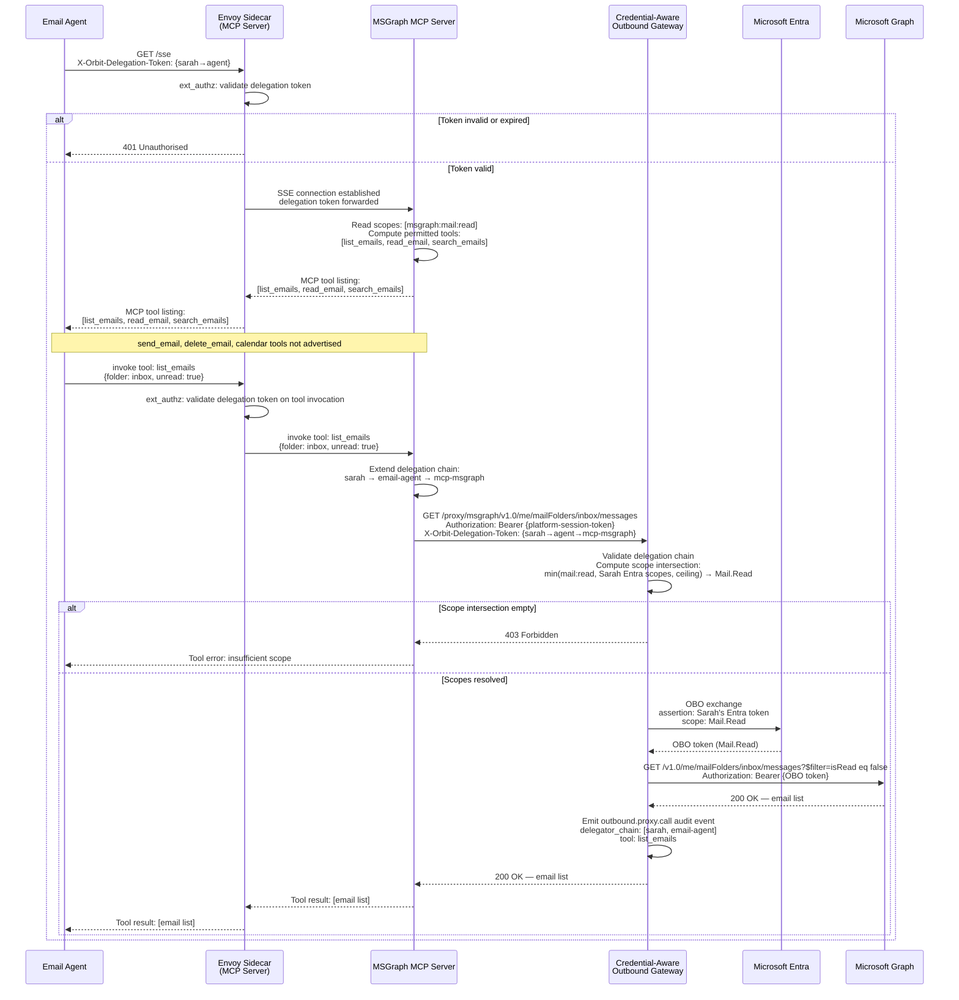

# Scope-Gated Tool Exposure via MCP

**Status:** Accepted
**Date:** 2026-03-05
**Deciders:** Platform Architecture Team
**Technical Story:** Defines how MCP servers deployed in the Orbit platform dynamically filter their advertised tool surface based on an agent's delegation context, how the delegation chain is extended through MCP hops, and how MCP servers route outbound external calls through the Credential-Aware Outbound Gateway.

---

## Context

[mcp-server-registration-deployment-and-governance](2026-03-05-mcp-server-registration-deployment-and-governance.md) established MCP servers as first-class `SERVICE` principals in the Orbit platform — registered, identity-bearing components deployed with Envoy sidecars that participate in the agent delegation chain. This ADR defines the behavioural model: what happens at connection time, how tools are filtered, how an agent invokes a tool, and how the outbound credential flow works.

The core challenge is that LLM-driven agents reason over their available tool surface to plan and execute tasks. If an agent can see tools it is not permitted to invoke, two problems arise:

1. **Incorrect planning**: the LLM may form plans that depend on tools it will be denied at call time, wasting tokens and compute on paths that cannot complete
2. **Attempted over-reach**: the agent may attempt to invoke out-of-scope tools, generating deny events and degrading the agent's task performance

The solution is to remove out-of-scope tools from the agent's possibility space entirely — not deny them at call time, but never advertise them in the first place. This requires the MCP server to read the agent's delegation context at connection time and compute a filtered tool surface before responding to the MCP protocol's tool listing request.

### Background

MCP servers communicate with agents over Server-Sent Events (SSE). When an agent connects, the first protocol exchange involves the agent requesting the server's tool list. This is the natural insertion point for scope-based filtering — the MCP server reads the delegation token before responding to the tool list request and returns only the subset of tools the delegation permits.

The outbound calls an MCP server makes to external APIs (e.g. Microsoft Graph) must route through the Credential-Aware Outbound Gateway ([credential-aware-outbound-gateway](2026-03-05-credential-aware-outbound-gateway.md)). The MCP server is a plain HTTP client for these calls — it does not implement OBO flows, does not access the session store, and does not manage credentials. This is identical to the model in which agent workloads are plain HTTP clients for internal platform calls (the sidecar handles authentication infrastructure transparently).

### Problem Statement

Orbit needs to define:
- How MCP servers filter their tool surface based on agent delegation scope at connection time
- What happens when a delegation token is expired or revoked during an active SSE session
- How the delegation chain is extended when an MCP server acts on behalf of an agent
- How MCP servers route outbound external calls without managing credentials themselves
- How the audit trail captures the full delegation path through MCP hops

### Goals

- Remove out-of-scope tools from the agent's possibility space at connection time, not at call time
- Extend the RFC 8693 delegation chain through MCP hops without breaking the root delegator model
- Keep MCP servers as plain HTTP clients for outbound calls — credential management stays in the gateway
- Maintain a complete, unbroken audit trail from agent tool invocation through to external API response
- Support multi-tenant safety: two agents with different delegation grants connecting to the same MCP server see different tool surfaces

### Non-Goals

- Orbit does not validate that the MCP server's scope declarations are accurate ([mcp-server-registration-deployment-and-governance](2026-03-05-mcp-server-registration-deployment-and-governance.md))
- Orbit does not restrict which tools an agent may request beyond what the delegation scope permits
- This ADR does not define the MCP protocol itself — it defines how Orbit governs its use
- Tool-level HTTP path enforcement is handled by the Outbound Gateway ([credential-aware-outbound-gateway](2026-03-05-credential-aware-outbound-gateway.md)), not the MCP server

---

## Decision Drivers

* **LLM planning integrity**: agents must only see tools they can actually invoke so the LLM can plan correctly
* **Security posture**: denial at advertisement time is stronger than denial at call time — it removes the tool from the possibility space
* **Multi-tenancy**: the same MCP server instance serves multiple agents with different delegation grants simultaneously
* **Audit completeness**: every tool invocation must produce a traceable audit record through the full delegation chain
* **Third-party compatibility**: open-source MCP servers whose code Orbit does not own must be able to participate via sidecar-mediated token injection
* **Developer simplicity**: MCP server authors should not need to implement OBO flows, token rotation, or audit emission

---

## Considered Options

### Option 1: Filter at Connection Time (Scope-Gated Advertisement)

**Description:** When an agent connects over SSE and the MCP protocol's tool listing exchange occurs, the MCP server reads the `X-Orbit-Delegation-Token` and computes the intersection of the server's full tool manifest and the agent's granted scopes. Only permitted tools are included in the tool listing response. Out-of-scope tools are not mentioned.

**Pros:**
- LLM never sees tools it cannot invoke — planning is always within permitted scope
- Multi-tenant safe — different agents see different tool surfaces from the same server instance
- Stronger security posture than call-time denial
- Removes the need for the LLM to reason about permission errors

**Cons:**
- MCP server must implement delegation token parsing at connection time
- Tool surface changes if delegation scope changes mid-session (requires reconnect or refresh)

### Option 2: Advertise All Tools, Deny at Call Time

**Description:** The MCP server advertises its full tool manifest regardless of delegation scope. When a tool is invoked, the server checks the delegation token and returns a permission error if the scope is insufficient.

**Pros:**
- Simpler MCP server implementation — no token parsing at connection time
- Agent always sees the full capability surface of the server

**Cons:**
- LLM may plan using tools it cannot invoke, leading to failed task paths
- Generates spurious deny events that pollute audit logs
- Weaker security posture — tool existence leaks information about capabilities the agent does not hold
- Degrades agent task performance through avoidable planning dead-ends

### Option 3: Per-Agent MCP Server Instances

**Description:** Rather than a shared MCP server instance, Orbit spawns a dedicated MCP server instance per agent session, pre-configured with only the tools the agent is permitted to invoke.

**Pros:**
- Complete isolation — no shared state between agents
- Tool surface is correct by construction, not by runtime filtering

**Cons:**
- Operationally expensive — N agent sessions require N MCP server processes
- Does not work for long-lived or pooled MCP servers (e.g. platform-managed shared instances)
- Adds significant instantiation latency to agent session startup
- Incompatible with third-party MCP servers that cannot be spawned on demand

---

## Decision

**Chosen Option:** Option 1 — Filter at Connection Time (Scope-Gated Advertisement)

### Rationale

Filtering at connection time is architecturally superior because it removes out-of-scope tools from the agent's possibility space before the LLM ever processes the tool list. This is not merely a security improvement — it directly improves agent task performance by ensuring the LLM plans only over tools it can actually invoke.

The call-time denial model (Option 2) creates a category of agent failure that is entirely avoidable: the LLM forms a plan, invokes a tool, receives a permission error, and must re-plan. This wastes tokens, adds latency, and can confuse the LLM's reasoning chain. Scope-gated advertisement eliminates this failure mode.

Per-agent instances (Option 3) are operationally infeasible at scale and incompatible with the platform's multi-tenant shared service model.

**Delegation chain:** The RFC 8693 `act` claim nesting model ([agent-execution-flow-patterns-and-delegation](2026-03-05-agent-execution-flow-patterns-and-delegation.md)) extends cleanly through MCP hops. The agent's delegation token carries the existing chain. When the MCP server calls the Outbound Gateway, it presents the same delegation token with its own identity appended as an additional `act` hop. The root delegator (the human principal at `sub`) is always preserved regardless of chain depth.

**Outbound calls:** MCP servers are plain HTTP clients for external API calls. They call `/proxy/{service-name}/{**path}` on the Outbound Gateway, exactly as agent workloads do for direct proxy calls. The gateway handles OBO exchange, scope intersection, credential injection, and audit emission. MCP server authors do not implement any of this.

---

## Consequences

### Positive

- LLM-driven agents operate with a clean, accurate tool surface — no planning failures from inaccessible tools
- The same MCP server instance correctly serves multiple agents with different delegation grants simultaneously
- MCP server authors do not need to implement OBO flows, token rotation, session store access, or audit emission
- The full delegation chain (human → agent → MCP server) is captured in every audit record
- Open-source MCP servers participate without code changes for platform authentication — the Envoy sidecar handles mTLS and delegation token validation at the network layer; scope-gated tool filtering is an MCP server implementation concern (see Negative consequences)

### Negative

- MCP servers must implement delegation token parsing to compute the filtered tool surface at connection time
- If an agent's delegation scope changes mid-session (e.g. scope revoked), the agent must reconnect to receive the updated tool surface — there is no live push of tool surface changes over an existing SSE connection
- MCP servers that do not implement scope-gated filtering will advertise their full tool surface regardless of delegation scope — Orbit cannot enforce this at the platform layer without owning the MCP server code (mitigated by the Outbound Gateway's scope intersection enforcement on outbound calls)

### Neutral

- The SSE connection is a long-lived HTTP connection through the Envoy sidecar — it is east-west internal traffic subject to the same mTLS and OPA enforcement as any other intra-platform service call ([universal-gateway-policy-enforcement](2026-03-05-universal-gateway-policy-enforcement.md))
- The MCP server is a `SERVICE` principal; its SPIFFE identity is what the Outbound Gateway sees as the caller when the delegation chain is extended

---

## Implementation

### Connection-Time Token Validation and Tool Filtering

When an agent establishes an SSE connection to an MCP server, the Envoy sidecar validates the `X-Orbit-Delegation-Token` via `ext_authz` before the connection reaches the MCP server process. If the token is invalid or expired, the sidecar returns 401 and the connection is rejected at the network layer.

If the token is valid, the MCP server process receives the connection with the delegation token available as a request header. The MCP server reads the token, extracts the granted scopes, and computes the permitted tool surface:

```
Agent delegation scopes: [msgraph:mail:read]

MCP server full manifest:
  list_emails        → requires msgraph:mail:read      ✅ include
  read_email         → requires msgraph:mail:read      ✅ include
  search_emails      → requires msgraph:mail:read      ✅ include
  send_email         → requires msgraph:mail:write     ❌ exclude
  delete_email       → requires msgraph:mail:write     ❌ exclude
  create_event       → requires msgraph:calendar:write ❌ exclude
  list_calendar      → requires msgraph:calendar:read  ❌ exclude

Tool listing response to agent: [list_emails, read_email, search_emails]
```

The agent's LLM receives only the three permitted tools. `send_email` does not exist in the agent's model context.

### Delegation Chain Extension Through MCP

When an agent calls a tool that results in an outbound API call, the MCP server extends the delegation chain before calling the Outbound Gateway.

Agent's inbound `X-Orbit-Delegation-Token`:

```json
{
  "sub": "principal-sarah-xyz",
  "act": {
    "sub": "principal-email-agent-abc"
  },
  "scope": "msgraph:mail:read",
  "tenant_id": "tenant-acme-corp",
  "exp": 1741000800,
  "jti": "grant-xyz-001"
}
```

MCP server presents to Outbound Gateway — chain extended with MCP server identity:

```json
{
  "sub": "principal-sarah-xyz",
  "act": {
    "sub": "principal-email-agent-abc",
    "act": {
      "sub": "principal-mcp-msgraph-service"
    }
  },
  "scope": "msgraph:mail:read",
  "tenant_id": "tenant-acme-corp",
  "exp": 1741000800,
  "jti": "grant-xyz-001"
}
```

The root `sub` (Sarah) is preserved. The Outbound Gateway uses Sarah's retained Entra token for the OBO exchange regardless of chain depth. The `act` nesting records the full delegation path.

### MCP Server Outbound Calls

MCP servers call the Outbound Gateway as plain HTTP clients:

```
GET /proxy/msgraph/v1.0/me/mailFolders/inbox/messages
Authorization: Bearer {platform-session-token}        ← injected by Envoy sidecar
X-Orbit-Delegation-Token: {extended-delegation-token} ← attached by MCP server
```

The gateway:
1. Validates the delegation token and extracts the full chain
2. Computes scope intersection: `min(delegation grant, Sarah's Entra session scopes, service registration ceiling)`
3. Performs OBO exchange with Entra using Sarah's retained access token
4. Strips the `/proxy/msgraph` prefix and injects the OBO token
5. Calls `https://graph.microsoft.com/v1.0/me/mailFolders/inbox/messages`
6. Emits `outbound.proxy.call` audit event

### Audit Event Structure

```json
{
  "event_type": "outbound.proxy.call",
  "timestamp": "2026-03-03T14:32:01Z",
  "principal_id": "principal-mcp-msgraph-service",
  "delegator_chain": [
    "principal-sarah-xyz",
    "principal-email-agent-abc"
  ],
  "service_name": "msgraph",
  "tool": "list_emails",
  "method": "GET",
  "path": "/v1.0/me/mailFolders/inbox/messages",
  "adapter_type": "oauth2_obo",
  "scopes_used": ["Mail.Read"],
  "response_status": 200,
  "duration_ms": 134,
  "grant_jti": "grant-xyz-001"
}
```

### Session Expiry and Revocation

**Token expired at connection time:** The Envoy sidecar rejects the SSE connection with 401 before it reaches the MCP server.

**Token revoked or expired mid-session:** The Envoy sidecar validates the delegation token on each tool invocation request (SSE is a persistent connection but individual tool calls are discrete HTTP-level exchanges). If the token has been revoked or expired, the sidecar returns 401 on the tool invocation. The agent must re-establish the SSE connection with a fresh delegation token.

**Scope revoked mid-session:** If a scope is revoked after the SSE connection is established, the agent continues to see the tool surface computed at connection time. The revocation takes effect at the next Outbound Gateway call — the gateway recomputes the scope intersection and will reject the call if the required scope is no longer valid. The agent should reconnect to receive the updated tool surface.

### Worked Example: Agent Reading Emails via MCP

**Setup:**
- Sarah has authenticated with Orbit; her Entra access token is retained in the session store
- A delegation grant has been created: `[msgraph:mail:read]`, 15-minute expiry
- An email agent has been instantiated with the delegation token (push model)
- The MSGraph MCP server is registered at platform scope

**Step 1 — Agent connects to MSGraph MCP over SSE**

The agent (or its framework) opens an SSE connection to the MSGraph MCP server endpoint, presenting the delegation token:

```
GET /sse
X-Orbit-Delegation-Token: {delegation-token}
```

Envoy sidecar validates the token via `ext_authz`. Token is valid — connection passes to MCP server.

**Step 2 — MCP server filters tool surface**

MCP server reads `msgraph:mail:read` from the delegation token. It computes the permitted tool surface: `[list_emails, read_email, search_emails]`. It responds to the MCP protocol tool listing with only these three tools. `send_email`, `delete_email`, and calendar tools are not mentioned.

**Step 3 — Agent's LLM plans with filtered tool surface**

The LLM receives its system context including the three available tools. It decides to call `list_emails` to find recent unread messages.

**Step 4 — Agent invokes `list_emails` tool**

The agent sends a tool invocation over the SSE connection:

```json
{
  "tool": "list_emails",
  "parameters": { "folder": "inbox", "unread": true }
}
```

**Step 5 — MCP server extends the delegation chain**

The MCP server appends its own identity to the `act` chain and calls the Outbound Gateway:

```
GET /proxy/msgraph/v1.0/me/mailFolders/inbox/messages?$filter=isRead eq false
Authorization: Bearer {platform-session-token}
X-Orbit-Delegation-Token: {chain: sarah → email-agent → mcp-msgraph}
```

**Step 6 — Gateway computes scope intersection and performs OBO**

The gateway resolves: `min(msgraph:mail:read, Sarah's Entra session scopes, msgraph service ceiling)` → `Mail.Read`. It exchanges Sarah's retained Entra token for an OBO token scoped to `Mail.Read`.

**Step 7 — Gateway calls MSGraph**

```
GET https://graph.microsoft.com/v1.0/me/mailFolders/inbox/messages?$filter=isRead eq false
Authorization: Bearer {OBO token scoped to Mail.Read}
```

**Step 8 — Response flows back**

MSGraph returns the email list. The gateway forwards the response to the MCP server. The MCP server formats the response as a tool result and streams it back to the agent over the SSE connection. The `outbound.proxy.call` audit event is emitted with the full delegation chain.

**Step 9 — Agent completes task**

The agent's LLM receives the email list as a tool result and continues task execution. At no point did the agent see an OBO token, know about Entra, or have access to Sarah's credentials.

### Sequence Diagram



### Migration Path

There is no existing MCP tool exposure model to migrate from. This is a greenfield definition.

---

## Validation

### Success Metrics

- Agents connecting with a restricted delegation scope receive only the tools their scope permits — verified by integration tests connecting with known scope sets and asserting the tool listing response
- Agents cannot invoke tools outside their delegation scope — verified by confirming the Outbound Gateway rejects calls where the tool's required scope is not in the delegation grant
- Audit logs contain complete delegation chains for all tool invocations routed through MCP servers
- Two agents connecting to the same MCP server instance with different delegation grants receive different tool surfaces simultaneously

### Monitoring

- `mcp.connection.established` — emitted when an agent establishes an SSE connection; includes principal IDs and computed tool surface size
- `mcp.connection.rejected` — emitted when a connection is rejected at the sidecar layer; includes rejection reason
- `mcp.tool.invoked` — emitted when an agent invokes a tool; includes tool name, delegation chain, and downstream gateway call reference
- `mcp.scope.filtered` — emitted at connection time with count of tools excluded due to insufficient delegation scope

---

## Related Decisions

- [unified-identity-model](2026-03-05-unified-identity-model.md) — `SERVICE` principal type that MCP servers instantiate
- [agent-execution-flow-patterns-and-delegation](2026-03-05-agent-execution-flow-patterns-and-delegation.md) — RFC 8693 delegation chain patterns extended through MCP hops
- [spiffe-spire-workload-attestation](2026-03-05-spiffe-spire-workload-attestation.md) — SPIFFE identity model for MCP server workload attestation
- [universal-gateway-policy-enforcement](2026-03-05-universal-gateway-policy-enforcement.md) — Envoy sidecar deployment and east-west mTLS for agent-to-MCP traffic
- [credential-aware-outbound-gateway](2026-03-05-credential-aware-outbound-gateway.md) — Outbound Gateway that MCP servers call for all external API access
- [mcp-server-registration-deployment-and-governance](2026-03-05-mcp-server-registration-deployment-and-governance.md) — MCP server registration, identity, and discovery model

---

## References

- [Model Context Protocol Specification](https://spec.modelcontextprotocol.io)
- [RFC 8693 — OAuth 2.0 Token Exchange](https://datatracker.ietf.org/doc/html/rfc8693)
- [Server-Sent Events — W3C](https://html.spec.whatwg.org/multipage/server-sent-events.html)
- [SPIFFE Workload API](https://spiffe.io/docs/latest/spiffe-about/spiffe-concepts/)

---

## Notes

The scope-gated advertisement model is architecturally stronger than call-time denial because it operates at the LLM reasoning layer, not just the enforcement layer. By ensuring the LLM never forms an intent to invoke a tool it cannot use, the platform prevents an entire class of agent planning failures before they occur. The Outbound Gateway remains the authoritative enforcement gate — scope-gated advertisement is a quality and performance improvement layered above it.

**Last Updated:** 2026-03-03
