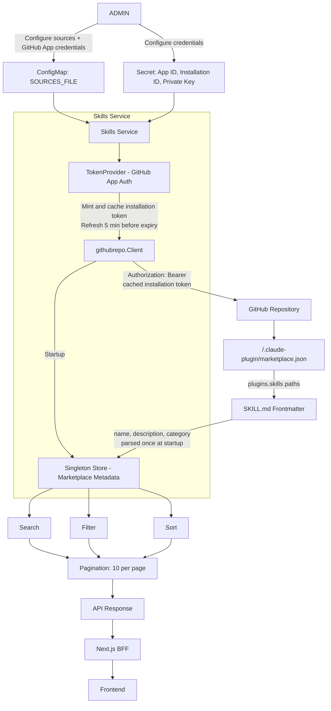

# ADR: Agent Marketplace — GitHub App Direct Fetch with Singleton In-Memory Store

**Status:** Accepted
**Date:** 2026-08-18
**Deciders:** Platform Engineering, Product Owner

---

## Context

Orbit needs a read-only Marketplace where users can browse, search, filter, and review skills from one or more approved GitHub repositories.

The Skills Service authenticates with GitHub using a **GitHub App**. The service holds the App's private key, mints short-lived installation tokens on demand, and caches each token until it is close to expiry. GitHub remains the source of truth.

---

## Decision

Use a **singleton in-memory Store** to hold Marketplace metadata for the lifetime of the Skills Service process.

- Metadata is loaded once at startup from `/.claude-plugin/marketplace.json` in each configured repository.
- All search, filter, sort, and pagination operations run against the Store — no GitHub call required.
- The full `SKILL.md` content is fetched from GitHub only when a user opens a skill detail page.
- Authentication uses a `TokenProvider` that mints a GitHub App installation token on first use and refreshes it after 60 minutes before expiry
- Alternatives considered and rejected for V1: PostgreSQL + Redis +  background sync, PostgreSQL only, fetch-on-every-request.

---

## Architecture




## Request Flows

**List / Search / Filter / Paginate — no GitHub call**
```text
Frontend → BFF → Skills Service → Singleton Store → 10 results → Frontend
```

**Skill detail click — GitHub call**
```text
Frontend → BFF → Skills Service → Singleton Store (get source path)
    │
    ▼
TokenProvider.Get() → cached/fresh installation token
    │
    ▼
GET raw.githubusercontent.com/.../SKILL.md
    │
    ▼
Full SKILL.md content → Frontend
```

**24h cron refresh**
```text
ticker fires
    │
    ▼
marketplace.Load() for each source (same as startup)
    │
    ▼
store.SwapStore(newStore) — atomic, zero downtime
```

**sources.json hot-reload**
```text
Kubernetes rotates ConfigMap
    │
    ▼
fsnotify detects "..data" symlink swap
    │
    ▼
registry.Registry reloads sources
    │
    ▼
store.SwapStore(newStore)
```

---


