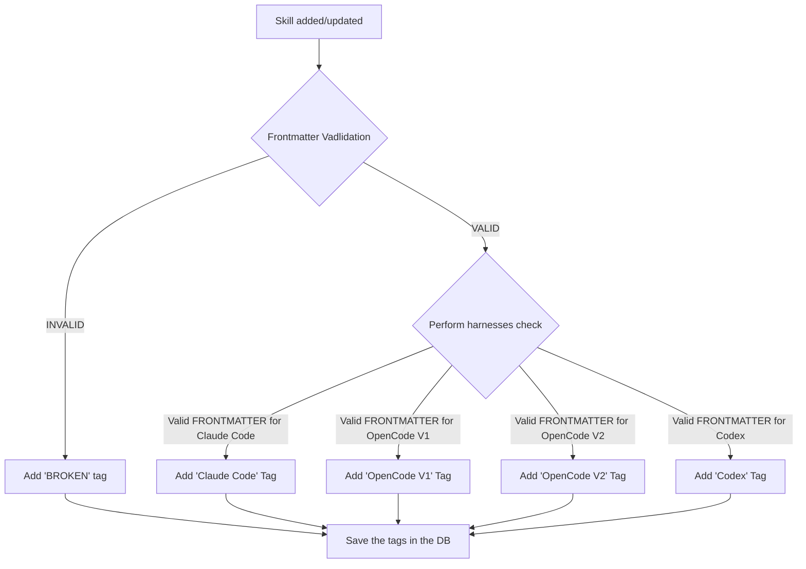

# Marketplace Skill Harness Compatibility at Source Configuration

<!-- Filename: 2026-11-04-marketplace-harness-compatibility.md  (decision date + slug; no sequential number) -->

**Status:** Proposed
**Date:** 2026-11-04
**Deciders:** Stoyan Grozdev, Viktor Stamoff. Review by Platform Engineering and Product is pending.
**Technical Story:** [Agent Marketplace: Iteration Two PRD](../prd/agent-marketplace-iteration-two.md), covering the skill-related portions of FR2-5, FR2-8 and FR2-9. Plugin compatibility is deferred to a separate decision.

---

## Context

This decision covers marking each Marketplace skill with the harnesses it is compatible with: Claude Code, Codex and OpenCode. A skill may support all three, a subset or none, depending on whether each harness can load it and preserve the behavior required by its configured fields. The check reads the skill's frontmatter, body and optional companion metadata, and runs when the operator configures the repository. Users see the compatible harnesses without explanations of the result.

In this ADR, **operator** means the Kubernetes operator controller. The PRD also uses that word for the person or team that runs Kora. **Harness** means the agent runtime that the PRD identifies. A **harness tag** is Marketplace metadata generated by the tagging rules and saved in PostgreSQL. The repository does not need to contain a tag, and scanning does not write one back to the repository.

### Background

The current source configuration path already separates approval from content access:

- The operator validates tenant ownership and duplicate registrations. It also checks the repository against the allowlist. Then it renders approved `SkillMarketplaceSource` entries into `orbit-skill-marketplace-sources`.
- The `skills-service` loads the mounted `skills-mapping.yaml` and watches for changes. It owns repository access through the platform GitHub client and the GitHub App token provider.
- The crawler currently reads on demand. It lists repository files with one recursive `GetTree` call using `HEAD` for the repository's default branch. Its frontmatter parser keeps only `name` and `description`, and it can recover those fields from invalid YAML for display.
- The service currently uses Redis for catalogue storage and has no PostgreSQL repository. This decision adds durable compatibility results in PostgreSQL.
- The status `SkillMarketplaceSource.status.phase: Aggregated` means that the operator gave the source to the service. It does not mean that the service fetched the repository or checked its content.

The [source aggregator](../../backend/internal/operator/skillmarketplace_aggregator.go), [registry](../../backend/internal/skills/registry.go), [crawler](../../backend/internal/skills/crawler.go), [GitHub client](../../backend/internal/platform/clients/github/client.go) and [frontmatter parser](../../backend/internal/skills/formatter.go) show these boundaries. The [source guide](../guides/register-skill-marketplace.md) describes the current approval and cache behavior.

### Problem Statement

Users need to know which skills match their preferred harness before selecting skills for an agent. Compatibility must be visible at selection time so users can identify harness mismatches before a run starts.

The current source path does not give a compatibility result. The crawler reads a source only when a request needs it, but the check must start at configuration time. Its parser output is not sufficient evidence of compatibility, because the parser keeps only two fields and can recover them from invalid YAML.

Frontmatter also has limits. It provides evidence of declared features, rather than proof that instructions will succeed. The Agent Skills format has shared fields, but each harness adds behavior with different meanings and defaults. The optional `compatibility` field of the format is free text that describes environment requirements. It is not a machine-readable harness list ([Agent Skills specification](https://agentskills.io/specification)).

A discovered skill can be checked individually even when its repository also contains a plugin. Its tags describe that skill only. Plugin manifests, other plugin components and whole-plugin compatibility are outside this decision and require a separate design.

### Goals

The goals of this decision are to:

- Enable users to identify and choose skills for their preferred harness before running an agent.
- Start the compatibility check as part of source configuration, before any Marketplace visit.
- Integrate the check into the existing `skills-service`, keeping the tagging function and its matching helpers in `backend/internal/skills/compatibility.go` and reusing the current source registry, parser, crawler and API.
- Mark each skill with the harnesses it is compatible with and persist the result in PostgreSQL.
- Display each skill's compatible harnesses as labelled badges beneath its name in Marketplace listings, skill details and the agent package chooser. The frontend views render the saved harness tags returned by the API using the existing Hades `Badge` component.

### Non-Goals

This decision does not cover:

- Plugin compatibility, plugin manifests or checks of non-skill plugin components
- Cross-harness translation
- Execution of repository content
- Permission grants
- Inspection of laptops, running agents, containers or sandboxes
- Proof that a tagged skill will execute successfully

---

## Decision Drivers

The primary driver is to enable users to see each skill for what harness is compatable.

The drivers are listed in order of importance:

1. **Skill choice for harness:** Users must be able to see which harnesses can use a skill before adding it to an agent.
2. **Cost for checks and rechecks:** Every skill must be checked when a repository is added and rechecked when its content or the checking rules change. The checking method must use little computation per skill, so larger repositories and frequent updates remain affordable to process.
3. **Persistant results:** When a check for the compatability is ready its results must remain available after service restarts and redis cache loss.
4. **Integration with existing code and UI:** The check must fit within the existing `skills-service` and reuse its source registry, repository access, parser, crawler and API. Harness labels must use the existing Hades `Badge` component. This keeps the work within the current feature ownership and UI conventions.

---

## Considered Options

Different approaches were considered for checking skill harness compatibility, including the checking method and where and when the check runs.

### Option 1: Manual Tagging During Repository Registration

**Description:** The person adding a repository to the Marketplace reviews each skill's frontmatter and manually selects its compatible harness tags during registration.

**Pros:**

- Makes harness tags available as part of repository registration.

**Cons:**

- **Manual effort:** Each skill requires individual review, making large repositories time-consuming to register.
- **Risk of incorrect tags:** Accuracy depends on the reviewer's knowledge of which frontmatter fields and behaviors each harness supports.
- **Ongoing maintenance:** Skill updates and changes in harness support require another manual review, otherwise, tags can become outdated.

### Option 2: Assign Harness Tags from Skill Metadata in `skills-service`

**Description:** When an approved source is configured, `skills-service` reads each skill's frontmatter, body and optional companion metadata. Deterministic rules compare its required behavior with documented harness support. The service stores every remaining compatible-harness tag in PostgreSQL. Later skill or rule changes trigger rechecking.

**Pros:**

- Reuses the current configuration and credential boundary
- Assigns tags without deterministicly without AI calls.
- Adding a repository automatically starts checking its skills.
- Marketplace pages display the tags already stored in PostgreSQL. Opening a listing or detail page does not repeat the compatibility check.
- An operator approving a repository doesnt have to also perform the skill compatability check.

**Cons:**

- Tags are not available immediately after repository approval, fetching and checking the skills takes time.
- The UI must show when a check is running.
- Approving and adding a repository automatically starts fetching and checking all its skills compatability even if nobody will use these skills.
- The hardcoded rules need maintenance as additional harnesses can be added or existing wants change.

### Option 3: Check Compatibility When a User Opens a Skill

**Description:** When a user opens an unchecked skill, `skills-service` fetches its content from GitHub and checks compatibility. It then saves the tags in PostgreSQL and caches the checked skill and tags in Redis before returning them to the UI. Later views reuse the saved result unless the content or checking rules change.

**Pros:**

- Checks compatibility only for skills users open.
- Checks compatibility using the content fetched for the detail page, before caching it in Redis.
- Saves the tags so later views do not repeat the same check.

**Cons:**

- The first user opening an unchecked skill must wait for its content and compatibility result.
- Marketplace listings cannot show harness tags for skills that have not been checked yet.

### Option 4: Ask an LLM to Check Every Skill

**Description:** Send each skill's content to an LLM and ask it to identify compatible harnesses. Repeat the evaluation when skill content, harness addition and/or update.

**Pros:**

- Can identify potential harness requirements described in the skill’s instructions, even when they are not declared in frontmatter.

**Cons:**

- Each AI evaluation costs money. Checking more skills or rechecking them increases the total cost and compute.
- Can give different answers for the same skill
- Still needs explicit harness rules and validation before its answer can be used as a compatibility tag.

### Option 5: Calculate Compatibility in the Frontend

**Description:** The frontend or the BFF receives skill content from the backend and calculates compatibility for each page of results.

**Pros:**

- Needs no background scan or result cache in the backend.

**Cons:**

- Puts business logic outside the backend and creates a second source of truth.
- The backend must still verify that each selected skill is compatible with the agent's harness before saving the agent.
- Filtering only the skills loaded on the current page can leave it partly empty, even when compatible skills exist on later pages. The total number of compatible skills cannot be calculated from that page alone.

---

## Decision

Use hardcoded compatibility rules in `skills-service` for skills only. When a repository is approved and added to the Marketplace, the service fetches its skills and checks them in the background. It reads each skill's frontmatter, body and any additional files it could have. Each scan or catalogue refresh reads the repository's current default branch (`HEAD`) without pinning a commit.

Each skill starts with Claude Code, Codex and OpenCode as possible harnesses. Remove a harness when the rules show that it cannot load the skill or support behavior the skill requires.

Save the resulting tags in PostgreSQL, then cache the checked skills and tags in Redis. The UI displays the saved harness tags.

**Chosen Option:** Option 2 - Assign Harness Tags from Skill Metadata in `skills-service`

### Rationale

Option 2 was chosen for the following reasons:

- **Harness choice:** Assigning tags when a repository is added to the Marketplace lets users see which skills are compatible with their chosen harness before adding them to an agent.
- **Cost:** Frontmatter parsing and signature matching use ordinary service code, avoiding an LLM request for every skill and every recheck in Option 4.
- **Repeatability:** A skill receives the same harness tags whenever its content and the hardcoded rules remain unchanged. The saved tags appear as badges when users browse skills, open a skill's details or select skills for an agent.
- **Availability:** Source configuration starts the check, and PostgreSQL retains completed results for browsing and selection. Skill or rule changes cause rechecking. Service restarts and Redis cache loss do not erase the results.
- **Integration:** Repository access and parsing remain in `skills-service`, the current API returns the saved tags, and frontend views render them with the existing Hades `Badge` component.

`skills-service` already owns repository access and parsing, so it owns the tagging logic. The operator keeps source approval.

The decision keeps Option 3 as recovery for missing results, but not as the initial trigger.

### Assign and Save Harness Tags

`skills-service` assigns each skill a `compatible_harnesses` list. For example, a skill compatible with Claude Code and Codex receives `{"compatible_harnesses":["claude-code","codex"]}`. Keep all three harness tags when no rule excludes one, and save an empty list when every harness is excluded.

Unrecognized frontmatter fields do not remove harness tags. If the skill passes frontmatter validation and all other compatibility checks, assign all three tags. Known incompatibilities still remove the affected harnesses. Invalid frontmatter remains marked `BROKEN` and receives no harness tags.

The implementation adds a new PostgreSQL table, `skill_compatibility`, owned by `skills-service`. Each result identifies the tenant, repository and skill path. Its `compatible_harnesses` column stores the tags as a `TEXT[]` array. The result also records the content digest, checking-rule version and check time. Reuse a saved result only when the fetched content's digest and the checking-rule version match; otherwise, recheck the skill.

A generated `skills-service` migration creates the table. The service saves results with SQL `INSERT` or `UPDATE` statements and reads them with `SELECT`. Adding a field to a Go struct does not create or populate a PostgreSQL column.

After the database write succeeds, the service caches the checked skills and tags in Redis using the existing JSON cache methods. If the cached tags expire but the saved result is still current, load the tags from PostgreSQL without repeating the check. The API returns the saved tags, and the dashboard displays them as harness badges without explanation text, reason codes or component-level reports. The repository's frontmatter is not changed.

Tags identify the harness: `claude-code`, `codex` or `opencode`. Model names such as GPT-6 are not harness tags. A model provider does not determine the skill's harness tag.

#### Skill Tagging Flow

The diagram below shows how skills-service validates a skill’s frontmatter, checks harness compatibility and saves the resulting tags.

If a harness can ignore an optional field without affecting how the skill works, keep its tag. Remove its tag if it cannot support a feature the skill needs. Consider all required fields before deciding which tags to save. The skill’s topic does not determine compatibility: a skill about Claude products is not automatically limited to Claude Code.

If the service cannot fetch or read the repository files, mark the scan as failed. If a skill has invalid frontmatter, mark it as BROKEN as shown in the diagram. Only assign compatibility tags after the files have been read and frontmatter validation has passed. Save the completed scan’s results in PostgreSQL before caching them in Redis or returning them to the UI.

During agent creation, the user chooses a harness under **Behaviour → Framework**, then selects skills in the new skills chooser. If the user changes the Framework after selecting skills, the dashboard checks their saved tags again. The user must remove skills without a tag for the new harness, or choose a harness compatible with all selected skills, before creating the agent.

When the user clicks **Create**, the backend checks the saved results in PostgreSQL and allows creation only if every selected skill has a current tag for the chosen harness. The agent cannot be created until every selected skill has current tags supporting the chosen harness. Each skill must come from a repository approved for the tenant, and the user must have permission to create the agent.

### Preserve the Three Platform Boundaries

The decision keeps these boundaries:

- **Who is this agent?** A skill check does not create or change agent identities. Internal results identify the source, checked content digest and checking-rule version. Each skill choice stays attributable to the verified person who makes it.
- **What can it access?** Compatibility is descriptive evidence. Current policy checks still control who can view, select and execute content. A compatible marking grants no permissions and overrides no restriction.
- **How does it connect?** The current service-owned GitHub App and typed client fetch approved content. The operator and agents get no repository credentials. Declared external services continue to require governed connections and just-in-time credentials.

---

## Consequences

### Positive

The decision gives these benefits:

- Approved repository entries appear in the Marketplace as soon as they are registered, with a **Checking skills…** status. Their skills and harness badges load after checking finishes and the results are saved.
- Marketplace listings, skill details and agent creation use the same saved tags for the same skill content and checking rules.
- Saved compatibility results survive service restarts and Redis cache loss.
- Repository credentials, fetching and parsing remain in `skills-service`.
- Compatibility checks use hardcoded rules without AI model calls.
- When only the checking rules change, cached skill content can be reused if it is available.

### Negative

The decision has these costs:

- The initial check now reads configured repositories even if no user visits them. Each scan reads the repository with one recursive tree call and one read for each descriptor file. It does not read other repository content. Work limits, deduplication and retry are necessary to control GitHub traffic.
- Because the default branch can change between GitHub requests, files fetched during a scan may come from different commits. Tags describe the content actually fetched and checked.
- Markings arrive after configuration propagation, so the product needs pending, failed and stale check states.
- Tagging signatures and fixtures need maintenance when harness metadata or native interfaces change.
- Tags depend on the accuracy and coverage of the reviewed behavior-support rules. Unrecognized requirements or undocumented differences can lead to missed incompatibilities, and incorrect blocking rules can exclude portable skills. The scan does not certify execution success.
- `skills-service` gains a PostgreSQL dependency, feature-owned tables and database migrations.

### Neutral

The decision also causes these changes:

- Compatibility tags are assigned to individual skills. Plugin compatibility remains outside this decision.
- The [existing backend design](2026-08-17-agent-skills.md#skills-service) fetches repository content when a request needs it. This decision adds an automatic fetch and compatibility check when an approved repository is registered.
- PostgreSQL stores the compatibility results. Redis caches both skill content and the saved results.
- The service reads repository files without changing or executing them. If fetching or reading the files fails, it records a failed scan.

---

### Migration Path

Apply additive migrations through the existing migration Job before deploying the database-backed service. These conditions apply during the transition from the current request-time path:

- On the first startup after deployment, `skills-service` finds no results for the sources that are already configured. It queues a scan for each of these sources.
- Later restarts reuse current PostgreSQL results and check sources with missing or outdated results.
- Approved repositories appear in the Marketplace immediately with a **Checking skills…** status. Their skills and harness badges appear after checking finishes, the results are saved in PostgreSQL and the checked skills are cached in Redis.
- The `Aggregated` phase keeps its current meaning, so `SkillMarketplaceSource` resources need no change.
- The current catalogue cache stays in Redis. PostgreSQL owns compatibility results; Redis may cache them after commit. Existing catalogue cache entries do not replace the persisted tagging result.
- Request-time crawling stays as recovery for missing results. It follows the same checking, PostgreSQL storage and Redis caching process before the skills appear in the UI.
- Rolling back the service leaves the added tables in place, following the platform's migration rollback rule.

### Timeline

TBD

---

## Validation

Verify that:

- Adding an approved repository starts checking automatically. Unapproved repositories, repositories belonging to inactive tenants and removed sources are not fetched or published.
- The same skill content and checking rules always produce the same tags: all three harnesses, a subset or none. Unsupported required features remove a harness; harmless optional fields do not.
- Unrecognized frontmatter fields do not remove tags. A skill that otherwise passes validation and compatibility checks receives all three tags; any exclusions from known rules still apply.
- Checks distinguish actual frontmatter settings and required tool use from examples and mentions. A generic tool name alone does not make a skill exclusive to one harness.
- Invalid frontmatter produces a `BROKEN` result without harness tags. Fetch failures, unreadable files or incomplete repository listings produce a failed scan, never a default compatible result.
- Only individual skills and their companion metadata are checked. The check does not classify whole plugins, execute repository code or call an LLM.
- Refreshes recheck skills when their content or the checking rules change. Saved tags match the fetched content, and removed skills lose their tags.
- A completed scan's results are saved together in PostgreSQL before caching or display. Failed or older scans cannot overwrite newer results. Results remain separate for each tenant and survive service restarts and Redis cache loss.
- Marketplace listings, skill details and the agent skills chooser display the same saved tags returned by the API, without explanation text. New skills appear after checking finishes and the results are saved.
- The backend allows agent creation only when every selected skill has current tags supporting the chosen harness. Changing the harness requires checking the selected skills against their saved tags again.

Run the documentation checks and the full quality gate (`make check`) for the implementation PR.

### Success Metrics

These release checks come from the goals of this ADR and from the success metrics of the [PRD](../prd/agent-marketplace-iteration-two.md):

- **Early check:** Every newly configured, approved source reaches the `ready` or `failed` scan state without a Marketplace visit.
- **Clear compatibility:** Every skill with a completed current check shows its compatible harnesses without explanation text. Only skills marked compatible with the chosen runtime can be selected. This check covers the skill portion of the PRD metric "Compatibility is clear before creation".
- **Behavior-based tagging:** Every readable skill retains the harnesses for which the reviewed rules find no loading failure or loss of required behavior. Shared fields and harmless optional hints do not cause exclusions. Save the resulting tags directly, with no environment-availability or field-validation gate.
- **Current markings:** New skill choices use tags that match the content fetched by the latest completed refresh and the current checking rules. A refresh that finds changed content, or a change to the checking rules, requires rechecking before the affected skills can be selected again.
- **Durable markings:** Completed results remain available from PostgreSQL after service restarts or Redis cache loss.
- **Unchanged permissions:** Skill choices give an agent no extra permissions. This check covers the skill portion of the PRD metric "Permissions stay unchanged".

### Monitoring

Use scan lifecycle events and source scan status to monitor these signals:

- Sources that stay in the `pending` or `failed` scan state
- Results that stay stale after failed refreshes
- Failed PostgreSQL writes and compatibility cache reloads
- Tag counts per harness, counts for shared skills and empty results. Changes after a rule update can reveal an overly broad blocking rule or an incorrect support mapping.
- GitHub traffic from scans, which the work limits must keep bounded.

---

## Related Decisions

- [Agent Skills dashboard](2026-08-17-agent-skills.md#dashboard) - Marketplace frontend architecture. The dashboard shows the compatible harnesses from this ADR without explanation text and does not calculate compatibility.
- [Agent Skills service](2026-08-17-agent-skills.md#skills-service) - Marketplace backend and its cache-aside model. If accepted, this ADR adds eager skill compatibility scanning and PostgreSQL persistence for checked results. GitHub remains the source of skill content.
- [database-migrations](2026-09-10-database-migrations.md) - Feature-owned migrations, deployment hooks and rollback rules for the added compatibility tables.
- [codex-agent-runner](2026-06-04-codex-agent-runner.md) - Managed Codex execution mode. Runtime operation remains separate from repository-time tagging.
- [opencode-agent-runner](2026-06-04-opencode-agent-runner.md) - Managed OpenCode execution mode. Runtime operation remains separate from repository-time tagging.
- [agent-pod-egress-lockdown](2026-09-30-agent-pod-egress-lockdown.md) - Egress limits for agent pods. Skill declarations of external services do not change these limits.

---

## References

- [Agent Marketplace: Iteration Two PRD](../prd/agent-marketplace-iteration-two.md)
- [Skill Marketplace sources guide](../guides/register-skill-marketplace.md)
- [Agent Skills specification](https://agentskills.io/specification)
- [Claude Code skills reference](https://code.claude.com/docs/en/skills#frontmatter-reference)
- [Official OpenAI skills documentation](https://learn.chatgpt.com/docs/build-skills#optional-metadata)
- [Codex native tool examples](https://developers.openai.com/cookbook/examples/gpt-5/codex_prompting_guide)
- [OpenCode skills](https://opencode.ai/docs/skills/#write-frontmatter)
- [OpenCode v2 skills](https://opencode.ai/v2/docs/skills#frontmatter)
- [OpenCode native tools](https://opencode.ai/docs/tools/)

---

## Open Questions

Questions marked **Open** remain unresolved. Resolved answers are incorporated in the Decision and Validation sections.

1. **How strict should the harness check be?** **Status: Open.** Should harness-specific frontmatter make a skill exclusive to that harness, or should other harnesses remain eligible when the reviewed rules show they can ignore the field without losing required behavior?
2. **How should unrecognized settings be handled?** **Status: Resolved.** Unrecognized frontmatter fields do not remove harness tags. Assign all three tags when frontmatter validation and the other compatibility checks pass. Keep any exclusions from known rules. Invalid frontmatter remains `BROKEN`.
3. **How quickly must source updates appear?** **Status: Open.** What is the maximum acceptable delay between a change on the repository's default branch and updated content and tags in the Marketplace? This determines whether refreshes can follow cache expiry or need a schedule or source-change notification.

---

## Notes

PRD Open Questions 6, 7 and 14 remain open. They cover version updates, failures to load chosen content, and supporting-file availability. Plugin compatibility and the supported plugin parts in PRD Open Question 1 remain deferred to a separate decision; this ADR assigns tags only to individual skills.

**Last Updated:** 2026-11-06
