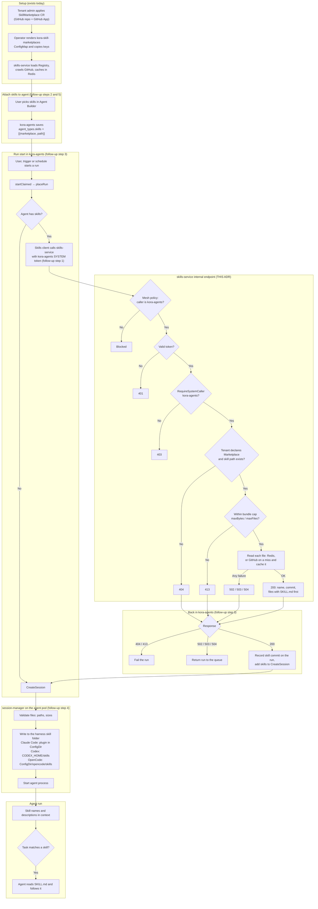

# Internal Skill Retrieval Endpoint for Agent Runs

**Status:** Proposed
**Date:** 2026-11-08
**Deciders:** Platform Team
**Technical Story:** Agents cannot use Marketplace skills today. This ADR is the first step towards loading skills into agent runs: an internal `skills-service` endpoint that returns a skill's complete set of files to `kora-agents` for a given tenant. The `kora-agents` client that calls it, and the delivery of the files to `session-manager` at run start, are separate [follow-up steps](#follow-up-steps).

---

## Context

### Why This Matters for the Software Factory

Today an agent learns a team procedure (coding standards, a release runbook, how to fill a form) only through its system prompt. That prompt is written by hand per agent, costs tokens on every turn, and has no history. Delivering Marketplace skills into agent runs changes that.

| Factory question | How this feature answers it |
| ---------------- | --------------------------- |
| **Does it make the agent better, faster, cheaper or more effective?** | Only a skill's name and description sit in context; the agent opens the full `SKILL.md` only when the task needs it. Prompts get shorter and cheaper, and the agent works with focused, task-specific instructions instead of one large prompt. One skill serves many agents, so a procedure is written once. |

| **Does it create durability, repeatability or accuracy?** | Every agent that uses a skill follows the same reviewed, versioned procedure, so output is consistent across agents and runs. Each run records the commit of every skill it received, so any run can be traced to the exact instructions it followed. Pinning a skill to a commit (see [Open Questions](#open-questions)) is the next step towards fully repeatable runs. |

| **Does it help manage the factory?** | Skills live in Git, change through pull requests, and are governed per tenant through `SkillMarketplace`. Platform teams update a procedure in one repository and every agent that uses it picks up the change, with a per-run audit trail of which version was used. |

This ADR is the first step of the feature: the endpoint that lets `kora-agents` fetch a skill securely. The [end-to-end flow](#end-to-end-flow) shows how it fits with the follow-up steps that deliver the full outcome: **an agent built in the Agent Builder runs with the team's skills.**

### Background

`skills-service` serves the Agent Marketplace: a read only catalogue of skills held in GitHub repositories that each tenant declares as `SkillMarketplace` resources in its namespace. The operator renders every tenant's Marketplaces into the `kora-skill-marketplaces` ConfigMap and copies each GitHub App private key into `kora-skill-marketplace-secrets`. `skills-service` loads both into its `Registry` and mints one installation token per Marketplace, limited to that repository with `contents: read`.

A crawl resolves the Marketplace's ref to one commit, reads the tree at that commit and fetches every `SKILL.md`. The result is a `skillList` cached in Redis. Supporting files are **not** fetched by the crawl: the crawl only records their paths (relative to the skill folder) and sizes. Each supporting file is fetched from GitHub the first time it is requested and cached under its commit SHA. Every cache key starts with `skills:<tenantID>:<slug>` (`cache.go`, `cacheKey`). After `cacheTTLSecs` (12 hours) the service re-resolves the ref and keeps the list if the commit has not changed.

Crawl limits (`marketplace.limits` in `cmd/skills-service/config/base.yaml`, set by the chart from `skillsService.limits`):

| Limit | Default |
| --- | --- |
| `skillsPerMarketplace` | 500 |
| `filesPerSkill` | 500 |
| `bytesPerFile` | 128 KiB |
| `skillMdBytesPerMarketplace` | 8 MiB |
| `fileCacheBytesPerMarketplace` | 32 MiB. A file that would exceed this is served but not cached. |

Binary files are never listed or fetched.

Every route today is a user-facing route under `/v1/marketplaces` (`internal/skills/handlers.go`):

| Route | Purpose |
| --- | --- |
| `GET /v1/marketplaces` | Marketplaces allowed for the caller's tenant |
| `GET /v1/marketplaces/skills?marketplace=&keys=&search=&offset=&limit=` | One page of skills across the tenant's Marketplaces |
| `GET /v1/marketplaces/{slug}/skills/{path...}` | One skill: `SKILL.md`, the list of its supporting files and the commit it was read at |
| `GET /v1/marketplaces/{slug}/skills/{path...}?file={file}` | One supporting file of the skill |

A skill is identified by its Marketplace slug and its **folder path** in the repository (for example `skills/pdf`). The frontmatter `name` is only a display name and is not unique.

The routes are protected by `AuthMiddlewareWithRevocation`, `DelegationMiddlewareWithBlocklist` and `ScopeEnforcementMiddleware` (`skills:read`). The tenant comes from the caller's token (`claims.Kora.TenantID`). There is no local authentication bypass.

`Service` already has the building blocks a run needs (`internal/skills/service.go`):

1. `skill(ctx, tenantID, slug, path)` calls `registry.Find(tenantID, slug)`, which returns `ErrMarketplaceNotFound` for a Marketplace the tenant does not declare. It then loads the cached list (crawling on a miss) and returns `ErrSkillNotFound` when no skill has that folder path. A Marketplace with no usable key fails closed with `ErrCredentialUnavailable`, cached content included.
2. `GetSkill` returns `SkillDetail`: `SKILL.md` content (`Content`), the supporting files as `[]SkillFileInfo{Path, Size}` **without content**, and `Commit`.
3. `GetSkillFile` returns one supporting file. It reads the Redis file cache at the list's commit and, on a miss, fetches the file from GitHub (sharing the fetch between concurrent callers) and caches it.

The [agent-skills](2026-08-17-agent-skills.md) ADR covers browsing only. It lists "installing skills, adding skills to agents, or running skill files" as a non-goal and leaves that decision to a later ADR. That ADR is unchanged. This ADR is a new feature built on top of it: delivering Marketplace skills into agent runs.

### Problem Statement

`kora-agents` has to fetch a skill's files when it starts a run for an agent with skills attached. None of the existing routes can serve it:

- **The tenant comes from the caller's token.** `kora-agents` calls other services with its own SYSTEM token (`identity.Client.SelfTokenSource()`, display name `kora-agents`), which has no tenant. A call to the public routes fails with `401 tenant-scoped platform token required`.
- **No user token is available.** Runs are started by the scheduler (`RunService.startClaimed`), not inside a user's request, and trigger runs have no user at all. There is nothing to forward.
- **SYSTEM tokens skip scope checks.** The platform convention is that a SYSTEM principal is not restricted by `ScopeEnforcementMiddleware` (`internal/platform/middleware/scope_enforce.go`). Any route that accepts a SYSTEM token and takes the tenant as a parameter must check which service is calling. Otherwise any component in the mesh could read any tenant's skills.
- **One skill needs many calls.** The detail route returns `SKILL.md` and only the *names* of the supporting files. A runner needs every file's content, which today means one extra request per file, up to `filesPerSkill` (500) requests per skill.

### Goals

- Add an internal endpoint that returns a skill's complete set of files for a named tenant: `GET /v1/internal/tenants/{tenantID}/marketplaces/{slug}/skills/{path...}`.
- Accept calls only from `kora-agents`, checked in the application with the existing `mw.RequireSystemCaller` (eads the caller's token and rejects anyone who isn't kora-agents with a 403) the and, where SPIFFE (where SPIFFE is on, Istio checks which service is calling and blocks the request before it reaches skills-service) is enabled, in the mesh.
- Enforce the same tenant and skill-membership checks as the public routes, by reusing `Service.skill` and the `GetSkillFile` fetch path.
- Serve from Redis when the cache is warm. On a miss, fetch from GitHub through the existing cache-aside path, with no new caching logic.
- Return the commit the files were read at, so a run can record which version it used.
- Bound the response size, independently of the crawl limits.
- Keep the endpoint unreachable from outside the cluster.

### Non-Goals

- **The `kora-agents` client** (`internal/platform/clients/skills/`) and its wiring.
- **Storing skills on an agent definition** (`agent_types.skills`) and the agent builder UI.
- **Sending skill files to `session-manager`**, and writing them into each framework's skill folder before the agent starts.
- **Version pinning:** serving a skill at a commit other than the Marketplace's current one. The endpoint returns the commit it served, but cannot be asked for an older one.
- **Binary files.** The crawler never lists them, so the endpoint never returns them.
- **Changes to the public `/v1/marketplaces` routes**, to the cache layout, or to the GitHub fetching.
- **Batch retrieval** (several skills in one call). One skill per call matches the existing service methods. A batch endpoint can be added if the per-run call count becomes a problem.

---

## Decision Drivers

* **What can it access?** A run may only receive skills from Marketplaces its tenant declares. The check must stay in `skills-service`, which owns the registry.
* **How does it connect?** The agent pod must never contact GitHub or hold a GitHub credential. Skill content reaches the run only through platform services.
* **Who is calling?** A SYSTEM token skips scope checks, so the endpoint must name its one permitted caller and reject everything else, as `session-manager` does with `mw.RequireSystemCaller(expectedCaller, ...)` and the kora-triggers `AuthorizationPolicy` does in the mesh.
* **Reuse.** `Service.skill` and the `GetSkillFile` fetch path already enforce tenant access and cache-aside reads. The endpoint should be a thin layer over them, not a second implementation.
* **Feature independence.** `kora-agents` must not import `internal/skills`. It talks to `skills-service` over HTTP through a typed platform client.
* **Run start time.** Run start sits on the scheduler's path, with `startBudgetSecs: 180`. A warm cache must answer quickly, and a cold one must still finish within the budget.
* **Payload size.** The crawl limits allow up to 500 files of 128 KiB per skill (about 64 MiB). The whole bundle is later forwarded in the session request, so it needs a much smaller cap of its own.
* **Platform conventions.** `api.Controller`, `api.JSON` / `api.ErrorResponse`, sentinel errors mapped with `errors.Is`, injected logger, no raw `http.Client`.

---

## Considered Options

### Option 1: `kora-agents` reads the skills Redis directly

**Description:** `kora-agents` connects to the `skills-service` Redis and reads the cached skill keys itself.

**Pros:**
- No HTTP hop on a warm cache.

**Cons:**
- Only `skills-service` should touch its cache. The key layout (`skills:<tenant>:<slug>:...`, files keyed by commit) is an internal detail.
- Copies the registry check into a second service. The tenant in the key only helps if the caller picks the right tenant and slug; the registry is what says a tenant may use a Marketplace.
- A cache miss has no fallback: `kora-agents` cannot fetch from GitHub, and files over `fileCacheBytesPerMarketplace` are never cached at all.

### Option 2: The agent pod fetches skills itself

**Description:** `session-manager` (or the agent) fetches skills from `skills-service` or GitHub inside the agent pod at run start.

**Pros:**
- No change to `kora-agents` or the session request.

**Cons:**
- The agent pod's egress is locked to platform services ([agent-pod-egress-lockdown](2026-09-30-agent-pod-egress-lockdown.md)). Fetching from GitHub would need a credential in the pod, against "agents never handle credentials".
- Calling `skills-service` from every agent pod in every tenant namespace widens who can reach it, and `session-manager` would need a tenant-trusting token of its own.
- The agent definition in `kora-agents`, not the pod, knows which skills an agent has.

### Option 3: Internal endpoint on `skills-service` that only `kora-agents` may call

**Description:** Add `GET /internal/tenants/{tenantID}/marketplaces/{slug}/skills/{path...}`. It accepts only the `kora-agents` SYSTEM principal, takes the tenant from the path, and calls a new `Service.GetSkillBundle` built from `skill` and the `GetSkillFile` fetch path. It returns `SKILL.md` and every supporting file with content, and the commit they were read at.

**Pros:**
- Tenant access and cache-aside reads come from existing code, unchanged.
- One permitted caller, checked in the application and in the mesh.
- One call per skill instead of one per file.
- Works for runs started by users, triggers and schedules alike.
- The agent pod and `kora-agents` never contact GitHub or Redis.
- Follows existing internal routes (`/internal/runs/...` on `kora-agents`, the `session-manager` routes guarded by `RequireSystemCaller`).

**Cons:**
- A second middleware chain in the `skills-service` controller.
- `kora-agents` becomes a caller of `skills-service`, adding a dependency on it at run start.
- A cold cache costs a crawl plus one GitHub fetch per supporting file during run start.

---

## Decision

**Chosen Option:** Option 3 - Internal endpoint on `skills-service` that only `kora-agents` may call.

### Rationale

It is the only option that keeps the tenant check in its single owner, keeps GitHub credentials and Redis out of every other service, and works for runs with no user behind them. The handler is a thin layer over `Service.skill` and the per-file fetch that `GetSkillFile` already does.

### End-to-End Flow



### Request Flow

```
kora-agents (run scheduler)
   │  GET /v1/internal/tenants/{tenantID}/marketplaces/{slug}/skills/{path...}
   │  Authorization: Bearer <kora-agents SYSTEM token>
   ▼
skills-service
   1. AuthMiddlewareWithRevocation → valid, unrevoked platform token
   2. RequireSystemCaller           → SYSTEM principal named "kora-agents"
   3. validate path parameters      → tenantID, slug, path (isSkillPath)
   4. Service.GetSkillBundle        → registry.Find, cached list or crawl,
                                       skill by folder path,
                                       each file from Redis or GitHub,
                                       bundle size cap
   ▼
200 { "marketplace": "...", "path": "skills/pdf", "name": "pdf",
      "commit": "<sha>", "files": [ ... ] }  →  kora-agents
```

### API Surface

**Route:** registered in `Controller.Boot` as

```go
mux.Handle("GET /internal/tenants/{tenantID}/marketplaces/{slug}/skills/{path...}", c.handleGetSkillBundle)
```

The server adds `basePath` (`/v1`), so the full path is `/v1/internal/tenants/{tenantID}/marketplaces/{slug}/skills/{path...}`.

**Path parameters:**

| Parameter | Rule |
| --- | --- |
| `tenantID` | Non-empty, one path segment (no `/`, `\`, `.` or `..`). |
| `slug` | As on the public route. A slug the tenant does not declare is `404`. |
| `path` | The skill's folder path, checked with the existing `isSkillPath` (no empty, `.` or `..` segment). An unknown path is `404`. |

**Response `200`:**

```json
{
  "marketplace": "team-skills",
  "path": "skills/pdf",
  "name": "pdf",
  "commit": "3f2a…",
  "files": [
    { "path": "SKILL.md", "content": "---\nname: pdf\ndescription: ...\n---\n..." },
    { "path": "reference/forms.md", "content": "..." }
  ]
}
```

New types in `internal/skills/models.go`:

```go
// SkillBundle is a skill as a run receives it: SKILL.md first, then every
// supporting file, with paths relative to the skill folder.
type SkillBundle struct {
	Marketplace string             `json:"marketplace"`
	Path        string             `json:"path"`
	Name        string             `json:"name"`
	Commit      string             `json:"commit"`
	Files       []SkillFileContent `json:"files"`
}
```

`SkillFileContent` (`Path`, `Content`) already exists and is reused.

**Building the bundle** (`Service.GetSkillBundle`):

- Call `skill(ctx, tenantID, slug, path)` once.
- Start the file list with `{Path: "SKILL.md", Content: skill.Content}`.
- `SkillFileInfo.Path` is already relative to the skill folder, so no path conversion is needed.
- For each `skill.Files` entry, read the file with the same cache-then-GitHub logic as `GetSkillFile`. Factor that logic out of `GetSkillFile` into a helper taking the already-resolved Marketplace, commit and skill, so it is not resolved again per file. Use bounded parallelism (for example 8 at a time).
- Sum `SkillFileInfo.Size` before fetching. If it exceeds `marketplace.bundle.maxBytes` (new config, default 4 MiB) or the file count exceeds `marketplace.bundle.maxFiles` (default 100), return `ErrSkillTooLarge` without fetching anything.
- Any file error fails the whole bundle. A run never receives a partial skill.

**Status codes:** these reuse the existing `apiError` mapping in `handlers.go`, plus one new case.

| Status | When | Source |
| --- | --- | --- |
| `200` | Skill returned | |
| `400` | `tenantID` malformed | handler |
| `401` | Missing, invalid or revoked token | `AuthMiddlewareWithRevocation` |
| `403` | Valid token, but not the `kora-agents` SYSTEM principal | `RequireSystemCaller` |
| `404` | Marketplace not declared by the tenant (`ErrMarketplaceNotFound`), repository or ref missing (`ErrRepositoryNotFound`), skill path not in the Marketplace or path malformed (`ErrSkillNotFound`), listed file gone (`ErrFileNotFound`) | `apiError` |
| `413` | Bundle over `maxBytes` or `maxFiles` (`ErrSkillTooLarge`, new) | `apiError` |
| `502` | Credential unavailable (`ErrCredentialUnavailable`) or GitHub failure (`ErrGitHubFailure`) | `apiError` |
| `503` | Redis unavailable (`storage.ErrRedisUnavailable`) | `apiError` |
| `504` | Request timed out (`context.DeadlineExceeded`) | `apiError` |
| `500` | Anything else | `apiError` |

A cancelled request gets no response, as on the public routes (`respondError`).

`kora-agents` treats `404` and `413` as permanent (fail the run with a message naming the skill) and `502`, `503`, `504` and transport errors as temporary (return the run to the queue). `ErrCredentialUnavailable` is reported as `502` but does not clear on retry; the run fails once the start budget runs out, and the message should say the Marketplace's credential is unavailable.

### Authentication and Authorization

**Separate middleware for `/internal/`.** `Controller.Middleware()` picks a chain by path, the same way `kora-agents` does (`internal/agents/server.go`, `Middleware`):

- **Public routes:** the existing chain, unchanged: `AuthMiddlewareWithRevocation` → `DelegationMiddlewareWithBlocklist` → `ScopeEnforcementMiddleware`.
- **`basePath + "/internal/"` routes:** `AuthMiddlewareWithRevocation` → `mw.RequireSystemCaller(internalCaller, logger)`.

`ScopeEnforcementMiddleware` is left off the internal chain on purpose. `Routes(basePath)` only declares the `/marketplaces` prefix, so an internal path would be denied with "no route match", and SYSTEM principals skip scope checks anyway. The caller check is what restricts access.

**Caller check.** Reuse the platform middleware rather than writing a new one:

```go
// internalCaller is the only principal allowed on /internal routes: kora-agents
// fetches skills for the runs it starts. A SYSTEM principal skips scope checks,
// so without this check any in-mesh component could read any tenant's skills.
const internalCaller = "kora-agents"
```

`mw.RequireSystemCaller` (`internal/platform/middleware/system_caller.go`) allows the request only when `claims.Kora.PrincipalType == token.PrincipalTypeSystem` and `claims.Kora.DisplayName == internalCaller`. It logs every rejection at `Warn` with path, expected caller, principal type and display name, and answers `403`.

**Mesh layer (when `platform.spiffe.enabled`).** Add `charts/kora/templates/skills-service/authorizationpolicy.yaml`, modelled on `charts/kora/templates/triggers/authorizationpolicy.yaml`. It should use `action: ALLOW`, so it fails closed when a new caller appears, and list:
- the `kora-agents` service account for paths under `/v1/internal/*`;
- the ingress gateway and the frontend for `/v1/marketplaces*`, so browsing keeps working;
- the metrics scraper, as the triggers policy does.

Principals are written without the `spiffe://` prefix. Put it behind `platform.spiffe.enabled` and a new `skillsService.authorizationPolicy.enabled` value, as triggers does.

**Not reachable from outside the cluster.** The API `VirtualService` (`charts/kora/templates/api/virtualservice.yaml`) sends only `exact: /v1/marketplaces` and `prefix: /v1/marketplaces/` to `kora-skills-service:8098`. `/v1/internal/...` does not match and never reaches the service from outside. No change to the `VirtualService` is needed, and none may add an `/internal` prefix for `skills-service`.

**Network.** `kora-agents` and `skills-service` both run in `kora-system`. `charts/kora/templates/platform/netpols.yaml` already allows mesh traffic to port `8098`, so no `NetworkPolicy` change is needed. Confirm in the cluster that `kora-agents` is covered.

### Caching

No change to keys or TTLs. The endpoint uses the same list cache, the same per-commit file cache and the same cache-aside refill as the Marketplace UI, so either side warms the cache for the other.

- A list miss or an expired list triggers a commit check, and a new commit triggers a full crawl of the Marketplace.
- A file miss triggers one GitHub fetch for that file.
- Files that would take the Marketplace past `fileCacheBytesPerMarketplace` (32 MiB) are never cached, so they are fetched from GitHub on every run. The bundle cap keeps this bounded.

### Observability

- The handler runs inside the existing HTTP server span. It adds the attributes `tenant_id`, `marketplace_slug`, `skill_path`, `commit`, `file_count` and `bundle_bytes`.
- Skill content is never logged or put on spans.
- One `Info` log line per successful call, with tenant, Marketplace, skill path, commit and file count. Rejections are logged at `Warn` by `RequireSystemCaller`.

---

## Implementation

### Steps in This ADR

All of these changes are in `skills-service` and its Helm chart.

1. **Add a "skill bundle" type.** A new type holds one skill with all its files: `SKILL.md` first, then every supporting file, plus the commit they came from. (`internal/skills/models.go`: `SkillBundle`)
2. **Add the method that builds the bundle.** It finds the skill for the tenant, checks the size limits, then reads each file from Redis, or from GitHub if Redis doesn't have it. If any file fails, the whole request fails, so a run never gets half a skill. (`internal/skills/service.go`: `GetSkillBundle`, reusing the file-reading code already in `GetSkillFile`)
3. **Add size limits.** Two new settings cap how big one skill can be: total bytes (default 4 MiB) and number of files (default 100). A skill over either limit is refused with `413` before anything is downloaded. (`marketplace.bundle.maxBytes`, `marketplace.bundle.maxFiles`, new error `ErrSkillTooLarge`)
4. **Add the internal URL.** Add `GET /v1/internal/tenants/{tenantID}/marketplaces/{slug}/skills/{path...}`. The tenant comes from the URL, not from the caller's token. The handler checks that the tenant ID and skill path are well formed. (`internal/skills/handlers.go`: `handleGetSkillBundle`)
5. **Allow only `kora-agents` to call it.** Internal URLs get their own security checks: a valid token, and the caller must be the `kora-agents` service. Anyone else gets `403`. The public Marketplace URLs keep their checks unchanged. (`Middleware()` split, `mw.RequireSystemCaller`)
6. **Block other services in the network too.** Add an Istio policy so that, when SPIFFE is on, only `kora-agents` can reach the internal URL. The ingress gateway and the dashboard can still reach the public URLs. (`charts/kora/templates/skills-service/authorizationpolicy.yaml`, new)
7. **Keep it hidden from outside.** Change nothing in the external routing. Only `/v1/marketplaces` is exposed outside the cluster, so `/v1/internal/...` cannot be reached from outside.
8. **Update the docs.** Add this ADR to `docs/adr/README.md`, and update the `skills-service` description in `AGENTS.md` and `docs/code-organization.md`, which still call it read-only browsing.

### Follow-up Steps

1. **Let `kora-agents` call the new URL.** Add a typed client in `kora-agents` that calls the internal URL with its own service token, and add the `skills-service` address to its config. (`internal/platform/clients/skills/client.go`, `platform.skillsServiceURL`)
2. **Let an agent have skills.** Save a list of skills (Marketplace + skill path) on each agent, in the database and in the create/update API. (`agent_types.skills` column, `AgentType.Skills`, the CRD applier)
3. **Fetch the skills when a run starts.** Before the agent starts, `kora-agents` fetches each of the agent's skills and adds them to the session request. A missing or oversized skill (`404`, `413`) fails the run. A temporary outage (`502`, `503`, `504`) puts the run back in the queue to try again. Record each skill's commit on the run. (`RunService.startClaimed`)
4. **Put the skills where the agent looks for them.** In the agent pod, `session-manager` checks the files are safe and writes them into the folder each tool reads skills from, before the agent starts:
   - **Claude Code:** as a local plugin, because automatic skill discovery is turned off.
   - **Codex:** `CODEX_HOME/skills`.
   - **OpenCode:** `<ConfigDir>/opencode/skills`.

   Skills that ship scripts need a decision first (see [Open Questions](#open-questions)): the skill folder is not visible where commands run.
5. **Pick skills in the Agent Builder.** Add skill selection to the Agent Builder and the agent's settings page, reusing the existing Marketplace pages.

---

## Consequences

### Positive

- `kora-agents` can fetch a skill for any run (user, trigger or scheduled) without a user token, in one call.
- The tenant check stays in one place. Agents use exactly the same access rules as the Marketplace UI.
- No GitHub credential and no Redis access outside `skills-service`. The agent pod stays within its egress lockdown.
- Each run can record the commit of every skill it received.
- Thin implementation: one handler, one service method (mostly existing code), one middleware split, one chart template.

### Negative

- Run start now depends on `skills-service` for agents that have skills. An outage returns `502`/`503`, and those runs wait in the queue until it recovers or the start budget runs out.
- On a cold cache, the first run after a new commit waits for a crawl plus one GitHub fetch per supporting file. This must fit inside the 180-second start budget.
- Skill content can change between two runs of the same agent, because the cache follows the branch.
- The `skills-service` controller now has two middleware chains to maintain.

### Neutral

- Marketplace content now also feeds agent runs. This is a new feature in its own ADR; [agent-skills](2026-08-17-agent-skills.md) stays as it is and still describes only browsing.
- `kora-agents` gains `skills-service` as a dependency, configured through a new `platform.skillsServiceURL`.
- The public `/v1/marketplaces` routes and the frontend do not change.

---

## Related Decisions

- [agent-skills](2026-08-17-agent-skills.md) - The Marketplace, `SkillMarketplace` and `skills-service`. This ADR builds on it and leaves it unchanged.
- [agent-pod-egress-lockdown](2026-09-30-agent-pod-egress-lockdown.md) - Why the agent pod cannot fetch skills itself.
- [platform-scope-enforcement-middleware](2026-06-04-platform-scope-enforcement-middleware.md) - Scope checks on the public routes, which SYSTEM principals skip.
- [spiffe-spire-workload-attestation](2026-03-05-spiffe-spire-workload-attestation.md) - The workload identities the mesh `AuthorizationPolicy` matches.
- [run-scheduling](2026-10-12-run-scheduling.md) - The run start path and start budget that will call this endpoint.
- [acp-agent-harness-protocol](2026-11-07-acp-agent-harness-protocol.md) - The per-harness run setup that follow-up step 4 extends.

---

## References

- `backend/internal/skills/service.go`: `skill`, `GetSkill`, `GetSkillFile`, `list`
- `backend/internal/skills/handlers.go`: current routes, `Middleware`, `tenantID`, `isSkillPath`, `respondError`, `apiError`
- `backend/internal/skills/cache.go`: `cacheKey`, `SetFile` and the per-Marketplace file budget
- `backend/internal/platform/middleware/system_caller.go`: `RequireSystemCaller`, the caller check
- `backend/internal/agents/server.go`: `Middleware`, the pattern for splitting public and internal chains
- `backend/internal/agents/run_scheduler.go`: `startClaimed`, `placeRun`, `sessionRequest`
- `backend/internal/agents/sessionmanager/acp_profile_claude.go`, `acp_profile_codex.go`, `acp_profile_opencode.go`: per-framework run setup
- `backend/internal/agents/sandbox/runfs/runfs.go`: `ConfigDir`, `HomeDir`
- `charts/kora/templates/triggers/authorizationpolicy.yaml`: the pattern for the mesh policy
- `charts/kora/templates/api/virtualservice.yaml`: the external routes for `skills-service`

---

## Notes

### Open Questions

These need a decision from reviewers. Questions 1 and 2 block follow-up step 4; none of them block this ADR's endpoint.

1. **Version pinning.** Skills follow the Marketplace's branch, so an agent can behave differently after someone pushes to the skills repository. Recording the commit per run makes this traceable but does not prevent it. For repeatable factory runs, should an agent be able to pin a skill to a commit? Pinning needs `skills-service` to serve a list and files at a requested commit, not just the current one.
   - *Proposed:* record the commit in this feature (required), and pin in the next one.
2. **Bundle size limits.** The proposed defaults (`maxBytes` 4 MiB, `maxFiles` 100 per skill) are a starting point. Should there also be a limit per agent (all skills combined), since the whole set is sent in one session request?
3. **Cold-cache latency at run start.** The first run after a new commit waits for a crawl plus one GitHub fetch per file. Is that acceptable inside `startBudgetSecs: 180`, or should `skills-service` warm the files of skills that agents reference? Measure on a large Marketplace before deciding.

**Last Updated:** 2026-11-12
