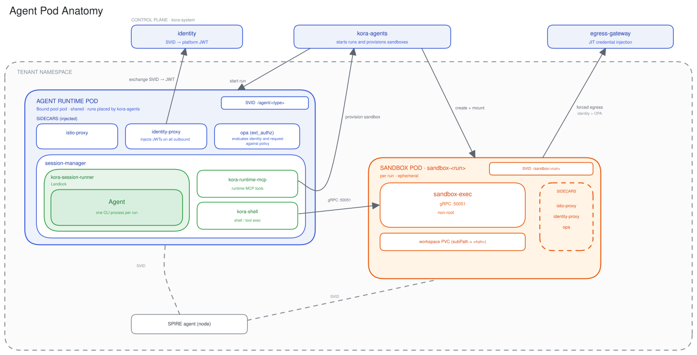

# Agent execution

In runkora, agents run as governed workloads on top of Kubernetes. Each agent process runs inside a shared runtime orchestrated by the `session-manager`. This session manager is responsible for the lifecycle of an agent's run. The session manager runs each agent process under `landlock` and provisions an isolated workspace for the agent to operate within, provisions the tools it has access to and triggers the agent startup. Every agent in the platform holds its own identity. These are known as `agent-types`. Each agent-type runs on its own session-manager pods, which `kora-agents` binds to it from a per-tenant pool.

Agents do not have access to credentials in their session or environment. An agent's access outside of its pod is governed by the control plane: tokens are injected on egress from an agent's pod for all requests and evaluated by policy before making a network hop.

See [creating an agent](../guides/create-an-agent.md) for configuring an agent-type's identity, behaviour and access.

## Control plane and tenant workloads

Agents are run as tenant workloads within kora. A central `kora-agents` service within the `kora-system` owns the lifecycle of `agent-types` and their `session-managers`. It provisions the Kubernetes workloads into the tenant namespace and is responsible for forwarding run events to the appropriate tenant from triggers and conversations and managing the scaling of resources for agents and sandboxes.

## Agent runtime pod

Each tenant keeps a pool of unbound session-manager pods, and `kora-agents` binds pool pods to an agent type as its runs need them. An agent has no StatefulSet. Runs are multiplexed onto the pods bound to the `agent-type` instead of requiring a pod per agent run. This allows kora to scale agent runs at a different rate to the [sandboxes](sandboxes.md) those agents require for heavy workloads, reducing the idle state cost of always running agent infrastructure. 

This enables agent runs that do not require a sandbox to run barebones inside their `agent-type` pod, requiring no further compute to complete their tasks. This is typical of agentic use cases that only utilise MCPs to complete their tasks and do not require code-ready environments for build and test like activities.

The `session-manager` container hosts each agent run. `kora-session-runner` wraps the agent harness and confines it with Landlock in its own workspace. The session-manager also hosts a local `kora-runtime-mcp` which provides the harness the tools required to provision sandboxes, and manage its environment. `kora-shell` is the harness's shell. It runs every command inside the run's sandbox and refuses commands until the agent provisions one. Landlock lets the harness execute only its own binaries, `kora-shell` and `kora-runtime-mcp`, so no command runs in the agent runtime pod.

| Component | Runs in | Job |
| --- | --- | --- |
| `kora-agents` | `kora-system` | Owns agent types, provisions their workloads, starts runs and provisions sandboxes |
| `session-manager` | Agent runtime pod | Hosts every run on the pod |
| `kora-session-runner` | Agent runtime pod | Wraps the agent harness and confines it to its workspace and its own binaries with Landlock |
| `kora-runtime-mcp` | Agent runtime pod | Gives the harness the tools to provision sandboxes and manage its environment |
| `kora-shell` | Agent runtime pod | Sends the harness's shell commands into the run's sandbox |
| `istio-proxy`, `identity-proxy`, `opa` | Every agent runtime pod and sandbox | Intercept outbound requests, attach the platform token and evaluate policy |

## Agent pod pool

Each tenant namespace runs one Deployment named `session-manager-pool`. Its pods are session-manager pods that serve no agent yet. The chart value `agents.pool.size` (default 2) sets how many unbound pods each tenant keeps ready. `kora-agents` renders the Deployment from the same pod template as an agent pod, so a pool pod carries the same sidecars, the same Landlock confinement and the same egress lockdown. `session-manager-pool` is a reserved agent slug.

A pool pod starts at the warm session-manager size and holds a generic ephemeral workspace volume. It carries the label `runkora.io/pool` and no agent label. The pod runs as the pool ServiceAccount and has a pool identity. See [identity](identity.md#pool-identity).

On each pass the scaler sets the Deployment's replicas to `agents.pool.size` plus the number of agents in the tenant that have a pending run and no bound pod. A bound pod leaves the pool's ReplicaSet, which creates a replacement. A run that finds no Ready pool pod stays `pending` and takes the first pool pod that turns Ready.

## Binding a pod

A bind turns a pool pod into an agent pod. `kora-agents` takes the agent lock, then patches one Ready pool pod in a single write. The patch removes `runkora.io/pool`, sets `spiffe.io/agent`, `app`, `runkora.io/agent-type` and `runkora.io/agent-config`, and hands the pod from its ReplicaSet to the tenant. The ReplicaSet creates a replacement pool pod. A bound pod serves its agent until it is deleted.

The bind then grows the pod from the warm requests to the full session-manager requests through the `pods/resize` subresource. The SPIRE agent attests the relabelled pod and issues the agent's SVID, `identity-proxy` exchanges it for the agent's platform token, and the pod's `GET /health/bound` check returns 200 once the token is held. `kora-agents` reaches the pod by its IP and sends the agent Service's host name in the `Host` header, so Envoy pins the call to the agent's identity. A run starts its session after the bound check passes.

A scale-up, a roll and the replacement of an evicted pod use the same bind. Two admission policies, `kora-agent-bind` and `kora-agents-pod-updates`, limit who may bind. Only `kora-agents` may set `spiffe.io/agent`, only once, only on a pool pod, and only to the slug in `app`. A pod cannot be created with that label.

## Scaling

The scaler in each `kora-agents` replica checks every active agent and binds or deletes its pods. It decides from the agent's pending, starting and active runs and from the memory each pod reports.

- **Placement:** A run takes the oldest Ready pod with room. A pod has room while its working set plus the starting allowance of its harness stays below `agents.scheduling.placementWatermark` (default 0.70) of its memory limit.
- **Pressure:** The session-manager kills its most recently started run when the working set passes `agents.scheduling.pressureLimit` (default 0.90) of the limit.
- **Limits:** An agent never has more pods than `agents.scheduling.maxReplicas` (default 10) or more concurrent runs than its own `maxConcurrentRuns`. The scaler removes the newest empty pod when no run needs it.
- **Floor:** A warm agent keeps at least `agents.scheduling.minReplicas` pods, and at least one. A cold agent has none.
- **Start budget:** A pending run fails after `agents.scheduling.startBudgetSecs` (default 180) when no pod is Ready or coming up for it.

A run that waits for a pod that is not Ready yet, for room on a Ready pod or for its agent's total of concurrent runs does not fail.

## Warm and cold agents

An agent is hot while a run is in progress on one of its pods. Two timers move an agent from hot to warm and from warm to cold. Both count from the end of the agent's latest run, and neither applies while the agent holds a pending, starting, active or idle run.

| Tier | Pods | Set by |
| --- | --- | --- |
| Hot | At full size | A run is in progress |
| Warm | Shrunk in place to `agents.workloads.sessionManager.warm` requests, with the limits unchanged | `agents.scheduling.warmAfterSecs` (default 300). 0 keeps every pod at full size. |
| Cold | None. The agent's pods are deleted with their workspace volumes. | `agents.scheduling.coldAfterSecs` (default 1800). 0 keeps every agent at `agents.scheduling.minReplicas`. |

A warm pod grows back to full size before its run starts. In-place resize needs the `InPlacePodVerticalScaling` feature gate, which is on by default from Kubernetes 1.33. The `kora-agent-wake-reserve` DaemonSet holds room on each session-manager node for those grows. It runs only when `agents.wakeReserve.enabled` is true, `agents.scheduling.warmAfterSecs` is above 0 and a node selector or required node affinity pins the session-manager nodes. A grow that the kubelet defers deletes the node's reserve pod once. A grow that stays deferred past 5 seconds releases the run, and the scaler replaces the pod, so the next attempt binds the next pool pod.

A cold agent keeps its configuration, identity and run history. Only its pods are gone. The agent's next run finds no pod, binds a pool pod, and publishes an `agent_waking` run event before the session starts. The files a finished run left in a pod's workspace are gone with the pod.

`kora.agents.wake.bound.duration` measures a wake from the bind to the first successful bound check. `kora.agents.wake.first_model_event.duration` measures it from the start of the wake to the run's first model event.

## Rolling a template change

A change to the pool pod template, or to an agent's framework or model, leaves bound pods on an old template. The scaler rolls them one agent at a time and does not use a StatefulSet partition. It binds pods on the new template until they equal the old pods in number. It then deletes the old pods one at a time, an empty pod first, as new pods pass the bound check. At `agents.scheduling.maxReplicas` the scaler binds one pod past the ceiling and deletes an old pod once that pod serves the agent. An old pod drains for up to `agents.scheduling.drainGracePeriodSecs` (default 3600) so its runs finish.

## Eviction protection

No PodDisruptionBudget exists per agent. The operator reconciles two budgets in each tenant namespace, both with `maxUnavailable: 0`. `agent-busy` selects bound pods labelled `runkora.io/busy: "true"`, and `sandbox-busy` selects sandbox pods. `kora-agents` sets the label in the write that places a run on a pod. The scaler removes it when the pod holds no pending, starting, active, idle or completing run. Pool pods never carry it. A node drain or the cluster autoscaler can therefore evict an idle agent pod, and the agent's next run binds a pool pod. A drain of a node that holds busy pods waits until their runs end.

## ACP runner profiles

The session-manager drives every agent harness through the Agent Client Protocol (ACP). One runner, `acpRunner`, owns the harness process, the ACP session and the translation to kora's run events. A profile holds what differs for each harness: the command, the per-run configuration files, the session parameters and how a failed turn is classified. The supported harnesses are listed in `backend/internal/platform/harnesses`.

| Profile | Harness | ACP adapter | Session mode |
| --- | --- | --- | --- |
| `claude-code` | Claude Code | `claude-agent-acp`, running the pinned `claude` binary | `bypassPermissions` |
| `codex` | Codex | `codex-acp`, wrapping the pinned `codex` binary | `agent-full-access` |
| `opencode` | OpenCode | `opencode acp`, which speaks ACP itself | None. The model is pinned in the run's configuration. |

All three profiles route model calls through the inference gateway, declare the runtime MCP server that provisions sandboxes and one governed MCP endpoint for each MCP server the agent holds grants on. Each profile blocks workspace configuration from adding MCP servers: Claude Code runs with `strictMcpConfig`, Codex reads a `config.toml` that kora rewrites before every start, and OpenCode runs with `OPENCODE_DISABLE_PROJECT_CONFIG=1`. The runner answers every permission request from the harness with the allow option, because the sandbox, Landlock and policy enforce access and the harness prompts do not. A turn that ends on a budget denial ends the run as `budget_exhausted` for each profile.

The profiles differ in what they surface. Codex subagent calls nest under the call that started them, and so do Claude Code subagent calls. OpenCode subagent calls are not surfaced. The Claude Code profile removes the built-in tools that would reach the network outside the sandbox: `WebSearch`, `WebFetch`, `AskUserQuestion`, `PushNotification` and `DesignSync`.

## Per-run sandbox

When an agent's task requires compute or tooling, it can provision a [sandbox](sandboxes.md) for its run. Each run can request its own isolated sandbox. The sandbox is ephemeral, and is torn down when the agent run ends, or is no longer using the idle sandbox. This allows us to provision larger compute nodes to give agents resource appropriate environments to complete their tasks effectively.

## Outbound path

The kora-operator injects the Istio `istio-proxy`, the kora `identity-proxy` and an OPA `ext_authz` sidecar which govern all egress and the chain stamps a [platform credential](../concepts/platform-tokens.md) on all requests.

No credentials are brokered or stored in an agent's environment, session or sandbox. Every outbound request leaves the pod through its sidecar chain:

1. The agent makes a bare request with no credential.
2. `istio-proxy` intercepts the request and passes it to `identity-proxy`.
3. `identity-proxy` attaches the agent's platform token.
4. The `opa` `ext_authz` sidecar evaluates the token and the request against policy, and denies it in the pod or forwards it.

Every request is evaluated in the pod before it makes a network hop to the rest of the platform.

`identity-proxy` obtains that token by exchanging the pod's SPIFFE SVID for a kora platform JWT with the `identity` service. It caches this token for the lifetime of its SPIFFE identity and automatically refreshes. The node's SPIRE agent delivers the SVID to the sidecars through the SPIFFE CSI socket. Agents that run without a sandbox can only connect to platform services, all other egress is denied.

For any external system, the agent must provision a sandbox. The sandbox's egress is forced through Envoy to the `egress-gateway`, which runs the same identity and policy checks and then mints and injects a just-in-time credential for the destination service.

See [connectivity](connectivity.md) for a detailed walkthrough of the outbound path.

## Related decisions

- [Run and session lifecycle](../adr/2026-05-11-run-and-session-lifecycle.md)
- [Agent execution infrastructure](../adr/2026-05-11-agent-execution-infrastructure.md)
- [Per-session home isolation](../adr/2026-06-04-per-session-home-isolation.md)
- [Sandbox provisioning and shell proxy](../adr/2026-05-11-sandbox-provisioning-and-shell-proxy.md)
- [Envoy ext_proc sidecar token injection](../adr/2026-03-21-envoy-ext-proc-sidecar-token-injection.md)
- [SPIFFE and SPIRE workload attestation](../adr/2026-03-05-spiffe-spire-workload-attestation.md)
- [Demand-driven agent scaling](../adr/2026-11-09-demand-driven-agent-scaling.md)
- [Agent cold tier](../adr/2026-11-22-agent-cold-tier.md)
- [ACP as the single agent harness protocol](../adr/2026-11-07-acp-agent-harness-protocol.md)
- [JIT credential brokering in the egress gateway](../adr/2026-06-06-jit-credential-brokering-egress-gateway.md)

## See also

- [Runs and sessions](../concepts/runs-and-sessions.md)
- [Identity](identity.md)
- [Monitor runkora](../guides/monitor-kora.md)
- [Prepare your cluster](../guides/prepare-your-cluster.md)
