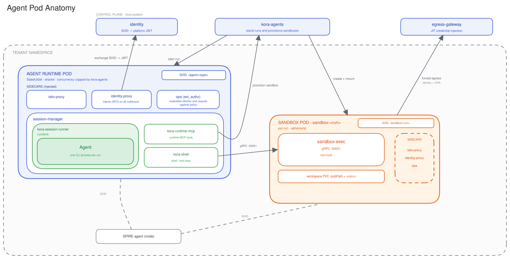

# Agent execution

Orbit runs each agent as a governed workload in Kubernetes. The agent process lives in a shared runtime pod, every run gets its own isolated sandbox, and the identity and egress paths around it are brokered so the agent never touches a credential. For the whole system, see the root [ARCHITECTURE.md](../../ARCHITECTURE.md).

## Control plane and tenant workloads

Agent execution is split between the control plane and tenant workloads.

- **Control plane (`orbit-system`).** `orbit-agents` owns run and session lifecycle and provisions the Kubernetes workloads. `identity` issues platform tokens. The `egress-gateway` brokers external credentials.
- **Tenant workloads (a per-tenant namespace).** The agent workload runs here. It reaches the control-plane services from the namespace and never holds credentials itself.

ADRs: [run-and-session-lifecycle](../adr/2026-05-11-run-and-session-lifecycle.md), [agent-execution-infrastructure](../adr/2026-05-11-agent-execution-infrastructure.md).

## Agent runtime pod

Each agent type gets one long-lived StatefulSet pod. Runs are multiplexed onto it. `orbit-agents` sets the per-pod concurrency limit. A pod is not created per run.

The `session-manager` container hosts each run. `orbit-session-runner` wraps the agent CLI process and confines it with Landlock: its own workspace, no per-process `/proc` entries, and, on kernels that support it, no signals to other runs. Alongside it, `orbit-runtime-mcp` provides the runtime MCP tools and `orbit-shell` is the shell and tool-exec shim.

The operator injects the Istio `istio-proxy`, the Orbit `identity-proxy`, and an OPA `ext_authz` sidecar.

ADR: [per-session-home-isolation](../adr/2026-06-04-per-session-home-isolation.md).

## Per-run sandbox

Shell and tool commands do not execute in the agent pod. Each run gets its own sandbox pod.

`orbit-runtime-mcp` calls the `orbit-agents` API to provision the sandbox. `orbit-agents` creates the pod and mounts the run's workspace, a `subPath` of the agent PVC. `orbit-shell` forwards each command to `sandbox-exec` over gRPC on `:50051`.

The sandbox container drops all capabilities, runs as non-root, and relies on the pod boundary for isolation. `orbit-agents` reaps each sandbox when its run finishes, and sweeps idle ones over time.

ADR: [sandbox-provisioning-and-shell-proxy](../adr/2026-05-11-sandbox-provisioning-and-shell-proxy.md).

## Outbound path

The agent never handles credentials, and it cannot reach anything unchecked. Every outbound request leaves a pod through its sidecar chain. `istio-proxy` intercepts it, `identity-proxy` injects the platform token, and the `opa` `ext_authz` sidecar authorizes it against policy before it goes anywhere.

`identity-proxy` obtains that token by exchanging the pod's SPIFFE SVID for an Orbit platform JWT at the `identity` service, caching it and reusing it across requests. The node's SPIRE agent delivers the SVID to the sidecars through the SPIFFE CSI socket.

Calls to platform services follow that chain directly over the mesh. For external systems, the sandbox's egress is forced through Envoy to the `egress-gateway`, which runs the same identity and policy checks and then injects a just-in-time credential for the destination service.

ADRs: [envoy-ext-proc-sidecar-token-injection](../adr/2026-03-21-envoy-ext-proc-sidecar-token-injection.md), [spiffe-spire-workload-attestation](../adr/2026-03-05-spiffe-spire-workload-attestation.md), [jit-credential-brokering-egress-gateway](../adr/2026-06-06-jit-credential-brokering-egress-gateway.md).

## See also

- [Code organization](../code-organization.md)
