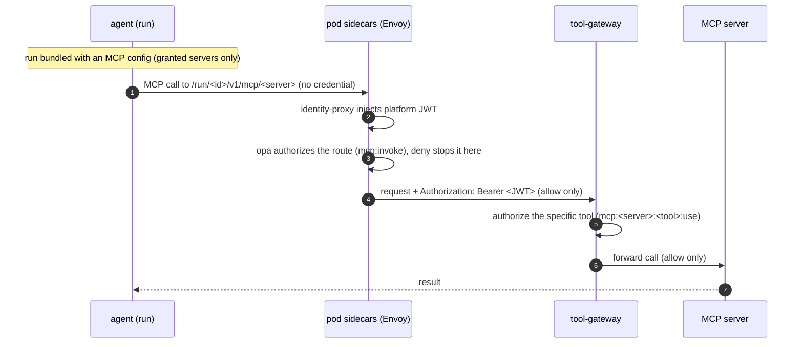
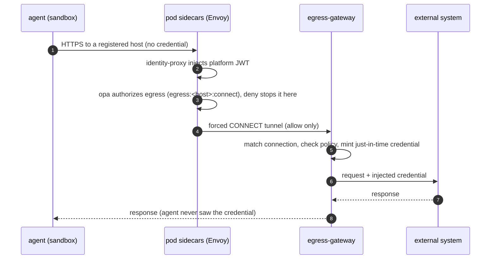

# Connectivity

Agents in the kora platform reach the outside world through MCP tools and through connectors. Each governs the egress from an agent in a different way and gives the agent a different mechanism to interact.

## MCP tools

Each run is dynamically bundled with an MCP config at startup that lists only the servers the agent has been granted. The agent uses them through its normal MCP client. `identity-proxy` stamps the platform JWT on every outbound MCP call. The pod's `opa` sidecar authorizes the call at the route level, and the `tool-gateway` then authorizes the specific tool for that identity before it reaches the server.

For the tool-gateway components, per-tool authorization, catalog, and scope registration, see [MCP tool gateway](mcp-tool-gateway.md).

## Connectors

Connectors run as adapters inside the `egress-gateway`. Envoy forces every sandbox egress through it. The pod's `opa` sidecar authorizes the destination (`egress:<host>:connect`) and `identity-proxy` stamps the platform JWT before the tunnel opens. The `egress-gateway` matches the destination to a connection, checks that this identity may use it, then mints and injects a scoped, just-in-time credential. The upstream system remains the authority on what the credential can do.

For the egress-gateway components, connection matching, and just-in-time credential brokering, see [Egress gateway](egress-gateway.md).

ADRs: [scope-gated-tool-exposure-via-mcp](../adr/2026-03-05-scope-gated-tool-exposure-via-mcp.md), [mcp-tool-gateway](../adr/2026-06-29-mcp-tool-gateway.md), [jit-credential-brokering-egress-gateway](../adr/2026-06-06-jit-credential-brokering-egress-gateway.md), [connection-scope-qualifiers](../adr/2026-07-22-connection-scope-qualifiers.md), [envoy-ext-proc-sidecar-token-injection](../adr/2026-03-21-envoy-ext-proc-sidecar-token-injection.md).
