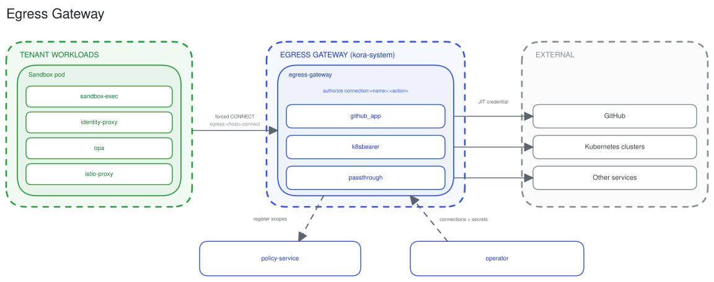

# Egress gateway

The egress-gateway brokers a sandbox's outbound calls to external systems and injects a just-in-time credential for the destination. The agent never handles the credential.

## Two-layer authorization

An outbound call is authorized twice. The sandbox's `opa` sidecar authorizes the destination at `egress:<host>:connect` before the call leaves the pod, and Envoy forces it through the gateway as a CONNECT tunnel. The egress-gateway then authorizes `connection:<name>:<action>` against the matched tenant connection before opening it.

## Credential brokering

Once authorized, the gateway mints a scoped, short-lived credential for the destination and injects it on the outbound leg: a GitHub App installation token, a Kubernetes bearer token, or none for a passthrough connection. It strips the platform token first. The agent never sees the injected credential, and the upstream system stays the authority on what it permits. A host with no matching connection falls through to passthrough. Reachability was already gated at `egress:<host>:connect`.

## Connections

An external system is a tenant-namespaced `Connection` custom resource naming an adapter, a host, and a secret. The operator aggregates every connection and its secret across tenants into a ConfigMap and Secret the gateway mounts and hot-reloads. Adapters are the credential mechanisms: `github_app`, `k8sbearer`, and `passthrough`. There is no database. Connections are GitOps resources.

## ADRs

[jit-credential-brokering-egress-gateway](../adr/2026-06-06-jit-credential-brokering-egress-gateway.md), [connection-scope-qualifiers](../adr/2026-07-22-connection-scope-qualifiers.md), [credential-aware-outbound-gateway](../adr/2026-03-05-credential-aware-outbound-gateway.md), [envoy-ext-proc-sidecar-token-injection](../adr/2026-03-21-envoy-ext-proc-sidecar-token-injection.md).

## See also

- [Connectivity](connectivity.md) for the connector call sequence.
