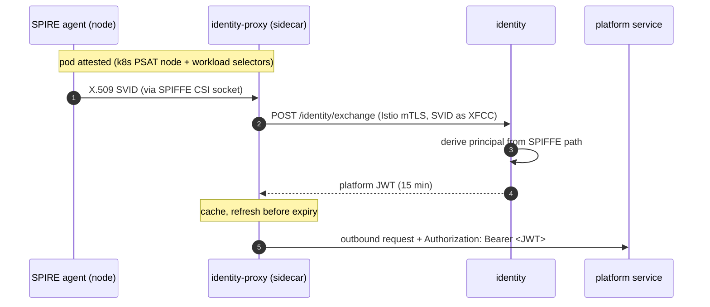

# Identity

Every principal in Orbit has one verifiable identity. Humans authenticate through
their tenant's OIDC provider. An agent workload is attested by SPIRE and exchanges
its SPIFFE SVID for an Orbit platform token, proving who it is without ever holding
a long-lived secret.

Humans and agents share one principal model, so a person can delegate to an agent
with a defined scope and full accountability. The agent can never access more than
the delegator.

ADRs: [unified-identity-model](../adr/2026-03-05-unified-identity-model.md),
[spiffe-spire-workload-attestation](../adr/2026-03-05-spiffe-spire-workload-attestation.md),
[envoy-ext-proc-sidecar-token-injection](../adr/2026-03-21-envoy-ext-proc-sidecar-token-injection.md).
