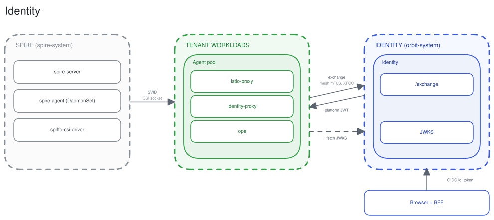
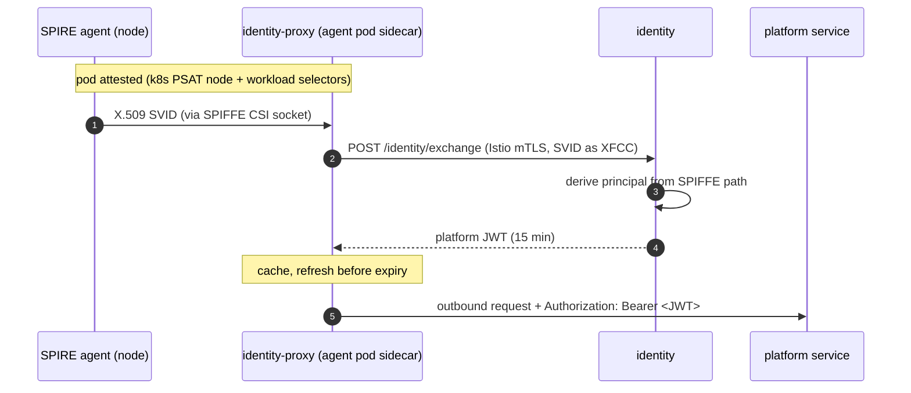

# Identity

Every principal in runkora has one verifiable identity. Humans authenticate through their tenant's OIDC provider. An agent workload is attested by SPIRE and exchanges its SPIFFE SVID for a kora platform token, proving who it is without ever holding a long-lived secret.

Platform services in `kora-system` make the same exchange in-process through the identity client and carry no identity-proxy. They attach the token only to the platform calls that need it.

People and agents share one principal model. A person can [delegate](../concepts/platform-tokens.md#delegation) to an agent, and a delegated request is allowed only when both the agent's grants and the person's live access cover it.

## Pool identity

Each tenant keeps unbound session-manager pods in a pool. A pool pod has a pool SPIFFE ID, `spiffe://<trust-domain>/tenant/<namespace>/pool/<pod>`, issued by the `kora-tenant-pool` `ClusterSPIFFEID` to a pod that carries the label `runkora.io/pool` and no `spiffe.io/agent` label. The ID names a pod and not an agent, so each pool pod is a separate workload in logs and audit.

A pool ID is not a principal. `PrincipalFromSpiffeID` refuses it, and `identity` issues no platform token for it. The `policy-service` accepts it for one purpose: a pool pod downloads its own tenant's policy bundle, so `opa` has the bundle when the pod is bound. In its pool phase `identity-proxy` reports itself ready, holds no token and makes no exchange.

The bind labels the pod with `spiffe.io/agent`, and the `kora-tenant-agent` entry then issues the pod the agent's ID, `spiffe://<trust-domain>/tenant/<namespace>/agent/<slug>`. `identity-proxy` exchanges the new SVID for the agent's platform token, retrying every 200 ms for up to 10 seconds before it falls back to its normal backoff, and `GET /health/bound` returns 200 once it holds the token. The operator adds a `DestinationRule` for `kora-identity` in each tenant namespace that opens a new connection for every exchange, so the first exchange cannot reuse a connection pinned to the pool certificate. A pod whose SVID later changes to another agent's ID drops its token and restarts `identity-proxy`.

Two admission policies guard the label. `kora-agent-bind` lets only `kora-agents` set `spiffe.io/agent`, only once, only on a pool pod, and only to the slug in `app`, and it refuses a pod created with the label. `kora-agents-pod-updates` limits what `kora-agents` may change on a pod. See [agent execution](agent-execution.md#binding-a-pod).

ADRs: [unified-identity-model](../adr/2026-03-05-unified-identity-model.md), [spiffe-spire-workload-attestation](../adr/2026-03-05-spiffe-spire-workload-attestation.md), [envoy-ext-proc-sidecar-token-injection](../adr/2026-03-21-envoy-ext-proc-sidecar-token-injection.md), [agent-cold-tier](../adr/2026-11-22-agent-cold-tier.md).
