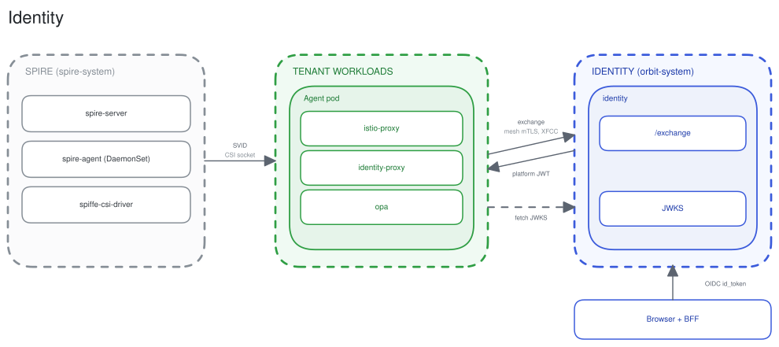
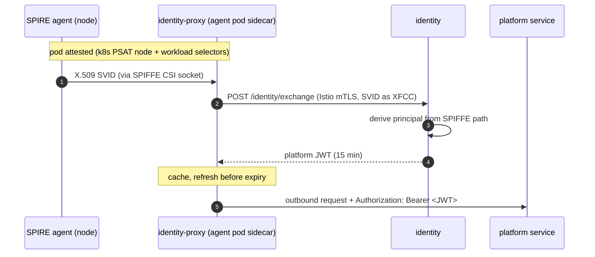

# Identity

Every principal in runkora has one verifiable identity. Humans authenticate through their tenant's OIDC provider. An agent workload is attested by SPIRE and exchanges its SPIFFE SVID for a kora platform token, proving who it is without ever holding a long-lived secret.

Platform services in `kora-system` make the same exchange in-process through the identity client and carry no identity-proxy. They attach the token only to the platform calls that need it.

People and agents share one principal model. A person can [delegate](../concepts/platform-tokens.md#delegation) to an agent, and a delegated request is allowed only when both the agent's grants and the person's live access cover it.

ADRs: [unified-identity-model](../adr/2026-03-05-unified-identity-model.md), [spiffe-spire-workload-attestation](../adr/2026-03-05-spiffe-spire-workload-attestation.md), [envoy-ext-proc-sidecar-token-injection](../adr/2026-03-21-envoy-ext-proc-sidecar-token-injection.md).
