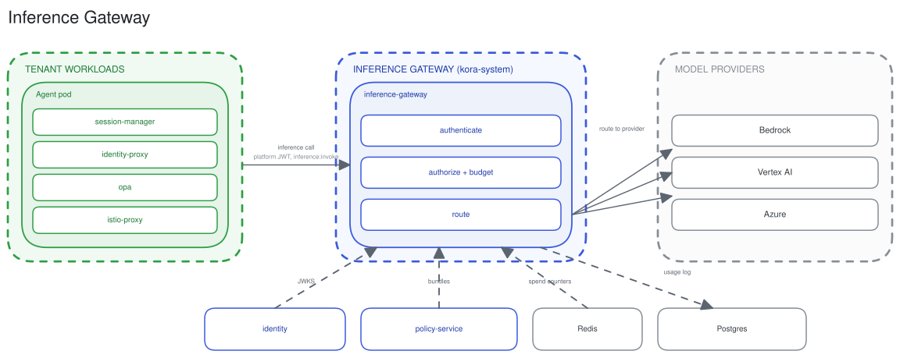

# Inference gateway

The inference-gateway is kora's LLM broker. Agents and API clients call one OpenAI/Anthropic-compatible endpoint, and the gateway authenticates, authorizes, budgets, and routes each request to a model provider.

## Request pipeline

Every request runs the same in-process chain, with no OPA sidecar:

- **Authenticate.** The platform JWT is verified against the identity JWKS. PATs and the Anthropic `x-api-key` are normalized to the same bearer.
- **Authorize + budget.** The polled OPA bundle gates the endpoint at `inference:invoke` and the specific model at `inference:<family>:<model>:use`. Hierarchical budgets (tenant, principal, role, run) are checked against Redis spend counters.
- **Route.** The virtual model (`family/name`) resolves to an ordered set of provider targets by strategy (priority, weighted, or lowest-cost), with failover across targets.

## Providers

The gateway holds each provider's credentials and speaks its native wire format: Bedrock, Vertex AI, Azure, and any endpoint that speaks the OpenAI or Anthropic APIs, such as OpenRouter. A platform admin registers each provider with an `InferenceProvider` resource in the system namespace. The gateway watches the resources and the Secrets they name, and applies a change without a restart. [Model providers](../guides/register-inference-provider.md) has an example per type.

## Usage and cost

Each call writes an `inference_usage` row to Postgres (tokens, estimated cost, latency, and full principal attribution) and increments the Redis spend counters that back budgets.

The Agents page reads agent-only rollups over 24-hour, 7-day, 30-day and 90-day windows: usage per agent, spend by model, spend over time, the previous window's total, and each agent's budget windows. The reads cover every agent in the tenant under `agents:usage:read`, delegated agents included. A caller with only `agents:usage:{slug}:read` scopes sees those agents. Spend of deleted agents counts. The agent overview's per-agent read returns the same rollups for one agent and requires `agents:usage:{slug}:read` or `agents:usage:read`.

## ADRs

[inference-gateway-architecture](../adr/2026-04-01-inference-gateway-architecture.md), [provider-model-catalog-and-alias-routing](../adr/2026-04-01-provider-model-catalog-and-alias-routing.md), [virtual-model-catalog-and-platform-routing](../adr/2026-04-17-virtual-model-catalog-and-platform-routing.md), [budget-model-redesign](../adr/2026-06-10-budget-model-redesign.md), [inference-usage-logs](../adr/2026-04-17-inference-usage-logs.md), [crd-inference-providers](../adr/2026-10-01-crd-inference-providers.md).

## See also

- [Policy plane](policy-plane.md) for how scopes and budgets are compiled and enforced.
