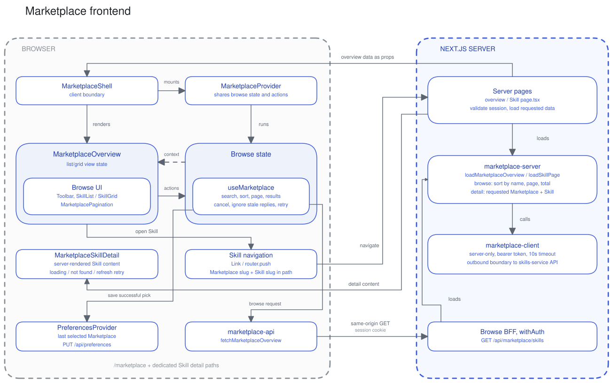

# Marketplace frontend

The Marketplace frontend lets dashboard users browse Skills and open their instructions and resources at `/marketplace`. Interactive browse controls and state run in the browser. The initial page load, authenticated API routes, data shaping, and calls to skills-service run in the Next.js server.

## Components and state

`MarketplaceShell` receives the initial data and error as props. It mounts `MarketplaceProvider` around `MarketplaceOverview`. The provider runs `useMarketplace`, which owns the Marketplace selection, search, sort, page, results, request status, and browse retry.

`MarketplaceOverview` keeps the list/grid choice in local state and renders the toolbar, `MarketplaceSkillList` or `MarketplaceSkillGrid`, and `MarketplacePagination`. List rows and cards navigate to the dedicated Skill route, following the Agents list/detail pattern.

The Skill route is a Server Component. It loads the requested Marketplace display name and Skill, then renders `MarketplaceSkillDetail`. Its components, stories, tests, loading skeleton, and refresh retry live under `marketplace/[marketplaceSlug]/[skillSlug]/`. A missing Skill and a failed load have separate states.

The detail loading skeleton is defined directly in the route's `loading.tsx`. The dashboard layout's `PageGutter` supplies outer spacing for the overview and detail pages.

Browse components read context and call actions. Result rows use `router.push` and cards use native links to the detail route. The hook calls `marketplace-api`, which sends requests to the frontend's own API route. It aborts an older browser request, ignores superseded responses, and keeps previous results visible while loading.

## Server pages and browser requests

The overview page, detail page, and authenticated browse API use `marketplace-server`:

- `page.tsx` is a React Server Component. It validates the session, loads the default result page with the saved Marketplace, and passes the data or error to `MarketplaceShell`.
- `[marketplaceSlug]/[skillSlug]/page.tsx` validates the session, reads the Marketplace and Skill identifiers from the path, and calls `loadSkillPage`.
- `GET /api/marketplace/skills` parses browse values and calls `loadMarketplaceOverview`. It uses `withAuth`, which rejects invalid sessions.

Skill details load through the server page. `loadSkillPage` uses a private `loadSkillDetail` helper; the unused detail BFF and its URL builder have been removed.

The server entry points read the platform JWT from the sealed session cookie and pass it to the loader. The loader returns success or failure as a result value. The overview supplies an initial error to its shell; the detail page renders its missing or retry view. The browse API translates failures to HTTP responses.

`marketplace-server` sorts Skills by name, cuts the page, and counts the total. It reads the saved Marketplace from user preferences when no Marketplace was requested. `marketplace-client` is the only frontend module that calls skills-service. It is server-only and sends the platform JWT as a bearer token with a 10-second timeout.

The skills-service list response contains at most 200 Skills and may include `nextCursor`. The server-only client follows every cursor with the same Marketplace, search, and bearer token before the loader sorts, counts, and slices the results. The browser receives only the requested display page. The complete Skills load shares one ten-second deadline and the caller's cancellation; a failed batch or repeated cursor rejects the load rather than returning an incomplete catalogue. Server memory and network work grow with the matching result set.

## Address and preferences

The overview address stays at `/marketplace`; browse values remain in client state. Opening a Skill navigates to `/marketplace/{marketplaceSlug}/{skillSlug}`, with both identifiers encoded as individual path segments and no browse query parameters. Refreshing the detail page reloads that Skill. Its Skills link returns to `/marketplace`. This route restoration adds no persistence or browse-state restoration mechanism.

After an explicit Marketplace selection loads successfully, `MarketplaceProvider` updates the shared `PreferencesProvider`. The preferences provider saves through `PUT /api/preferences` after a 500 ms debounce. A failed initial preferences read prevents saving defaults over the stored preferences.

## File map

Paths below are relative to `frontend/src/`:

| Responsibility                            | Location                                                                    |
| ----------------------------------------- | --------------------------------------------------------------------------- |
| Server page and initial load              | `app/(dashboard)/marketplace/page.tsx`                                      |
| Shell, overview, and result views         | `app/(dashboard)/marketplace/_components/`                                  |
| Skill page, loading, detail UI, and retry | `app/(dashboard)/marketplace/[marketplaceSlug]/[skillSlug]/`                |
| Context provider                          | `app/(dashboard)/marketplace/_context/marketplace-context.tsx`              |
| Browse state                              | `app/(dashboard)/marketplace/_hooks/`                                       |
| Browser requests                          | `app/(dashboard)/marketplace/_services/marketplace-api.ts`                  |
| Shared server loader                      | `app/(dashboard)/marketplace/_services/marketplace-server.ts`               |
| Authenticated browse API                  | `app/api/marketplace/skills/route.ts`                                       |
| Outbound skills-service client            | `server/marketplace-client.ts`                                              |
| Shared preferences                        | `app/(dashboard)/_preferences/`                                             |

## ADRs

[agent-marketplace-frontend-architecture](../adr/2026-08-17-agent-marketplace-frontend-architecture.md), [marketplace-adr-backend](../adr/2026-08-28-marketplace-adr-backend.md).

## See also

- [Identity](identity.md) for the platform JWT and session boundary.
- [Agent Marketplace backend ADR](../adr/2026-08-28-marketplace-adr-backend.md) for the API beyond the frontend boundary.
