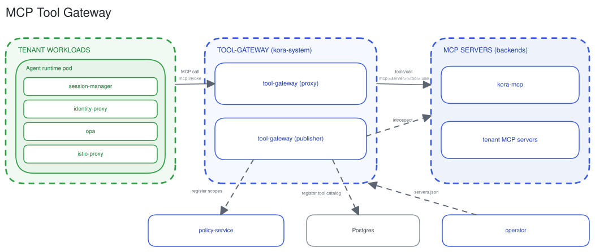

# MCP tool gateway

The tool-gateway authorizes each MCP tool call against a per-tool scope, then proxies it to a platform-hosted MCP server. The agent holds no credential and can invoke only the tools it is granted.

## Two-layer authorization

An MCP call is authorized twice. The pod's `opa` sidecar authorizes the route at the coarse scope `mcp:invoke`, and a deny stops the call in the pod. The tool-gateway then authorizes the specific tool at `mcp:<server>:<tool>:use` before forwarding. Default-deny is structural: a tool outside the caller's grants is absent from `tools/list` and denied on call.

The proxy evaluates policy locally against OPA bundles polled from policy-service. Authorization makes no per-call hop.

## Two modes

The tool-gateway is one image in two modes.

- **Proxy.** The per-tool PEP and MCP proxy. It authorizes each `tools/call`, serves a filtered `tools/list`, and forwards allowed calls to the backing server.
- **Publisher.** The build-time role. It introspects each backend (`initialize` plus `tools/list`), upserts the discovered tools to the `mcp_tools` catalog in Postgres, and registers the route and tool scopes with policy-service.

## Backends

Backends are MCP servers declared as `MCPServer` custom resources. The operator aggregates every `MCPServer` across namespaces into the `servers.json` registry the gateway mounts and hot-reloads. `orbit-mcp` is the platform MCP server, registered globally, providing agent access to manage and set up the orbit platform. Each tenant MCP server is declared in the tenant's namespace, and the tool-gateway governs any custom or open source MCP with the same authorisation and scope registration. The proxy reaches each backend over streamable-http on the spire-mTLS mesh. The caller identity (platform JWT of the user) is forwarded to a backend only when that server opts in for `callerIdentity: forward` and is registered globally; these servers can act-on-behalf of the user by impersonation.

## ADRs

[mcp-tool-gateway](../adr/2026-06-29-mcp-tool-gateway.md), [scope-gated-tool-exposure-via-mcp](../adr/2026-03-05-scope-gated-tool-exposure-via-mcp.md).

## See also

- [Connectivity](connectivity.md) for the MCP call sequence.
