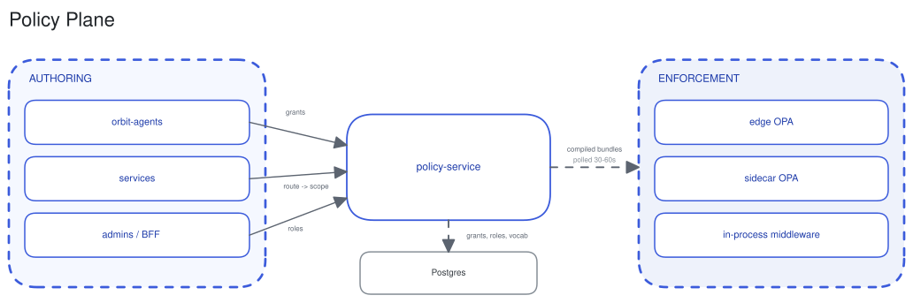

# Policy plane

kora authorizes every action against policy before it runs. policy-service compiles the policy into OPA bundles, and the enforcement points evaluate them locally.

## Authoring and compilation

policy-service owns policy authoring and compilation. It stores grants, roles, and scope vocabulary in Postgres, and holds the route-to-scope table in memory, which services register at startup. It compiles these into per-tenant OPA bundles and one gateway bundle.

A grant attaches scopes to a principal, a role maps an OIDC role to scopes, and a route declares the scope it requires. Scopes take the form `resource:path:action`. orbit-agents provisions an agent's grants when its agent type is created.

## Distribution

Enforcement points pull bundles from policy-service on a 30 to 60 second poll. Nothing is pushed. A policy change takes effect within one poll interval.

## Enforcement

Every enforcement point evaluates the same compiled bundles, default-deny and fail-closed:

- edge OPA at the Istio ingress gateway, for north-south requests.
- a sidecar OPA in each tenant pod, for east-west calls leaving the pod.
- in-process middleware in control-plane services for dynamic evaluation at runtime.

## ADRs

[policy-gateway-and-authorisation-model](../adr/2026-04-14-policy-gateway-and-authorisation-model.md), [dynamic-route-scope-registration](../adr/2026-04-14-dynamic-route-scope-registration.md), [universal-gateway-policy-enforcement](../adr/2026-03-05-universal-gateway-policy-enforcement.md), [platform-scope-enforcement-middleware](../adr/2026-06-04-platform-scope-enforcement-middleware.md), [gateway-level-opa-enforcement-for-external-traffic](../adr/2026-04-27-gateway-level-opa-enforcement-for-external-traffic.md).

## See also

- [Policy](policy.md) for the authorization sequence.
