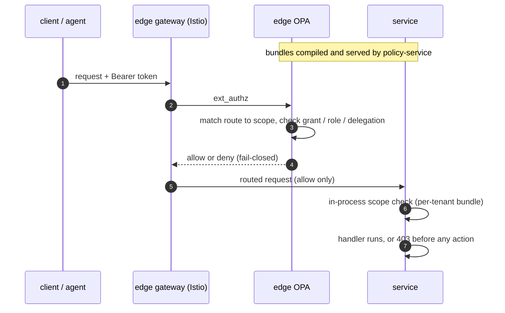

# Policy

Orbit checks every action against policy before it runs. `policy-service` compiles per-tenant OPA bundles from grants, roles, and a route-scope vocabulary. The edge OPA on the ingress gateway and the in-process middleware in each service both evaluate those bundles.

A denial returns before the handler executes. Nothing outside a principal's granted scope reaches the business logic.

For the components that author, compile, and distribute policy, see [Policy plane](policy-plane.md).

ADRs: [policy-gateway-and-authorisation-model](../adr/2026-04-14-policy-gateway-and-authorisation-model.md), [gateway-level-opa-enforcement-for-external-traffic](../adr/2026-04-27-gateway-level-opa-enforcement-for-external-traffic.md), [platform-scope-enforcement-middleware](../adr/2026-06-04-platform-scope-enforcement-middleware.md), [dynamic-route-scope-registration](../adr/2026-04-14-dynamic-route-scope-registration.md).
