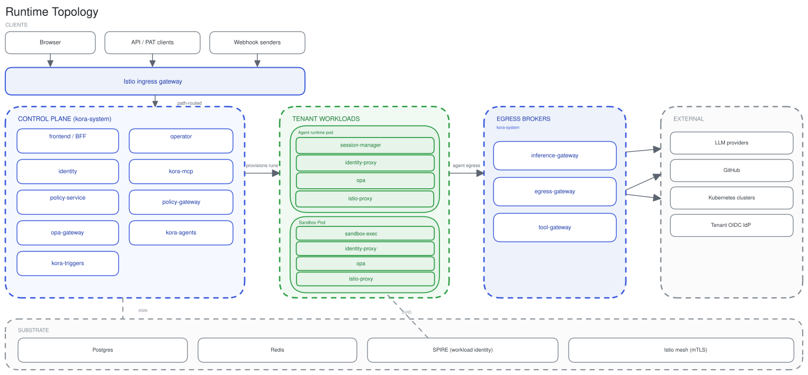

# Runtime topology

Orbit runs as a set of control-plane services in `orbit-system` and per-tenant workloads in tenant-isolated namespaces, on a shared substrate of Postgres, Redis, SPIRE, and an Istio mesh.

## Traffic and enforcement

Edge OPA at the Istio ingress gateway authorizes north-south requests. In tenant pods, a sidecar OPA authorizes outbound calls. Control-plane services enforce the same scopes in-process. See [policy](policy.md) for the enforcement model.

## Control plane and tenant workloads

- **Control plane (`orbit-system`).** The governing services own identity, policy, agent run lifecycle, and triggers. The operator reconciles the tenant and platform CRDs.
- **Tenant workloads.** The agent runtime pod and its per-run sandbox run in a tenant namespace. These workloads hold no credentials and reach the control plane over the mesh. See [agent execution](agent-execution.md) for pod internals.

## Egress brokers

The inference-gateway, egress-gateway, and tool-gateway broker the agent's outbound access, one class each: model inference, external connectors, and MCP tools. The agent sends no credential of its own. The broker injects one just in time. See [connectivity](connectivity.md).

## Substrate

Postgres holds durable state, Redis backs queues and caching, SPIRE issues the workload identity behind mesh mTLS, and the Istio mesh carries service-to-service traffic.

## See also

- [Identity](identity.md), [Policy](policy.md), [Connectivity](connectivity.md)
- [Agent execution](agent-execution.md)
