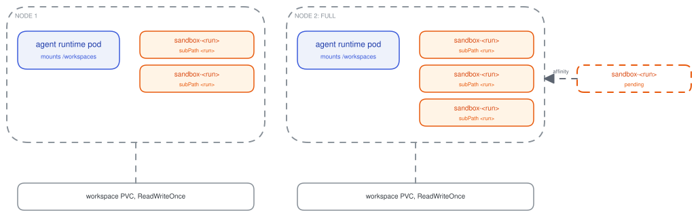
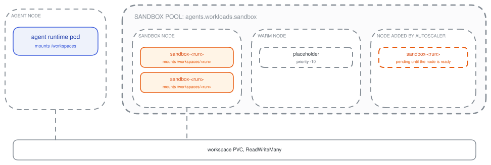
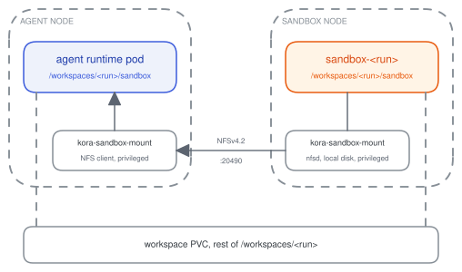

# Sandboxes

In kora, a sandbox is an isolated pod that an agent provisions for its run when its task needs compute or tooling, such as building and testing code. `kora-agents` creates the sandbox in the tenant namespace when the agent calls `provision_sandbox`, and deletes it when the run ends. See [sandboxes](../concepts/sandboxes.md) for environments, sandbox images and the tools an agent uses to manage its sandbox.

The sandbox and the agent runtime pod mount the same run workspace. `kora-shell` runs every shell command the agent issues inside the sandbox, while the agent harness stays in the agent runtime pod.

## Sandbox pod

Each sandbox is a single pod named `sandbox-<run>` with one `sandbox-exec` container from the environment's image. The kora-operator injects the same sidecars as the agent runtime pod. SPIRE issues the sandbox its own SVID for the run. Sandbox egress passes the same identity and policy checks as the agent runtime pod's egress. See [agent execution](agent-execution.md) for the full pod anatomy.

A sandbox runs the agent's own code. Each sandbox pod runs as a non-root user under the restricted Pod Security level, with a read-only root filesystem, no Linux capabilities and no Kubernetes service account token. CPU and memory come from the environment's size. The environment's disk size sets a local volume on the node for the sandbox's home directory, `/tmp`, build caches and installed tools.

## Running commands

Commands reach the sandbox over gRPC. `kora-agents` mints a token for each run when it provisions the sandbox. The session-manager writes the sandbox's address and the token into the run's workspace. Landlock keeps every other run on the pod out of that workspace. `kora-shell` checks for the address on every command. Once a sandbox exists, `kora-shell` streams each command to `sandbox-exec` on port 50051 with the run's token. `sandbox-exec` rejects any call without the token. Another run on the same agent that finds the address cannot execute commands in the sandbox.

ADRs: [sandbox-provisioning-and-shell-proxy](../adr/2026-05-11-sandbox-provisioning-and-shell-proxy.md), [sandbox-exec-trust-boundary](../adr/2026-09-18-sandbox-exec-trust-boundary.md).

## Placement

A sandbox shares its workspace volume with its agent runtime pod. kora has two placement modes that decide whether sandboxes scale with your agent runtime pods or independently of them.

Co-located schedules each sandbox onto the node of its agent runtime pod. Separate pool runs sandboxes on their own node pool. Either mode can add the sandbox mount for faster builds on local disk.

| Mode | Setting | Where the sandbox runs |
| --- | --- | --- |
| Co-located | `agents.workspace.accessModes: [ReadWriteOnce]` (default) | On the same node as its agent runtime pod |
| Separate pool | `ReadWriteMany` workspace and `agents.workloads.sandbox` placement | On its own node pool |
| Sandbox mount | `sandboxMount.enabled: true` | Either of the above, with its working folder on local disk |

### Co-located

Co-located is the default mode. It fits clusters without shared storage, and agents with small sandboxes that can share a node with their agent runtime pod. It runs on the `ReadWriteOnce` block storage every managed cluster provides, with fast file access and no extra setup. kora also supports fast network storage in separate pool mode, but it takes more work to set up and is not available on every cluster.

`kora-agents` pins each sandbox to the node of its agent runtime pod with a required pod affinity. A sandbox for a full node stays pending until capacity frees on that node. New nodes from a cluster autoscaler cannot run it. When the provisioning budget runs out, the run records `sandbox_lost` with the scheduler's reason.

### Separate pool

Separate pool fits clusters with shared storage, and agents with heavy sandboxes that need to scale independently of their runtime pods. It needs a `ReadWriteMany` storage class, such as EFS, Filestore or an NFS server. Build speed depends on the file system behind that storage class.

Sandboxes run on their own node pool with the node selector, tolerations and affinity under `agents.workloads.sandbox`. A sandbox will stay pending until a node has room or a cluster autoscaler adds a new sandbox node. The sandbox pool can scale to zero when no run needs a sandbox. Every cold start then waits for a node to boot. [Capacity warming](#warming) is configurable to hold a node open for quick provisioning.

### Sandbox mount

Builds and tasks that write many small files are slow on most shared storage. The sandbox mount moves each sandbox's working folder, `/workspaces/<run>/sandbox`, onto its own node's disk to perform at local disk speeds. The agent's harness then reaches it over NFS. `kora-sandbox-mount` runs on every sandbox and agent node. It exports the folder with the kernel NFS server on the sandbox's node and mounts it over NFSv4.2 on the agent runtime pod's node. The session-manager waits up to 60 seconds for the mount before it hands the sandbox to the agent.

The sandbox mount requires `kora-sandbox-mount` to run as a privileged container on the host network of every agent and sandbox node. Clusters that do not allow privileged workloads can use co-located or separate pool without the mount. Agent and sandbox nodes also need the kernel `nfsd` and NFSv4 client modules. Port 20490, set by `sandboxMount.port`, must be open from agent nodes to sandbox nodes. In co-located mode, both pods share a node and the mount stays on that node.

The working folder is deleted when its sandbox is deleted or replaced.

ADRs: [agent-workspace-model](../adr/2026-05-11-agent-workspace-model.md), [sandbox-workspace-mount](../adr/2026-10-08-sandbox-workspace-mount.md).

## Warming

A cold sandbox waits for its image to pull and, in a pool that scales to zero, for a node to boot. kora has two warming settings that remove these waits.

Image warming keeps a sandbox image pulled on every sandbox node. Setting `warm` on a `SandboxImage`, or `agents.sandboxImages.warmBase` for `kora-base`, runs a DaemonSet that pulls the image.

Capacity warming holds sandbox nodes open. With `agents.sandboxWarming.mode: capacity`, kora runs placeholder pods at priority -10. Placeholders reserve a default-size sandbox. Setting `agents.sandboxWarming.resources` to a larger reservation allows you to warm nodes for environments that exceed the default. A new sandbox can preempt a placeholder and start straight away. The evicted placeholder goes pending, and the cluster autoscaler then boots a new node ready for the next sandbox. `agents.sandboxWarming.replicas` sets how many warm nodes you require as headroom.

## When a sandbox dies

If a sandbox dies mid-run, the agent's next command fails to reach it and `kora-shell` asks the session-manager for a new one. The session-manager tries up to three times to provision a new sandbox through `kora-agents`, waiting up to 90 seconds for each one to start. It gives up after 300 seconds in total. Everything in the lost sandbox is gone, including installed tools, build caches and, with the sandbox mount, its working folder. The new sandbox starts fresh.

A sandbox that runs out of memory is replaced at the same size. The agent is told which files were lost and to call `replace_environment` with a larger environment.

When every attempt fails, the run records `sandbox_lost` with the reason. The agent cannot provision another sandbox until a person replies to the run.

ADRs: [sandbox-environments](../adr/2026-10-03-sandbox-environments.md), [agent-run-guardrails](../adr/2026-09-29-agent-run-guardrails.md).
