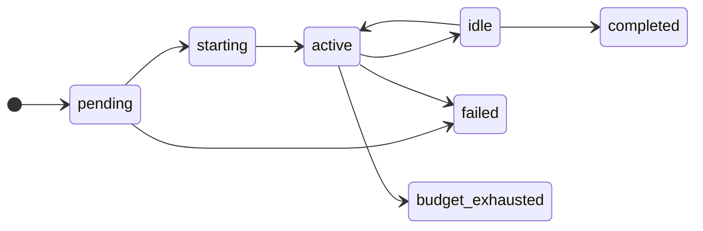

# Runs and sessions

In kora, a run is a single unit of work performed by an agent. Runs are durable and work in the background. A run can take minutes or hours, preserves its history as a durable log and can be observed by anyone with access while it completes its task. A session is the live agent working on a run. The session only exists while the agent is running, and everything it does is recorded against the run.

Agent runs in kora are started by triggers, from events like a pull request, an alert or a schedule, and can also be started through the API or manually by a user. A new run waits as `pending` until its agent has capacity, then moves through `starting` to `active` once its session is running. Agent runs can queue behind active sessions whilst capacity is freed, with configurable defaults for platform teams to customise this behaviour.

Every run is completed by an agent harness, such as Claude Code, Codex, or OpenCode. kora starts the run with the agent's model, tools, environments and identity, orchestrating the agent harness for the lifetime of the session.

## States

| State | Meaning | Moves to |
| --- | --- | --- |
| `pending` | Waiting for the agent to have capacity | `starting` when capacity frees, or `failed` after 180 seconds |
| `starting` | Starting its session | `active` |
| `active` | The agent is working | `idle` when the agent finishes its turn |
| `idle` | The agent is waiting for the next message | `active` on a new message, or `completed` after the idle timeout |
| `completed` | The run ended cleanly | |
| `failed` | The run hit an error it could not recover from | |
| `budget_exhausted` | The run reached its budget limit | |

An `idle` run is healthy. Its session stays alive waiting for the next message until the idle timeout completes the run, after 20 minutes for a run a person started and 5 minutes for a run a trigger started. A person who messages a triggered run moves it onto the 20 minute timeout. A `budget_exhausted` run has not failed, but has used all the budget it was given.

## Working with a run

| Action | When | Who |
| --- | --- | --- |
| Send a message | While the run is `active` or `idle` | Anyone with access to the run. For a [delegated](identity.md) agent, only the person who started it. |
| Interrupt | While the run is `active` | The same people who can send a message |
| Terminate | Any state before the run ends | Anyone with access to the run. For a delegated agent, the person who started it or someone who can read every delegated run. |

A delegated agent acts with the authority of the person who started the run. Messages from anyone else are refused.

## When a run ends

When a run ends, its [sandbox](sandboxes.md) and anything installed or cached inside it are deleted. If the agent stops unexpectedly, kora marks the run as `failed`.

## Related decisions

- [Run and session lifecycle](../adr/2026-05-11-run-and-session-lifecycle.md)
- [Run scheduling](../adr/2026-10-12-run-scheduling.md)
