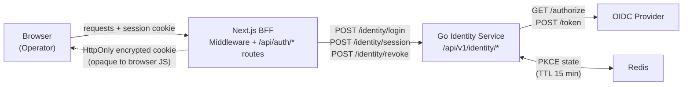
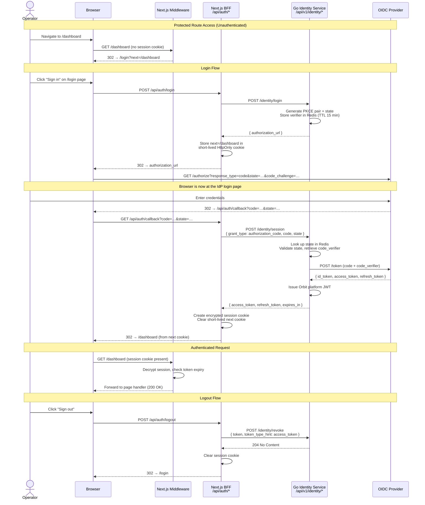

# Browser-Based Authentication Flow — Product Requirements Document

**Status:** Draft
**Created:** 2026-03-23
**Last Updated:** 2026-03-25
**Owner:** Engineering Team  
**Stakeholders:** Engineering, Product, Security

---

## Executive Summary

Orbit currently has no authentication mechanism for human operators accessing the web UI. The only existing human auth path — the OAuth 2.0 Device Authorization Grant (RFC 8628) — was explicitly designed for headless CLI use and does not map to a browser session model. This PRD defines the requirements for a browser-native login flow, a server-side BFF session layer, and route protection middleware so that the Orbit web UI can be accessed only by authenticated operators.

---

## Problem Statement

### Current State

The Orbit frontend is an unauthenticated application. Any user who can reach the URL gets full access to every page. There is no login page, no session management, no middleware protecting routes, and no mechanism for the frontend to prove operator identity to the Go backend.

The Go backend identity service (`ADR-0017`) implements the OAuth 2.0 Device Authorization Grant (RFC 8628) as its only human authentication flow. This was an intentional deferral — at the time the identity service was built there was no frontend — and ADR-0017 explicitly lists "supporting OAuth 2.0 authorization code flow (requires a frontend — deferred)" as a non-goal.

The current gaps, by layer:

**Backend (`backend/internal/identity/handlers.go`):**
- No `POST /identity/login` endpoint to initiate a browser redirect flow
- No `authorization_code` grant type case in `handleSession`
- No PKCE verifier or OAuth state parameter storage
- No callback redirect URI registration or validation

**Frontend (`frontend/src/`):**
- No `middleware.ts` — every route is publicly accessible
- No `src/app/login/` page
- No `src/app/api/auth/` routes (no login initiation, no callback handler, no session introspection, no logout)
- No session layer — `config.sessionSecret` exists but nothing reads it
- `APP_ROUTES` registers `/login` but the path has no implementation

### User Pain Points

- **Platform operators cannot log in** — there is no way to establish an authenticated session in the browser
- **All routes are publicly accessible** — any unauthenticated user who reaches the URL can view all pages, including future sensitive dashboards
- **No session continuity** — once the backend grows protected API endpoints, the frontend has no mechanism to attach operator credentials to outbound requests
- **No logout path** — even when authentication exists, there is no way to end a session

### Business Impact

- The Orbit control plane cannot be safely opened to real users while the frontend is unauthenticated
- Every protected feature built on top of the frontend (agent management, policy review, credential audit) will be unreachable without this foundation
- External OIDC provider integrations cannot be demonstrated in the browser until a browser flow exists

---

## Goals and Objectives

### Primary Goals

1. Enable human operators to log in to the Orbit web UI via their configured OIDC provider using the browser-native Authorization Code Flow with PKCE
2. Establish an encrypted, server-side-only BFF session so that no tokens are exposed to the browser
3. Protect all non-public routes via Next.js middleware — unauthenticated users are redirected to `/login`
4. Enable logout — revoke the session and redirect to the login page
5. Work against the existing local OIDC provider with zero additional infrastructure changes

### Success Metrics

- A user visiting any protected route without a session is redirected to `/login`
- A user completing the OIDC login flow is redirected back to their original destination
- The browser receives no `access_token` or `refresh_token` values at any point — they are held server-side only
- `POST /api/auth/logout` revokes the backend token via `POST /identity/revoke` and clears the session cookie
- The full flow works against the local OIDC provider (`dev@orbit.local` / `password`) with `make dev-up` and no additional setup
- An expired or revoked session redirects the user back to `/login` on the next request

### Non-Goals

- SAML federation (future)
- Social login (Google, GitHub) — these are OIDC provider configuration concerns, not a frontend concern
- Role or permission management UI
- Multi-tenant tenant-picker UI (single tenant assumed; see OQ-05)
- Mobile or native app authentication
- Removal or replacement of the existing Device Authorization Grant — it remains for CLI use
- Admin session management UI (force-logout other users, active session list)

---

## User Stories

### US-01: Operator Login

**As a** platform operator,  
**I want to** click "Sign in" on the Orbit login page and authenticate via my organisation's identity provider,  
**So that** I can access the Orbit control plane without managing a separate credential.

**Acceptance Criteria:**
- [ ] Visiting `/login` presents a login page with a sign-in call-to-action
- [ ] Initiating sign-in redirects the browser to the configured OIDC provider's authorisation endpoint with `response_type=code`, `code_challenge`, `code_challenge_method=S256`, and a `state` parameter
- [ ] After successful authentication at the provider, the browser is redirected back to the Orbit callback URL
- [ ] The callback exchanges the authorisation code for tokens at the backend identity service
- [ ] A signed, encrypted session cookie is set on the browser — the cookie is `HttpOnly`, `Secure`, and `SameSite=Lax`
- [ ] The user is redirected to their original destination (or `/` if no destination was recorded)
- [ ] The tokens (`access_token`, `refresh_token`) are not present in the browser at any point

---

### US-02: Protected Route Enforcement

**As a** platform operator,  
**I want** unauthenticated users to be redirected to the login page when they visit any protected route,  
**So that** Orbit pages are not publicly accessible.

**Acceptance Criteria:**
- [ ] A request to any protected route without a valid session cookie is redirected to `/login?next=<original_path>`
- [ ] A request to `/login` with a valid session is redirected to `/`
- [ ] Public routes (e.g., `/login`, `/api/auth/*`) are never redirected

---

### US-03: Session Continuation

**As a** platform operator with an active session,  
**I want** my session to remain valid across page navigations and browser refreshes,  
**So that** I am not asked to log in repeatedly within a reasonable working session.

**Acceptance Criteria:**
- [ ] A valid session cookie grants access to protected routes without re-authentication
- [ ] When the Orbit access token is close to expiry, the BFF silently refreshes it using the stored refresh token before serving the request
- [ ] A BFF API route (`GET /api/auth/session`) returns the current user identity (name, email) for use by client components — it does not expose tokens

---

### US-04: Logout

**As a** platform operator,  
**I want** to be able to sign out of Orbit,  
**So that** I can end my session on a shared machine or after completing my work.

**Acceptance Criteria:**
- [ ] `POST /api/auth/logout` revokes the stored access token at `POST /identity/revoke`
- [ ] The session cookie is cleared from the browser
- [ ] The operator is redirected to `/login` after logout
- [ ] Visiting a protected route after logout redirects to `/login`

---

### US-05: Expired or Revoked Session Handling

**As a** platform operator whose session has expired or been administratively revoked,  
**I want** to be redirected to the login page rather than seeing an error,  
**So that** I can re-authenticate cleanly without manual intervention.

**Acceptance Criteria:**
- [ ] A request carrying a session cookie whose access token has expired and cannot be refreshed (refresh token also expired or revoked) redirects to `/login`
- [ ] A request carrying a structurally invalid or tampered session cookie redirects to `/login`
- [ ] The redirect preserves the original destination via `?next=<path>` so the operator lands back where they intended after re-authentication
- [ ] No error page or unhandled exception is shown — the redirect is silent and transparent to the operator

---

## Proposed Solution

### High-Level Architecture

The browser-based authentication flow spans four layers. The browser communicates only with the Next.js BFF — it never talks to the Go identity service or the OIDC provider directly. All token material stays on the server side.



**Trust boundary:** The encrypted session cookie is the only thing the browser holds. Its contents are opaque to JavaScript — the browser cannot read, modify, or forge it. All token operations happen inside the BFF or the Go identity service, both of which run in server-side processes the browser cannot access.

### High-Level Approach

The Orbit Next.js frontend application operates as a Backend-for-Frontend (BFF). The browser never communicates with the Go identity service directly — all token operations happen server-side in Next.js API routes. The session is represented by an encrypted cookie that is opaque to the browser.

The Go backend owns the full Authorization Code Flow with PKCE. The BFF calls the Go backend to obtain the provider redirect URL, and calls it again on callback to exchange the authorization code for Orbit platform JWTs. The BFF then stores those JWTs in an encrypted session cookie — the browser never sees them.



### Decided Architecture

The Go backend owns the entire Authorization Code Flow with PKCE. This is the authoritative design decision (resolved from OQ-01).

**Why the Go backend owns the flow:**

All OIDC-sensitive logic — PKCE verifier generation, state token management, code exchange, and token issuance — lives in the identity service. The Next.js BFF is a thin orchestration layer: it initiates the flow, redirects the browser, handles the callback by calling the backend, and converts the resulting Orbit JWTs into an encrypted session cookie.

This means the backend grows two new endpoints:

- **`POST /identity/login`** — request body: `{ "redirect_uri": "<callback URL>" }`. Generates a PKCE code pair and an opaque `state` token (32 bytes, `crypto/rand`, base64url-encoded — 256-bit entropy; PKCE verifier 32–96 bytes per RFC 7636 §4.1). Stores verifier in Redis keyed by `state` (TTL 15 minutes). Returns: `{ "authorization_url": "<fully-constructed provider /authorize URL>" }`. The `redirect_uri` is config-driven in the Go backend; the value passed by the BFF must match it exactly. Redis payload schema: `{ "verifier": "<base64url PKCE verifier>" }` — the `next` destination is a BFF concern and is stored in a separate short-lived HttpOnly cookie by the BFF before the redirect, not in Redis.
- **`authorization_code` grant type in `POST /identity/session`** — request body: `{ "grant_type": "authorization_code", "code": "<auth code>", "state": "<opaque state>" }`. The `redirect_uri` used in the token exchange is config-driven in the Go backend — it is not accepted from the BFF caller. The backend looks up `state` in Redis to retrieve the PKCE verifier, then calls the OIDC provider's token endpoint. On success, issues an Orbit platform JWT and returns the standard `SessionResponse` shape (`access_token`, `refresh_token`, `expires_in`, `issued_at`). The Redis key for `state` is deleted after a single successful exchange.

The BFF does not implement any PKCE logic and does not talk to the OIDC provider directly. It calls the Go backend for both the authorize redirect URL and the token exchange.

This keeps all OIDC and credential material server-side within the Go service, consistent with how the identity layer is already designed. It also means that any future OIDC provider change requires changes only in the Go backend, not in the Next.js layer.

### User Experience

#### Login Flow

1. Operator navigates to any protected page (e.g., `/dashboard`)
2. Middleware detects no session cookie → redirects to `/login?next=/dashboard`
3. Login page renders with a "Sign in" button
4. Operator clicks the button → browser POSTs to `/api/auth/login`
5. BFF calls `POST /identity/login` → backend generates PKCE pair and state, stores in Redis, returns authorization URL
6. BFF stores the `next` destination in a short-lived HttpOnly cookie
7. BFF responds with a redirect to the OIDC provider's authorization URL
8. Operator authenticates at the OIDC provider (enters credentials on the IdP login page)
9. Provider redirects to `<orbit-url>/api/auth/callback?code=…&state=…`
10. BFF calls `POST /identity/session` with `grant_type=authorization_code`, `code`, and `state`
11. Backend validates state, exchanges code with the OIDC provider, issues Orbit platform JWT
12. BFF creates an encrypted session cookie and clears the `next` cookie
13. BFF redirects to the original destination (from `next` cookie), or `/` if absent

#### Authenticated State

- All protected pages load normally
- Client components can call `GET /api/auth/session` to get user display information (name, email) without receiving tokens
- Token refresh is invisible to the operator — the BFF performs it inline on the server before returning the response (resolved from OQ-04)

#### Logout Flow

1. Operator clicks "Sign out" in the UI
2. Browser sends `POST /api/auth/logout`
3. BFF reads the session, extracts the access token, calls `POST /identity/revoke` on the Go backend
4. BFF clears the session cookie
5. Browser is redirected to `/login`

### Key Components

- **`middleware.ts`** — Edge-compatible middleware that checks for a valid session cookie on every request. Redirects unauthenticated requests to `/login?next=<path>`. Validates the `next` parameter on redirect to prevent open redirect (must be a relative path present in `APP_ROUTES`). Performs token expiry check and triggers inline refresh if needed.
- **`src/server/session.ts`** — Server-only session read/write helpers for encrypted cookie management. Wraps the session cookie lifecycle; never called from client components. Session payload schema:
  ```typescript
  interface SessionPayload {
    user: { sub: string; email: string; name: string };
    accessToken: string;
    refreshToken: string;
    expiresAt: number; // Unix seconds — used by middleware to decide whether to refresh
  }
  ```
- **`POST /api/auth/login`** — BFF route that calls `POST /identity/login`, stores the `next` destination cookie, and redirects the browser to the returned authorization URL.
- **`GET /api/auth/callback`** — BFF route that handles the OIDC provider redirect. On error (provider returns `?error=<code>&error_description=<msg>`): clears any `next` cookie and redirects to `/login?error=<code>`. On success: validates that `state` is present (missing or mismatched → `400`), calls `POST /identity/session` with `grant_type=authorization_code`, sets the encrypted session cookie, clears the `next` cookie, and redirects to the `next` destination (or `/` if absent). The login page reads the `error` query parameter and renders an appropriate message to the operator.
- **`GET /api/auth/session`** — BFF route that returns non-sensitive user info (name, email, expiry) from the decrypted session. Returns `401` if no session.
- **`POST /api/auth/logout`** — BFF route that revokes the token and clears the session cookie.
- **`src/app/login/page.tsx`** — Login page component with a single "Sign in" button that POSTs to `/api/auth/login`.
- **Backend identity service** (`backend/internal/identity/`) — Extended with `POST /identity/login` and `authorization_code` grant type in `POST /identity/session`.
- **`BFF_SESSION_SECRET`** — Already wired in `src/server/config.ts`; must be set in the local `.env` file (minimum 32 characters).
- **OIDC provider** (`orbit-local` client) — Must have `redirectURIs` updated to include the callback URL (see OQ-03).

---

## Scope

### In Scope

- Browser-based operator login via OIDC Authorization Code Flow with PKCE
- Server-side BFF session layer — encrypted, HttpOnly session cookie; tokens never exposed to the browser
- Next.js route-protection middleware — unauthenticated requests redirected to `/login`
- Silent inline token refresh in middleware when the access token nears expiry
- Logout with backend token revocation (`POST /identity/revoke`)
- `GET /api/auth/session` endpoint for client-side user display information (name, email)
- Post-login redirect preservation via validated `next` parameter
- `POST /identity/login` and `authorization_code` grant type additions to the Go identity service
- PKCE state and code verifier storage in Redis (Go identity service; TTL 15 minutes)
- Local development end-to-end via `make dev-up`, no additional setup

### Out of Scope

- SAML federation (future iteration)
- Social login (Google, GitHub) — OIDC provider configuration, not a frontend concern
- Role and permission management UI
- Multi-tenant tenant-picker UI (single tenant hardcoded; see OQ-05)
- Mobile or native app authentication
- Replacement or modification of the Device Authorization Grant — it remains for CLI use
- Admin force-logout or active session management UI
- Refresh token rotation

### Future Considerations

- Server-side session store (Redis or Postgres) to support admin force-logout and per-session revocation — the encrypted cookie approach can be revisited if this becomes a requirement
- Multi-tenant OIDC provider picker at login time
- SAML 2.0 federation layer
- Refresh token rotation (issue a new refresh token on each use)

---

## Requirements

### Functional Requirements

**Must Have (P0):**
- [ ] `POST /identity/login` Go backend endpoint: generates PKCE pair and `state` (32 bytes, `crypto/rand`, base64url); stores verifier in Redis (TTL 15 min); returns `{ "authorization_url": "..." }`
- [ ] `authorization_code` grant type in `POST /identity/session`: validates `state` against Redis, exchanges code with OIDC provider, issues Orbit platform JWT
- [ ] `POST /api/auth/login` BFF route: calls `POST /identity/login`, stores `next` destination in short-lived HttpOnly cookie, redirects browser to provider
- [ ] `GET /api/auth/callback` BFF route: validates `state` presence, calls `POST /identity/session`, sets encrypted session cookie, clears `next` cookie, redirects to destination
- [ ] `GET /api/auth/session` BFF route: returns non-sensitive user identity (name, email) from the decrypted session; returns `401` if no session
- [ ] `POST /api/auth/logout` BFF route: calls `POST /identity/revoke`, clears session cookie, redirects to `/login`
- [ ] `middleware.ts`: protects all non-public routes; redirects unauthenticated requests to `/login?next=<path>`; redirects authenticated requests away from `/login`
- [ ] `src/app/login/page.tsx`: login page with a single sign-in call-to-action
- [ ] Session cookie must be `HttpOnly`, `Secure`, and `SameSite=Lax`; tokens must never be readable by browser JavaScript
- [ ] PKCE state and code verifier stored in Redis with a 15-minute TTL; verifier never leaves the Go backend process
- [ ] `state` parameter validated on every callback; mismatches rejected with `400`
- [ ] `next` parameter validated as a relative path present in `APP_ROUTES` before use; invalid values silently fall back to `/`
- [ ] `config/dex/config.yaml` updated with the callback redirect URI for local development

**Should Have (P1):**
- [ ] Inline token refresh in middleware — when the access token is within a configurable threshold of expiry, the BFF silently refreshes it before forwarding the request
- [ ] Structured log entries emitted for login initiation, callback success/failure, token refresh, and logout — no token values in any log output

**Nice to Have (P2):**
- [ ] `GET /api/auth/session` includes a token expiry timestamp so client components can proactively prompt re-login without a full page navigation

### Non-Functional Requirements

**Security:**
- No OAuth tokens (`access_token`, `refresh_token`, `id_token`) may appear in the browser, in server logs, or in any observable client-side context at any point in the flow
- All session cookies must be `HttpOnly`, `Secure`, and `SameSite=Lax` — no exceptions
- CSRF protection enforced via the PKCE `state` parameter — a callback with a mismatched or missing `state` must be rejected with `400`
- The `next` redirect parameter must be validated against `APP_ROUTES` before use to prevent open redirect attacks
- The PKCE code verifier must be generated and validated entirely within the Go identity service; it must never cross the BFF boundary
- The session management library used by `src/server/session.ts` must be compatible with the Next.js Edge Runtime — it must rely on the Web Crypto API only and must not import any Node.js built-in modules. Library selection is deferred to ADR-0023.

**Performance:**
- Token refresh adds at most one additional backend round-trip per expiry event; subsequent requests within the new token window are not affected
- Middleware session decryption must not add measurable latency under normal load on the control plane (low request volume)

**Reliability:**
- A Redis outage during the PKCE round-trip causes auth to fail with a clear error response, not a silent hang or unhandled exception
- The session cookie is self-contained — horizontal scaling of the Next.js BFF requires no sticky sessions or shared session store

**Observability:**
- Auth route handlers emit structured log entries for all significant transitions (login start, callback outcome, refresh, logout)
- No token material appears in log output at any log level

---

## Dependencies

### Internal Dependencies

- **Go identity service** (`backend/internal/identity/`) — requires two new additions: `POST /identity/login` endpoint and `authorization_code` grant type in `POST /identity/session`. Status: not yet implemented; tracked as Phase 1 backend work.
- **Redis** — already deployed as part of the identity service for the JTI blocklist. Reused for PKCE state storage (new key namespace, 15-minute TTL). Status: available.
- **`APP_ROUTES`** (`frontend/src/`) — `/login` is already registered; used by middleware and callback handler to validate the `next` redirect parameter. Status: available.
- **`BFF_SESSION_SECRET`** environment variable — already defined in `src/server/config.ts`. Must be set in the local `.env` file (minimum 32 characters). Status: available; no code changes required.
- **`config/dex/config.yaml`** — must be updated with the callback redirect URI (`http://localhost:3000/api/auth/callback`) for local development. Status: change required.

### External Dependencies

- **OIDC provider** — Any OIDC-compliant provider that supports Authorization Code Flow with PKCE. The specific provider is configured and managed independently of the frontend — the BFF communicates only with the Go identity service, which abstracts all provider details.
- **Redis** — Already used by the identity service. The PKCE/state store reuses the same Redis instance with a 15-minute TTL on authentication state keys.

---

## Risks and Mitigations

| Risk | Impact | Probability | Mitigation |
|------|--------|-------------|------------|
| CSRF via forged callback state | High | Medium | Validate `state` parameter on every callback; reject mismatches with 400 |
| Token leakage via server logs | High | Low | Audit all log statements in auth routes; never log token values |
| Open redirect via `next` parameter | High | Medium | Validate `next` is a relative path belonging to `APP_ROUTES` before redirecting |
| PKCE verifier stored in insecure location | High | Low | Verifier stored in Redis server-side in the Go backend — never touches the browser |
| Session cookie readable by client JS | High | Low | Enforce `HttpOnly` on all session cookies; no exceptions |
| CSRF on `POST /api/auth/logout` | Low | Low | `SameSite=Lax` does not block cross-site `fetch`/`XHR` POST requests. Forcing a sign-out grants the attacker nothing — the session is cleared but no data is exfiltrated or modified. Risk accepted for this phase; a CSRF token on logout is explicitly deferred to a later phase. |
| `redirect_uri` mismatch breaking local dev | Medium | Medium | Document exact callback URL; add it to `config/dex/config.yaml` as part of implementation |
| Backend not ready (new endpoints not yet implemented) | Medium | Medium | Frontend and backend changes tracked together; frontend gated behind feature flag until backend is ready |
| Edge Runtime incompatibility in middleware | Medium | Low | Prefer a session library built on the Web Crypto API, which is natively available in the Edge Runtime |
| Redis TTL expiry during slow auth flow | Low | Low | 15-minute TTL on PKCE/state keys is sufficient for any realistic login interaction |

---

## Alternatives Considered

### Alternative 1: Keep Device Authorization Grant for the browser UI

Use the existing Device Code flow in the browser — show the `user_code` and `verification_uri` to the operator, and poll `POST /identity/session` until the flow completes.

**Why not chosen:**
- The device code flow requires the user to navigate to a separate URL, enter a code, and wait for a poll to complete — appropriate for CLI and TV apps but unnecessary friction in a browser where a direct redirect is possible
- It does not result in a session that can be maintained transparently across page navigations
- It provides no natural place to perform CSRF protection or attach a browser session cookie

### Alternative 2: BFF-direct OIDC (BFF talks directly to the OIDC provider, bypasses Go backend)

The Next.js BFF initiates the OIDC Authorization Code Flow by talking directly to the OIDC provider — bypassing the Go backend entirely for the redirect and callback steps. On successful callback, the BFF calls `POST /identity/session` with a new `authorization_code` grant type to exchange the OIDC tokens for an Orbit platform JWT.

**Why not chosen:**
- Splits OIDC logic across two services: the Go backend already owns all identity and session logic; duplicating PKCE and provider interaction in the BFF creates a second implementation to maintain
- Any future provider change requires updating both the BFF and the Go backend
- OIDC client credentials and provider discovery would need to be available to the Next.js process, expanding its secret surface

### Alternative 3: BFF-managed session with tokens stored in Redis/Postgres

Store session data in Redis or Postgres keyed by a session ID, rather than an encrypted cookie.

**Why not chosen for this PRD:**
- Adds a stateful server-side store dependency to the frontend service, which currently has none
- Encrypted cookie sessions are simpler to deploy, horizontally scale without sticky sessions, and eliminate a session store as a single point of failure
- Can be revisited if session revocation requirements (e.g., admin force-logout) require server-side session records

---

## Open Questions

### OQ-01 — Authorization Code Flow ownership ✅ Resolved

**Question:** Should the BFF talk directly to the OIDC provider for the Authorization Code Flow, or should the Go backend own the full flow?

**Decision:** The Go backend owns the full flow. A new `POST /identity/login` endpoint and an `authorization_code` grant type in `POST /identity/session` will be added to the identity service. The BFF calls the Go backend to obtain the authorization redirect URL and to exchange the authorization code for tokens — it never communicates with the OIDC provider directly.

**Rationale:** All OIDC-sensitive logic (PKCE verifier generation, state management, code exchange, token issuance) stays within the identity service. This is consistent with the existing architecture — the BFF is a thin orchestration layer, not an OIDC client — and ensures that future provider changes require updates only in the Go backend.

---

### OQ-02 — PKCE state and code verifier storage mechanism ✅ Resolved

**Question:** During the OAuth round-trip, the PKCE code verifier and `state` parameter must be stored somewhere between the authorization redirect and the callback. Where should they live?

**Decision:** Option A — the Go backend stores the PKCE verifier in Redis, keyed by the opaque `state` value (TTL 15 minutes). The verifier is generated and validated entirely within the Go identity service; it never crosses the BFF boundary. Redis is already present for the JTI blocklist. This is consistent with OQ-01: since the backend owns the Authorization Code Flow, it also owns the PKCE state machine.

**Options considered (for ADR reference):**

| | Option A: Go backend (Redis) | Option B: BFF short-lived HttpOnly cookie | Option C: Encrypted state parameter (JWE) |
|---|---|---|---|
| **Where stored** | Redis in the Go identity service, keyed by the opaque `state` value | A signed, encrypted cookie set by the BFF before the redirect, cleared on callback | The code verifier is encrypted and embedded directly in the `state` parameter value (a JWE token) |
| **State machine** | Backend generates and validates; BFF is stateless | BFF generates and validates; backend receives raw values | Backend generates, encrypts, and decrypts; no external store needed |
| **Server-side store** | Redis (already present) | None | None |
| **Verifier leaves Go process?** | Never | Yes — encrypted in a BFF cookie, but the raw bytes exist in Next.js memory | Never — embedded in the state token, decrypted only in the backend |
| **Scalability** | Scales horizontally; Redis is shared | Scales horizontally; cookie is self-contained | Scales horizontally; stateless |
| **Complexity** | Low — standard Redis SET / GET with TTL | Low — short-lived HttpOnly cookie with short TTL | Medium — JWE encryption/decryption on every auth initiation and callback |
| **Failure mode** | Redis unavailable → auth fails | Cookie cleared by browser → auth fails with no recovery | Malformed state → 400; no external dependency |
| **Fit with OQ-01 decision** | ✅ Natural fit — backend owns all auth state, verifier never touches BFF | ⚠️ Requires BFF to hold and transmit the raw verifier | ✅ Stateless and backend-owned, but adds crypto complexity |

---

### OQ-03 — OIDC provider `redirect_uri` registration ✅ Resolved

**Question:** Does the local OIDC provider configuration need to be updated to support the Authorization Code Flow?

**Decision:** Yes. Add `http://localhost:3000/api/auth/callback` to the `redirectURIs` list in `config/dex/config.yaml` under the `orbit-local` static client. This change ships alongside the backend and frontend implementation. Production and staging providers require equivalent callback URL registration.

---

### OQ-04 — Token refresh strategy in middleware ✅ Resolved

**Question:** When the Orbit access token is close to expiry, how should the BFF handle it?

**Decision:** Option (a) — perform the refresh inline before forwarding the request. When middleware detects that the stored access token is within a configurable threshold of expiry (e.g., less than 5 minutes remaining), it calls `POST /identity/session` with `grant_type=refresh_token` before forwarding the request. The session cookie is updated in-place with the new tokens. From the operator's perspective, the session simply continues.

**Trade-off acknowledged:** This adds one extra backend round-trip latency to a single request per refresh event. For a low-traffic control plane application this is acceptable, and it is preferable to exposing refresh logic to the client (option c) or allowing requests to fail with near-expired tokens (option b).

---

### OQ-05 — Tenant ID at login time ✅ Resolved

**Question:** The Go backend's device flow requires a `tenant_id`. Does the Authorization Code Flow also require one, and how does the browser obtain it?

**Decision:** The browser-based Authorization Code Flow does not use the Device Authorization Grant tenant resolution path. The tenant ID will be a single hardcoded value for now, supplied by the backend's `POST /identity/login` endpoint internally — the BFF does not need to know about or pass a tenant ID. A pre-login tenant picker UI is explicitly out of scope for this PRD.

---

### OQ-06 — Post-login redirect destination ✅ Resolved

**Question:** What is the validation rule for the `next` parameter, and what is the default post-login destination?

**Decision:**
- **Default destination:** `/` (the root page). If no `next` parameter is present or it fails validation, the operator is sent to `/`.
- **Validation rule:** The `next` value must be a relative URL (no scheme, no host) whose pathname is present in `APP_ROUTES`. Any `next` value that is absolute, contains a host, or does not match an `APP_ROUTES` entry is silently discarded and the default `/` is used. This prevents open redirect attacks via a forged `next` parameter.
- **Mechanism:** When middleware redirects an unauthenticated request to `/login`, it appends `?next=<original_path>`. The login page reads this from the query string and passes it to the BFF `/api/auth/login` route, which stores it in a short-lived HttpOnly cookie before redirecting to the OIDC provider. On callback, the BFF reads the cookie, validates the value against `APP_ROUTES`, and uses it as the final redirect destination.

---

## Timeline and Milestones

### Phases

**Phase 1: Foundation**
- ~~Resolve all open questions (OQ-01 through OQ-06)~~ ✅ In progress
- Write ADR-0023 (browser auth flow architecture)
- Update `config/dex/config.yaml` with callback redirect URI
- Implement backend changes: `POST /identity/login` + `authorization_code` grant in `POST /identity/session`

**Phase 2: BFF Auth Routes and Session Layer**
- Implement `src/server/session.ts` — encrypted session read/write
- Implement `POST /api/auth/login` — call backend login, store `next` cookie, redirect
- Implement `GET /api/auth/callback` — call backend session exchange, create session cookie, redirect
- Implement `GET /api/auth/session` — session introspection for client components
- Implement `POST /api/auth/logout` — token revocation, session clearance

**Phase 3: Route Protection and Login UI**
- Implement `middleware.ts` — session check, inline token refresh, redirect to login
- Implement `src/app/login/page.tsx` — sign-in UI
- Update `APP_ROUTES` if any new routes are needed
- End-to-end test: full login → protected page → logout cycle against the local OIDC provider

### Key Milestones

- [ ] PRD Approved
- [ ] Open questions resolved
- [ ] ADR-0023 Written and Approved
- [ ] Backend changes implemented
- [ ] Frontend implementation complete
- [ ] End-to-end local dev test passing
- [ ] Security review complete

---

## Appendix

### Related Documents

- [ADR-0017](../adr/0017-oidc-provider-abstraction-and-local-identity-provider.md) — OIDC provider abstraction; establishes Device Authorization Grant and explicitly defers Authorization Code Flow
- [ADR-0019](../adr/0019-frontend-scaffolding-and-toolchain.md) — Frontend scaffolding and Next.js conventions
- [ADR-0008](../adr/0008-unified-identity-model.md) — Unified identity model; defines the `Principal` abstraction

### References

- [RFC 6749 — OAuth 2.0 Authorization Framework](https://datatracker.ietf.org/doc/html/rfc6749)
- [RFC 7636 — Proof Key for Code Exchange (PKCE)](https://datatracker.ietf.org/doc/html/rfc7636)
- [RFC 7009 — OAuth 2.0 Token Revocation](https://datatracker.ietf.org/doc/html/rfc7009)
- [OpenID Connect Core 1.0](https://openid.net/specs/openid-connect-core-1_0.html)
- [OAuth 2.0 Security Best Current Practice (BCP)](https://datatracker.ietf.org/doc/html/draft-ietf-oauth-security-topics)

### Glossary

- **Authorization Code Flow** — The OAuth 2.0 grant type in which the provider issues a short-lived `code` to the browser, which the backend then exchanges for tokens. The browser never sees the tokens.
- **PKCE** (Proof Key for Code Exchange) — An extension to the Authorization Code Flow that prevents code interception attacks. The client generates a random `code_verifier`, sends a hash of it (`code_challenge`) in the authorization request, and must present the raw verifier at token exchange.
- **BFF** (Backend-for-Frontend) — The Next.js server process acting as a security-aware proxy between the browser and the Go identity service. Token operations happen here, never in the browser.
- **`state` parameter** — A random, single-use value included in the authorization request and returned verbatim in the callback. Used to prevent CSRF attacks on the callback endpoint.
- **JTI blocklist** — The Redis-backed list of revoked JWT identifiers maintained by the Go identity service. Used by `POST /identity/revoke`.
