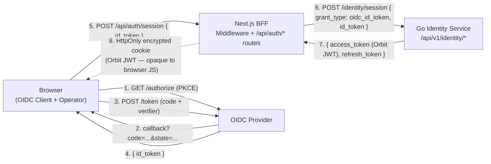
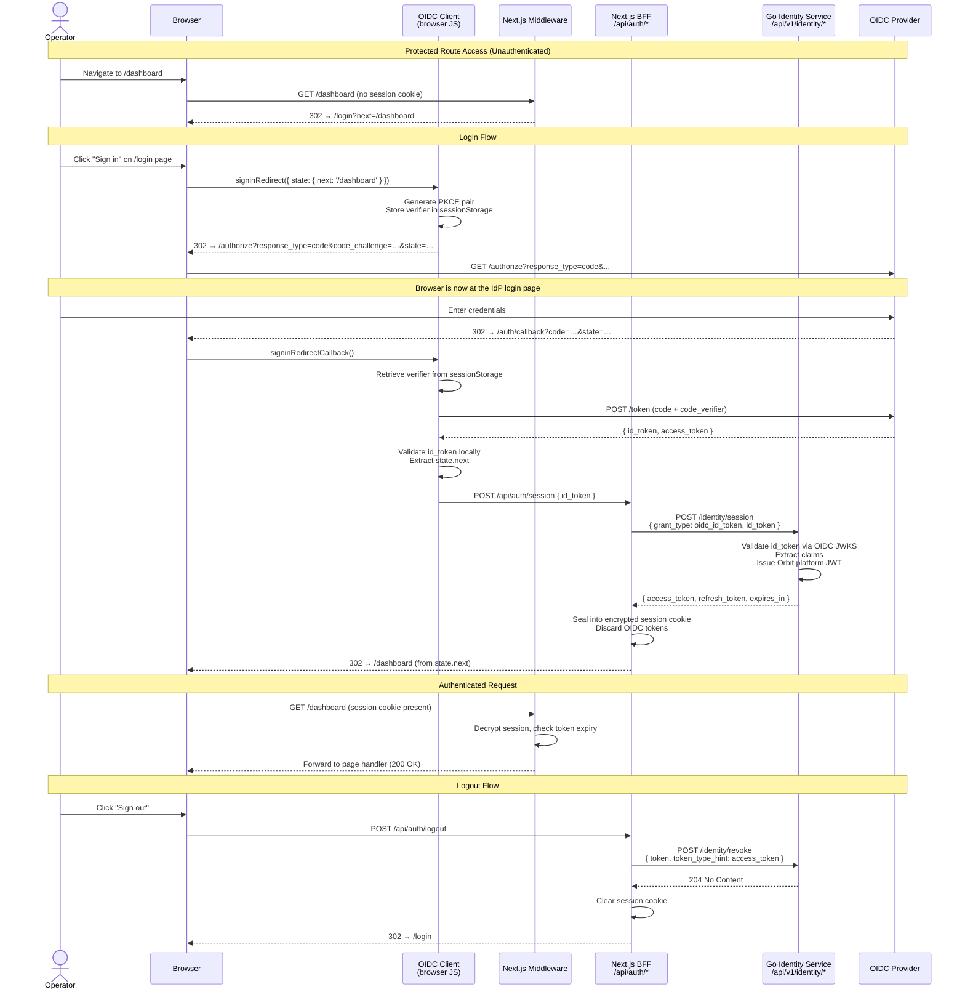

# Browser-Based Authentication Flow — Product Requirements Document

**Status:** Draft
**Created:** 2026-03-23
**Last Updated:** 2026-03-25
**Owner:** Engineering Team  
**Stakeholders:** Engineering, Product, Security

---

## Executive Summary

Orbit currently has no authentication mechanism for human operators accessing the web UI. This PRD defines the requirements for a browser-native login flow using a frontend OIDC client, a server-side BFF session layer, and route-protection middleware so that the Orbit web UI can be accessed only by authenticated operators.

---

## Problem Statement

### Current State

The Orbit frontend is an unauthenticated application. Any user who can reach the URL gets full access to every page. There is no login page, no session management, no middleware protecting routes, and no mechanism for the frontend to prove operator identity to the Go backend.

The Go identity service (`ADR-0017`) implements the OAuth 2.0 Device Authorization Grant (RFC 8628) as its only human authentication flow. This was designed for headless CLI use and is unsuitable for a browser session model. ADR-0017 explicitly lists "supporting OAuth 2.0 Authorization Code Flow" as a deferred non-goal.

The current gaps, by layer:

**Backend (`backend/internal/identity/handlers.go`):**
- No endpoint to accept a verified OIDC `id_token` and exchange it for an Orbit platform JWT
- No mechanism to validate an externally-presented identity assertion from a browser client

**Frontend (`frontend/src/`):**
- No `middleware.ts` — every route is publicly accessible
- No `src/app/login/` page
- No `src/app/api/auth/` routes (no session handoff, no session introspection, no logout)
- No session layer — `config.sessionSecret` exists but nothing reads it
- `APP_ROUTES` registers `/login` but the path has no implementation

### User Pain Points

- **Platform operators cannot log in** — there is no way to establish an authenticated session in the browser
- **All routes are publicly accessible** — any unauthenticated user who reaches the URL can view all pages, including future sensitive dashboards
- **No session continuity** — once the backend grows protected API endpoints, the frontend has no mechanism to attach operator credentials to outbound requests
- **No logout path** — even when authentication exists, there is no way to end a session

### Business Impact

- The Orbit control plane cannot be safely opened to real users while the frontend is unauthenticated
- Every protected feature built on top of the frontend (agent management, policy review, credential audit) will be unreachable without this foundation
- External OIDC provider integrations cannot be demonstrated in the browser until a browser flow exists

---

## Goals and Objectives

### Primary Goals

1. Enable human operators to log in to the Orbit web UI via their configured OIDC provider using the browser-native Authorization Code Flow with PKCE
2. Establish an encrypted, server-side BFF session so that Orbit platform tokens are not exposed to browser JavaScript
3. Protect all non-public routes via Next.js middleware — unauthenticated users are redirected to `/login`
4. Enable logout — revoke the session and redirect to the login page
5. Work against the existing local OIDC provider with zero additional infrastructure changes

### Success Metrics

- A user visiting any protected route without a session is redirected to `/login`
- A user completing the OIDC login flow is redirected back to their original destination
- The browser receives no Orbit `access_token` or `refresh_token` values at any point — they are held in an encrypted cookie after the session handoff
- `POST /api/auth/logout` revokes the backend token via `POST /identity/revoke` and clears the session cookie
- The full flow works against the local OIDC provider (`dev@orbit.test` / `password`) with `make dev-up` and no additional setup
- An expired or revoked session redirects the user back to `/login` on the next request

### Non-Goals

- SAML federation (future)
- Social login (Google, GitHub) — these are OIDC provider configuration concerns, not a frontend concern
- Role or permission management UI
- Multi-tenant tenant-picker UI (single tenant assumed)
- Mobile or native app authentication
- Removal or replacement of the existing Device Authorization Grant — it remains for CLI use
- Admin session management UI (force-logout other users, active session list)

---

## User Stories

### US-01: Operator Login

**As a** platform operator,  
**I want to** click "Sign in" on the Orbit login page and authenticate via my organisation's identity provider,  
**So that** I can access the Orbit control plane without managing a separate credential.

**Acceptance Criteria:**
- [ ] Visiting `/login` presents a login page with a sign-in call-to-action
- [ ] Initiating sign-in redirects the browser to the configured OIDC provider's authorisation endpoint with `response_type=code`, `code_challenge`, `code_challenge_method=S256`, and a `state` parameter
- [ ] After successful authentication at the provider, the browser is redirected back to the Orbit callback URL
- [ ] The browser exchanges the authorisation code for an OIDC `id_token` directly with the provider, then hands the `id_token` to the BFF
- [ ] The BFF forwards the `id_token` to the Go identity service, which validates it and issues an Orbit platform JWT
- [ ] A signed, encrypted session cookie is set on the browser — the cookie is `HttpOnly`, `Secure`, and `SameSite=Lax`
- [ ] The user is redirected to their original destination (or `/` if no destination was recorded)
- [ ] The Orbit `access_token` and `refresh_token` are not readable by browser JavaScript at any point

---

### US-02: Protected Route Enforcement

**As a** platform operator,  
**I want** unauthenticated users to be redirected to the login page when they visit any protected route,  
**So that** Orbit pages are not publicly accessible.

**Acceptance Criteria:**
- [ ] A request to any protected route without a valid session cookie is redirected to `/login?next=<original_path>`
- [ ] A request to `/login` with a valid session is redirected to `/`
- [ ] Public routes (e.g., `/login`, `/auth/callback`, `/api/auth/*`) are never redirected

---

### US-03: Session Continuation

**As a** platform operator with an active session,  
**I want** my session to remain valid across page navigations and browser refreshes,  
**So that** I am not asked to log in repeatedly within a reasonable working session.

**Acceptance Criteria:**
- [ ] A valid session cookie grants access to protected routes without re-authentication
- [ ] When the Orbit access token is close to expiry, the BFF silently refreshes it using the stored refresh token before serving the request
- [ ] A BFF API route (`GET /api/auth/session`) returns the current user identity (name, email) for use by client components — it does not expose tokens

---

### US-04: Logout

**As a** platform operator,  
**I want** to be able to sign out of Orbit,  
**So that** I can end my session on a shared machine or after completing my work.

**Acceptance Criteria:**
- [ ] `POST /api/auth/logout` revokes the stored access token at `POST /identity/revoke`
- [ ] The session cookie is cleared from the browser
- [ ] The operator is redirected to `/login` after logout
- [ ] Visiting a protected route after logout redirects to `/login`

---

### US-05: Expired or Revoked Session Handling

**As a** platform operator whose session has expired or been administratively revoked,  
**I want** to be redirected to the login page rather than seeing an error,  
**So that** I can re-authenticate cleanly without manual intervention.

**Acceptance Criteria:**
- [ ] A request carrying a session cookie whose access token has expired and cannot be refreshed (refresh token also expired or revoked) redirects to `/login`
- [ ] A request carrying a structurally invalid or tampered session cookie redirects to `/login`
- [ ] The redirect preserves the original destination via `?next=<path>` so the operator lands back where they intended after re-authentication
- [ ] No error page or unhandled exception is shown — the redirect is silent and transparent to the operator

---

## Proposed Solution

### High-Level Architecture

The browser-based authentication flow spans four layers. The frontend OIDC client handles the Authorization Code Flow with PKCE entirely in the browser, including the token exchange with the OIDC provider. Once the browser has the OIDC `id_token`, it is handed off to the BFF, which validates it with the Go identity service and seals the resulting Orbit platform JWT into an encrypted HttpOnly cookie.



**Trust boundary:** The OIDC `id_token` is held in the browser only transiently — it exists in JavaScript memory during the callback flow and is discarded once the BFF completes the session handoff. The Orbit platform tokens (`access_token`, `refresh_token`) never appear in the browser; they are sealed into an encrypted HttpOnly cookie immediately upon receipt. Browser JavaScript cannot read the contents of that cookie.

### High-Level Approach

A frontend OIDC client library runs in the browser and owns the full Authorization Code Flow with PKCE: it generates the code verifier, constructs the authorization URL, handles the callback, and exchanges the code with the OIDC provider. On receiving the `id_token`, the browser immediately forwards it to the Next.js BFF.

The BFF presents the `id_token` to the Go identity service via a new `oidc_id_token` grant type in `POST /identity/session`. The identity service validates the `id_token` signature against the OIDC provider's JWKS, extracts the claims, and issues an Orbit platform JWT. The BFF seals the platform JWT and refresh token into an encrypted, HttpOnly session cookie. The browser discards the OIDC tokens after the handoff.

From this point forward, the browser's auth state is represented entirely by the encrypted session cookie — the browser never holds an Orbit token in readable form.



### User Experience

#### Login Flow

1. Operator navigates to any protected page (e.g., `/dashboard`)
2. Middleware detects no session cookie → redirects to `/login?next=/dashboard`
3. Login page renders with a "Sign in" button
4. Operator clicks the button → the OIDC client generates a PKCE pair, stores the verifier in sessionStorage, and redirects the browser to the OIDC provider's authorization endpoint
5. Operator authenticates at the OIDC provider
6. Provider redirects to `/auth/callback?code=…&state=…`
7. The `/auth/callback` page loads; the OIDC client retrieves the verifier from sessionStorage and exchanges the code with the provider's token endpoint
8. The OIDC client receives the `id_token` and immediately POSTs it to `/api/auth/session`
9. The BFF forwards the `id_token` to `POST /identity/session` with `grant_type: oidc_id_token`
10. The identity service validates the `id_token`, extracts claims, and issues an Orbit platform JWT
11. The BFF seals the Orbit tokens into an encrypted session cookie and redirects to the original destination (from state carried through the OIDC flow), or `/` if absent

#### Authenticated State

- All protected pages load normally
- Client components can call `GET /api/auth/session` to get user display information (name, email) without receiving tokens
- Token refresh is invisible to the operator — the BFF performs it inline on the server before returning the response

#### Logout Flow

1. Operator clicks "Sign out" in the UI
2. Browser sends `POST /api/auth/logout`
3. BFF reads the session, extracts the access token, calls `POST /identity/revoke` on the Go backend
4. BFF clears the session cookie
5. Browser is redirected to `/login`

### Key Components

- **OIDC client library** (browser) — An OIDC-compliant library that runs in the browser and owns the Authorization Code Flow with PKCE. Responsible for generating the code verifier, redirecting to the provider, handling the callback, exchanging the code, and validating the `id_token` locally. Specific library selection is deferred to ADR-0023.
- **`/auth/callback` page** (`src/app/auth/callback/page.tsx`) — A client-rendered Next.js page that the OIDC provider redirects to. Invokes the OIDC client's callback handler, which completes the token exchange and then calls `/api/auth/session` to hand off the `id_token`.
- **`middleware.ts`** — Edge-compatible middleware that checks for a valid session cookie on every request. Redirects unauthenticated requests to `/login?next=<path>`. Validates the `next` parameter on redirect to prevent open redirect (must be a relative path present in `APP_ROUTES`). Performs token expiry check and triggers inline refresh if needed.
- **`src/server/session.ts`** — Server-only session read/write helpers for encrypted cookie management. Session payload schema:
  ```typescript
  interface SessionPayload {
    user: { sub: string; email: string; name: string };
    accessToken: string;
    refreshToken: string;
    expiresAt: number; // Unix seconds
  }
  ```
- **`POST /api/auth/session`** — BFF route that receives the `id_token` from the OIDC client, forwards it to `POST /identity/session` with `grant_type: oidc_id_token`, seals the returned Orbit tokens into the session cookie, and redirects to the post-login destination.
- **`GET /api/auth/session`** — BFF route that returns non-sensitive user info (name, email, expiry) from the decrypted session. Returns `401` if no session.
- **`POST /api/auth/logout`** — BFF route that revokes the token and clears the session cookie.
- **`src/app/login/page.tsx`** — Login page component with a single "Sign in" button that triggers the OIDC client's authorization redirect.
- **`oidc_id_token` grant type in `POST /identity/session`** — New grant type in the Go identity service. Accepts a raw OIDC `id_token`, validates it against the configured OIDC provider's JWKS, extracts claims (`sub`, `email`, `name`), and issues an Orbit platform JWT.
- **`BFF_SESSION_SECRET`** — Already wired in `src/server/config.ts`; used to seal and unseal the session cookie.
- **OIDC provider public config** — The OIDC issuer URL, client ID, and callback redirect URI must be exposed as `NEXT_PUBLIC_*` environment variables so the browser-side OIDC client can use them.

---

## Scope

### In Scope

- Browser-based operator login via OIDC Authorization Code Flow with PKCE, owned by a frontend OIDC client library
- OIDC `id_token` handoff to Go identity service via `oidc_id_token` grant type in `POST /identity/session`
- Server-side BFF session layer — encrypted, HttpOnly session cookie; Orbit platform tokens sealed server-side
- Next.js route-protection middleware — unauthenticated requests redirected to `/login`
- Silent inline token refresh in middleware when the access token nears expiry
- Logout with backend token revocation (`POST /identity/revoke`)
- `GET /api/auth/session` endpoint for client-side user display information (name, email)
- Post-login redirect preservation carried through the OIDC state parameter
- `oidc_id_token` grant type addition to the Go identity service
- Local development end-to-end via `make dev-up`, no additional setup

### Out of Scope

- SAML federation (future iteration)
- Social login (Google, GitHub) — OIDC provider configuration, not a frontend concern
- Role and permission management UI
- Multi-tenant tenant-picker UI (single tenant hardcoded)
- Mobile or native app authentication
- Replacement or modification of the Device Authorization Grant — it remains for CLI use
- Admin force-logout or active session management UI
- Refresh token rotation

### Future Considerations

- Server-side session store (Redis or Postgres) to support admin force-logout and per-session revocation
- Multi-tenant OIDC provider picker at login time
- SAML 2.0 federation layer
- Refresh token rotation (issue a new refresh token on each use)

---

## Requirements

### Functional Requirements

**Must Have (P0):**
- [ ] `oidc_id_token` grant type in `POST /identity/session`: validates the presented `id_token` against the OIDC provider's JWKS, extracts claims, and issues an Orbit platform JWT
- [ ] Frontend OIDC client library configured with OIDC issuer URL, client ID, and redirect URI from `NEXT_PUBLIC_*` environment variables
- [ ] OIDC client generates a PKCE code verifier and `state` parameter in the browser; the verifier is stored in sessionStorage and never sent to the BFF or backend
- [ ] `/auth/callback` client-side page: invokes the OIDC client callback handler; on success POSTs `id_token` to `POST /api/auth/session`
- [ ] `POST /api/auth/session` BFF route: accepts `id_token`, calls Go identity service with `oidc_id_token` grant, seals returned Orbit tokens into encrypted session cookie
- [ ] `GET /api/auth/session` BFF route: returns non-sensitive user identity (name, email) from the decrypted session; returns `401` if no session
- [ ] `POST /api/auth/logout` BFF route: calls `POST /identity/revoke`, clears session cookie, redirects to `/login`
- [ ] `middleware.ts`: protects all non-public routes; redirects unauthenticated requests to `/login?next=<path>`; redirects authenticated requests away from `/login`
- [ ] `src/app/login/page.tsx`: login page with a single sign-in call-to-action
- [ ] Session cookie must be `HttpOnly`, `Secure`, and `SameSite=Lax`; Orbit tokens must not be readable by browser JavaScript
- [ ] `state` parameter validated on every callback; mismatches rejected
- [ ] Post-login `next` destination encoded in the OIDC `state` parameter and validated as a relative `APP_ROUTES` path before use; invalid values silently fall back to `/`
- [ ] `config/dex/config.yaml` updated with the callback redirect URI for local development

**Should Have (P1):**
- [ ] Inline token refresh in middleware — when the Orbit access token is within a configurable threshold of expiry, the BFF silently refreshes it before forwarding the request
- [ ] Structured log entries emitted for session handoff, token refresh, and logout — no token values in any log output

**Nice to Have (P2):**
- [ ] `GET /api/auth/session` includes a token expiry timestamp so client components can proactively prompt re-login without a full page navigation

### Non-Functional Requirements

**Security:**
- Orbit `access_token` and `refresh_token` must not appear in browser JavaScript-accessible storage at any point after the session handoff
- The OIDC `id_token` is held in browser memory only transiently during the callback flow; it is discarded immediately after the BFF session handoff completes
- All session cookies must be `HttpOnly`, `Secure`, and `SameSite=Lax` — no exceptions
- CSRF protection enforced via the OIDC `state` parameter — a callback with a mismatched or missing `state` must be rejected
- The `next` redirect parameter must be validated against `APP_ROUTES` before use to prevent open redirect attacks
- OIDC `client_secret` must not be required — the frontend OIDC client is a public client; PKCE provides code interception protection
- The session management library used by `src/server/session.ts` must be compatible with the Next.js Edge Runtime. Library selection is deferred to ADR-0023.

**Performance:**
- Token refresh adds at most one additional backend round-trip per expiry event; subsequent requests within the new token window are not affected
- Middleware session decryption must not add measurable latency under normal load on the control plane

**Reliability:**
- The session cookie is self-contained — horizontal scaling of the Next.js BFF requires no sticky sessions or shared session store
- A failed `id_token` validation at the Go identity service returns a clear error to the callback page, which redirects to `/login?error=<code>`

**Observability:**
- Auth route handlers emit structured log entries for all significant transitions (callback outcome, session creation, refresh, logout)
- No token material appears in log output at any log level

---

## Dependencies

### Internal Dependencies

- **Go identity service** (`backend/internal/identity/`) — requires one new addition: `oidc_id_token` grant type in `POST /identity/session`. Status: not yet implemented; tracked as Phase 1 backend work.
- **`APP_ROUTES`** (`frontend/src/`) — `/login` is already registered; used by middleware and callback handler to validate the `next` redirect parameter. Status: available.
- **`BFF_SESSION_SECRET`** environment variable — already defined in `src/server/config.ts`. Must be set in the local `.env` file (minimum 32 characters). Status: available; no code changes required.
- **`config/dex/config.yaml`** — must be updated with the callback redirect URI (`http://localhost:3000/auth/callback`) for local development. Status: change required.

### External Dependencies

- **OIDC provider** — Any OIDC-compliant provider that supports Authorization Code Flow with PKCE and public clients. Issuer URL and client ID must be available as `NEXT_PUBLIC_*` environment variables.
- **No Redis dependency for PKCE state** — PKCE verifier is managed entirely by the frontend OIDC client in sessionStorage. No server-side state store is required for the auth round-trip.

---

## Risks and Mitigations

| Risk | Impact | Probability | Mitigation |
|------|--------|-------------|------------|
| OIDC `id_token` exposed in browser memory during callback | Medium | High (by design) | `id_token` is transient — forwarded to BFF immediately and not persisted to any browser storage. Window of exposure is the callback page lifecycle only. |
| CSRF via forged callback state | High | Medium | OIDC client validates `state` on every callback; mismatch causes auth to abort |
| Open redirect via `next` parameter in state | High | Medium | Validate `next` is a relative path belonging to `APP_ROUTES` before redirecting |
| sessionStorage PKCE verifier readable by same-origin JS (XSS) | High | Low | An XSS attacker can read the verifier but would also need to intercept the code — both are short-lived; defend via CSP and standard XSS hygiene |
| Orbit session cookie readable by client JS | High | Low | Enforce `HttpOnly` on all session cookies; no exceptions |
| CSRF on `POST /api/auth/logout` | Low | Low | `SameSite=Lax` does not block cross-site POST but forcing a sign-out has no data exfiltration consequence. Risk accepted for this phase. |
| `redirect_uri` mismatch breaking local dev | Medium | Medium | Document exact callback URL; add to `config/dex/config.yaml` as part of implementation |
| OIDC provider JWKS unavailable during id_token validation | Medium | Low | Go backend returns a clear error; callback page redirects to `/login?error=provider_unavailable` |
| Edge Runtime incompatibility in middleware | Medium | Low | Prefer a session library built on the Web Crypto API |

---

## Alternatives Considered

### Alternative 1: Go backend owns the full Authorization Code Flow (BFF as thin proxy)

The Go identity service exposes `POST /identity/login` (generates PKCE pair and state, returns authorization URL) and an `authorization_code` grant type in `POST /identity/session` (validates state, exchanges code with OIDC provider). The BFF calls the backend for both operations — it never communicates with the OIDC provider directly.

**Why not chosen:**
- Requires the backend to store PKCE state server-side (Redis) for every login attempt, adding operational complexity
- OIDC provider discovery and client interaction is duplicated between the backend and any future clients
- Standard OIDC tooling (PKCE libraries, OIDC client SDKs) is purpose-built for the browser; re-implementing it in Go adds maintenance overhead
- A frontend OIDC client is a well-established pattern for SPAs with a BFF, and is the approach that OIDC client libraries are designed to support

### Alternative 2: Keep Device Authorization Grant for the browser UI

Use the existing Device Code flow in the browser — show the `user_code` and `verification_uri` to the operator, and poll `POST /identity/session` until the flow completes.

**Why not chosen:**
- Requires the user to navigate to a separate URL, enter a code, and wait for a poll to complete — unnecessary friction in a browser where a direct redirect is possible
- Does not result in a session that can be maintained transparently across page navigations

### Alternative 3: Auth.js (NextAuth.js v5)

Use Auth.js as the integrated Next.js authentication framework. It supports OIDC providers natively and manages sessions.

**Why not chosen:**
- Auth.js is opinionated about owning the OIDC flow and issuing its own session tokens — it conflicts with the requirement that the Go identity service is the authoritative issuer of Orbit platform JWTs
- Introduces significant framework concepts (providers, adapters, callbacks) that are unnecessary when the BFF is a thin handoff layer between the OIDC client and the Go identity service
- Risk of coupling between Auth.js OIDC assumptions and Go backend behaviour

---

## Timeline and Milestones

### Phases

**Phase 1: Foundation**
- Write ADR-0023 (browser auth flow architecture)
- Update `config/dex/config.yaml` with callback redirect URI
- Implement backend change: `oidc_id_token` grant type in `POST /identity/session`

**Phase 2: BFF Auth Routes and Session Layer**
- Implement `src/server/session.ts` — encrypted session read/write
- Implement `POST /api/auth/session` — accept `id_token`, call backend, seal session cookie
- Implement `GET /api/auth/session` — session introspection for client components
- Implement `POST /api/auth/logout` — token revocation, session clearance

**Phase 3: Frontend OIDC Client and Route Protection**
- Add and configure the OIDC client library with `NEXT_PUBLIC_*` env vars
- Implement `src/app/auth/callback/page.tsx` — callback page that completes the OIDC flow
- Implement `middleware.ts` — session check, inline token refresh, redirect to login
- Implement `src/app/login/page.tsx` — sign-in UI
- End-to-end test: full login → protected page → logout cycle against the local OIDC provider

### Key Milestones

- [ ] PRD Approved
- [ ] ADR-0023 Written and Approved
- [ ] Backend changes implemented
- [ ] Frontend implementation complete
- [ ] End-to-end local dev test passing
- [ ] Security review complete

---

## Appendix

### Related Documents

- [ADR-0017](../adr/0017-oidc-provider-abstraction-and-local-identity-provider.md) — OIDC provider abstraction; establishes Device Authorization Grant and explicitly defers Authorization Code Flow
- [ADR-0019](../adr/0019-frontend-scaffolding-and-toolchain.md) — Frontend scaffolding and Next.js conventions
- [ADR-0008](../adr/0008-unified-identity-model.md) — Unified identity model; defines the `Principal` abstraction

### References

- [RFC 6749 — OAuth 2.0 Authorization Framework](https://datatracker.ietf.org/doc/html/rfc6749)
- [RFC 7636 — Proof Key for Code Exchange (PKCE)](https://datatracker.ietf.org/doc/html/rfc7636)
- [RFC 7009 — OAuth 2.0 Token Revocation](https://datatracker.ietf.org/doc/html/rfc7009)
- [OpenID Connect Core 1.0](https://openid.net/specs/openid-connect-core-1_0.html)
- [OAuth 2.0 Security Best Current Practice (BCP)](https://datatracker.ietf.org/doc/html/draft-ietf-oauth-security-topics)

### Glossary

- **Authorization Code Flow** — The OAuth 2.0 grant type in which the provider issues a short-lived `code` to the browser, which the OIDC client then exchanges for tokens at the token endpoint.
- **PKCE** (Proof Key for Code Exchange) — An extension to the Authorization Code Flow that prevents code interception attacks. The client generates a random `code_verifier`, sends a hash of it (`code_challenge`) in the authorization request, and must present the raw verifier at token exchange.
- **Frontend OIDC client** — A browser-side library that implements the Authorization Code Flow with PKCE. It manages the code verifier in sessionStorage, handles the provider redirect, and exchanges the code at the token endpoint.
- **BFF** (Backend-for-Frontend) — The Next.js server process acting as a security-aware proxy between the browser and the Go identity service. After the OIDC client completes the token exchange, the BFF converts the resulting `id_token` into an encrypted Orbit session cookie.
- **`id_token`** — A JWT issued by the OIDC provider that contains identity claims (`sub`, `email`, `name`). Used by the BFF to prove the operator's identity to the Go identity service, which validates it and issues an Orbit platform JWT in exchange.
- **`state` parameter** — A random, single-use value included in the authorization request and returned verbatim in the callback. Used by the OIDC client to prevent CSRF attacks and to carry custom data (e.g., the post-login destination) through the flow.
- **JTI blocklist** — The Redis-backed list of revoked JWT identifiers maintained by the Go identity service. Used by `POST /identity/revoke`.
